# 04. 시퀀스 다이어그램

유스케이스([02-usecases.md](02-usecases.md))마다 어느 객체가 누구를 어떤 순서로 부르는지 그린다. 참여자와 메시지는 [07 클래스 다이어그램](07-class-diagram.md)의 클래스 이름과 메서드 이름 그대로다. 표기는 수업 슬라이드 "0. Diagrams"의 Sequence Diagram을 따른다.

## 읽는 법

| 표기 | 뜻 |
|---|---|
| 사람 모양 | 유스케이스를 시작하는 액터(02 액터 표) |
| 밑줄 친 이름의 상자와 아래 점선 | 객체와 그 생명선. 이름은 07의 클래스 이름이다 |
| 번호 붙은 실선 화살표 | 메시지. 번호는 일어나는 순서다. 객체 사이 메시지는 받는 클래스의 07 메서드이고, 괄호 안은 07의 인자 이름이나 넘기는 값이다 |
| 자기에게 돌아오는 화살표 | 객체가 자기 메서드나 자기가 가진 함수를 부른다 |
| 접힌 모서리 상자 | 노트. 화면에 보이는 것이나 메시지로 그리지 않은 일 |
| `alt`, `opt` 조각 | 02의 대안 흐름. 조건 칸 앞의 번호(5a 같은 것)가 02의 갈래다. `alt`는 칸 가운데 하나가 일어나고, `opt`는 조건이 맞을 때만 일어난다 |
| `loop` 조각 | 되풀이 |
| `ref` 조각 | 다른 그림에 그린 흐름을 가리킨다 |

- 조각(`alt`, `opt`, `loop`, `ref`)은 슬라이드에 없다. 02의 갈래를 기본 흐름과 한 그림에 넣으려고 UML의 결합 조각 표기를 썼다.
- 사용자에서 나가는 화살표는 화면에서 하는 일이고 05의 화면 글자 그대로 적는다. 07의 메서드가 아니다.
- view 클래스는 07에 메서드가 없다(07 읽는 법). 창을 열고 닫기, 칸 아래 글, 확인 창처럼 view 안이나 view끼리 하는 일은 노트로 적는다.
- controller가 view에게서 받은 함수(`ask`, `errors`)를 부르는 것과 22번 `change`가 받은 `edit`를 부르는 것은 07의 인자나 필드 이름으로 적는다(07 "controller는 창을 모른다").
- 값을 읽기만 하는 메서드(`getTitle` 같은 것)는 07처럼 그리지 않는다. 돌아오는 화살표도 그리지 않고, 돌려받은 값이 흐름을 가르면 조각의 조건에 적는다.
- 데이터를 바꾸는 일은 모두 22번 `AppController.change`를 거친다. 그 안의 저장과 되돌리기는 아래 그림 하나로 그리고, 유스케이스 그림에서는 `ref` 조각으로 가리킨다. 02의 저장 실패 갈래(UC-03의 6a 같은 것)는 그 `ref` 조각에 번호를 적었다.

## 저장과 되돌리기


- 06의 22번이다. controller가 `change`에 바꿀 일(`edit`)을 넘기면, `AppController`가 데이터를 복사해 두고 `edit`를 부른 뒤 한 번 저장한다. 실패하면 복사본으로 되돌리고 view가 넘긴 `errors`로 저장 실패 창을 띄운다. 성공하든 되돌리든 데이터 변경 알림을 한 번 보낸다.
- 그림의 `TaskController`는 예다. 다른 도메인 controller도 같다.
- 마지막 `opt`는 06 16번의 다시 세기(D-106)다. 끝내기나 추가처럼 새 펫 말을 하는 변경은 이 조각을 지나지 않는다.

## 일정 유스케이스

### UC-03 일정 추가하기

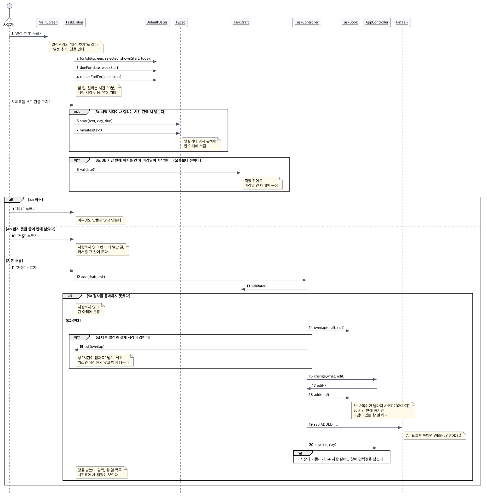

- 3a와 3b는 마감일 칸의 같은 검사(06 2번)에서 문장만 달라 한 `opt`로 묶었다. 5b와 5c는 `TaskBook.add` 안에서 나뉘어 메시지가 같으므로 그 메시지의 노트에 적었다.
- 겹침 물음(5d)은 controller가 창을 모르므로 view가 넘긴 `ask`로 묻는다(07). 새 일정이라 `self`는 `null`이다.
- 펫 말(7a)은 `TaskController`가 `PetTalk.say`로 만들어 `AppController.say`에 넘긴다. 일정관리에서 넣으면 일정관리 말풍선은 그대로이고 홈 말풍선에 남는다(D-94).

### UC-04 할 일 빠르게 추가하기


- 빠른 추가는 일정 입력 창 없이 UC-03과 같은 `TaskController.add`를 부른다. 시작 시각이 없어 겹침을 묻지 않는다(06 3번은 입력 창과 시각 고치기 창의 저장만 묻는다).

### UC-05 일정 수정하기

갈래가 많아 그림 둘로 나눴다. 첫 그림은 일정 수정 창과 시각 고치기 창, 둘째 그림은 일정관리 목록에서 시간표로 끌어 놓기(1c부터 1i까지)다.

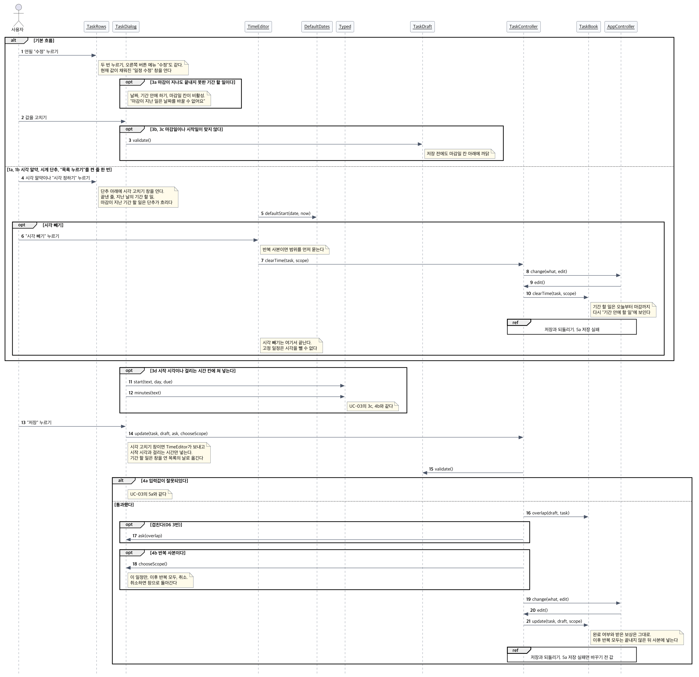

- 1a와 1b는 시각 고치기 창을 여는 길만 달라 한 칸으로 묶었다. 3b와 3c도 마감일 칸의 같은 검사(06 2번)라 묶었다.
- 저장 뒤의 메시지는 두 창이 같아 한 번만 그렸다. 시각 고치기 창이면 `TaskDialog` 자리에 `TimeEditor`가 선다.
- 겹침 물음(06 3번)이 범위 물음(4b)보다 먼저다. 그래서 controller가 view에게서 받은 `ask`와 `chooseScope`를 이 순서로 부른다.


- 1d의 두 물음은 첫 그림의 겹침 물음, 4b와 같다. 1e는 `dropStart` 안에서 나뉘어 그 메시지의 노트에 적었다.
- 놓은 뒤 펫 말풍선의 수가 주는 것(1c)은 저장과 되돌리기 그림의 다시 세기다.

### UC-06 일정 삭제하기

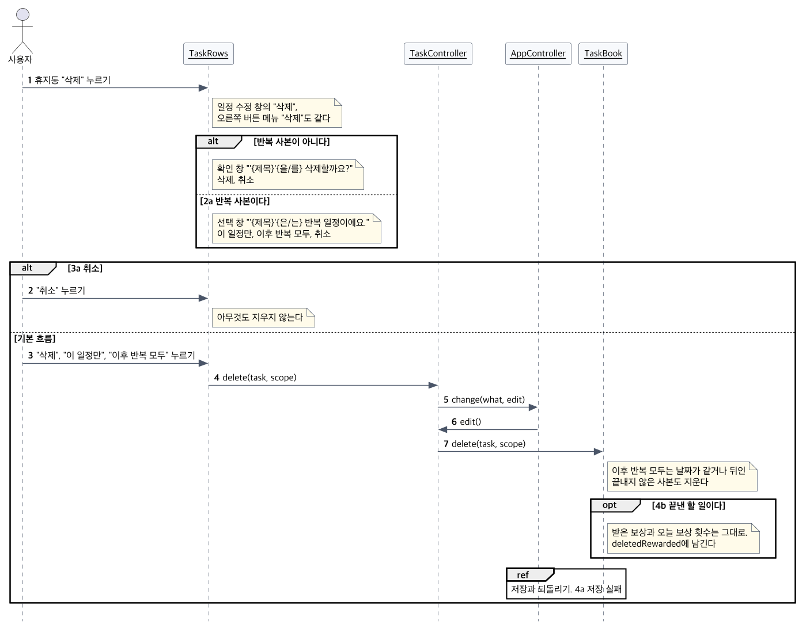

- 삭제 버튼은 세 곳(목록 줄의 휴지통, 일정 수정 창의 삭제, 오른쪽 버튼 메뉴)이고 그 뒤 흐름이 같아 목록 줄 하나로 그렸다.
- 확인 창과 범위 물음은 view가 띄우고, 고른 범위를 `scope`로 넘긴다. 반복 사본이 아니면 `ONLY_THIS`다(06 5번).

### UC-09 달력으로 일정 보기

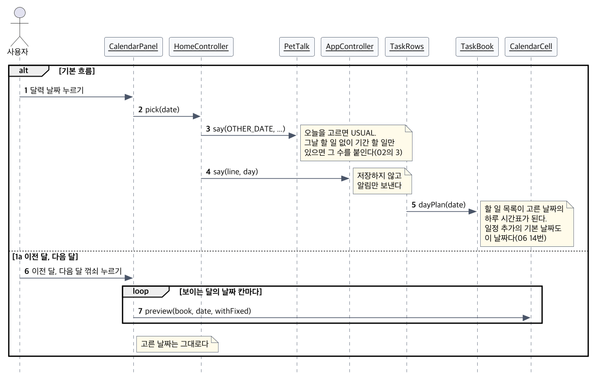

- 날짜 고르기는 펫 말만 바꾸므로 22번을 거치지 않는다(06 읽는 법). `AppController.say`가 말풍선을 바꾸고 알림을 보내면 할 일 목록이 고른 날짜로 `dayPlan`을 다시 부른다.

### UC-10 시간표로 일정 보기

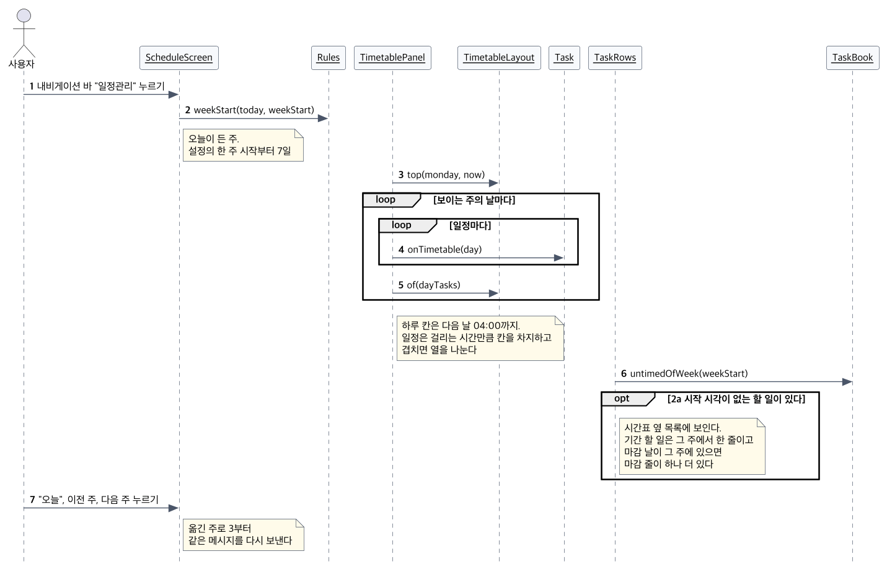

- 주 옮기기는 model을 바꾸지 않는 다시 그리기라 view끼리 한다(06 읽는 법). 그래서 7 뒤의 메시지는 3부터와 같아 다시 그리지 않았다.

### UC-11 할 일 자동 배치하기

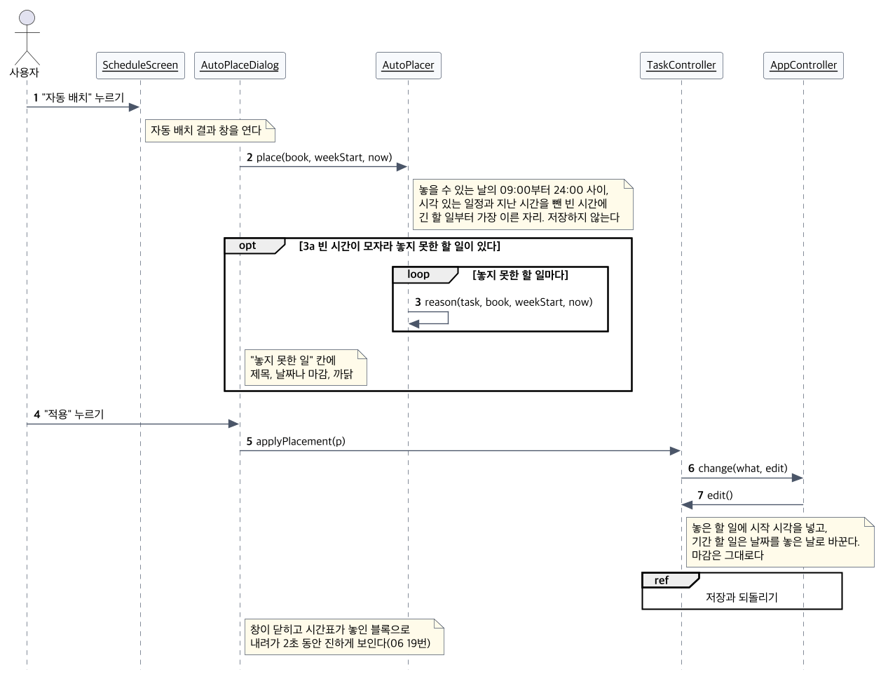

- `place`는 안만 만들고 저장하지 않는다(06 18번). 적용을 눌러야 22번으로 한 번 저장한다.
- 시작 시각과 날짜를 넣는 일은 값 하나를 바꾸는 메서드라 07처럼 그리지 않고 노트로 적었다.

## 앱과 보상 유스케이스

운영체제와 시계에서 나가는 화살표는 화면에서 하는 일이 아니라 그 액터가 하는 일이다.

### UC-01 앱 시작하기

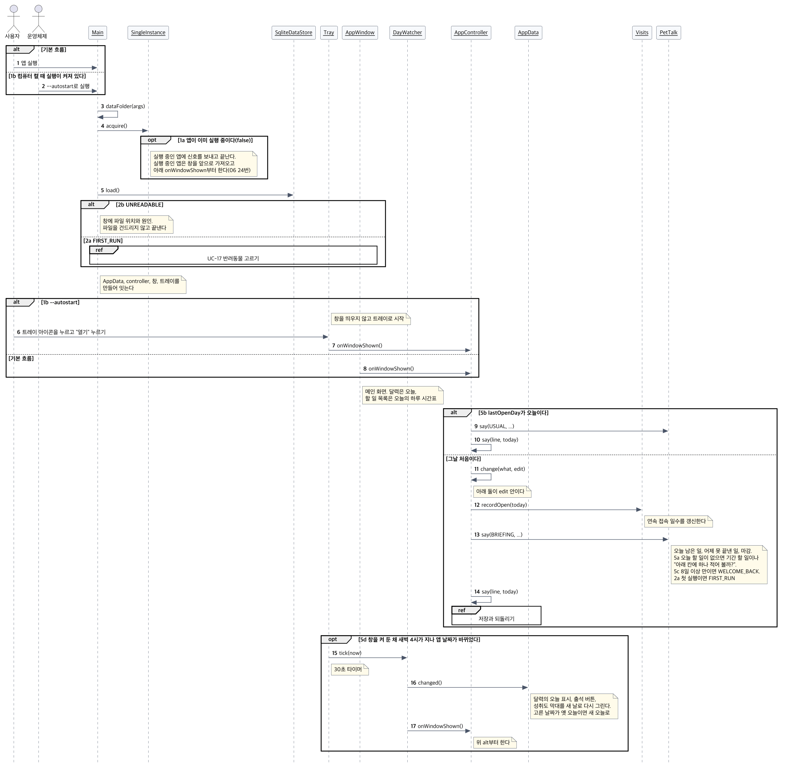

- 진입점 `Main`은 층 밖에서 클래스를 만들어 잇기만 해서 07에 화살표가 없다(07 "층과 의존 방향"). 그래서 `Main`이 부르는 메시지에는 07 화살표가 없다.
- 1a의 `onSignal`은 `Main`이 `SingleInstance`에 넣어 둔 함수라 07의 필드 이름으로 적었다. 신호를 받는 쪽은 이미 실행 중인 앱이다.
- 그날 처음인지는 `onWindowShown` 안에서 가른다(06 15번). 1a로 앞에 온 창도, 1b의 트레이 "열기"도, 5d의 날 바뀜도 이 메시지부터 같다.
- 연속 접속 일수(`lastOpenDay`, `streak`)는 저장할 데이터라 22번 `change`로 감쌌다. 5b의 `USUAL`은 펫 말만 바꾸므로 UC-09처럼 `say`로 알림만 보낸다.
- 5a와 5c, 2a의 첫 말은 `PetTalk.say`가 고르는 상황과 문장만 달라 그 메시지의 노트에 적었다.

### UC-02 출석하기

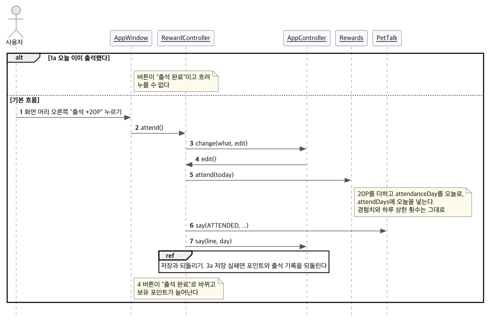

- 출석 버튼은 홈, 일정관리, 설정의 화면 머리 오른쪽 카드에 있다(05 창 구조). 그 카드는 창 틀 `AppWindow`의 것으로 보고 그렸다.
- 펫 말 "출석했어! +20P"는 06 16번의 `ATTENDED`다.

### UC-07 할 일 완료하기

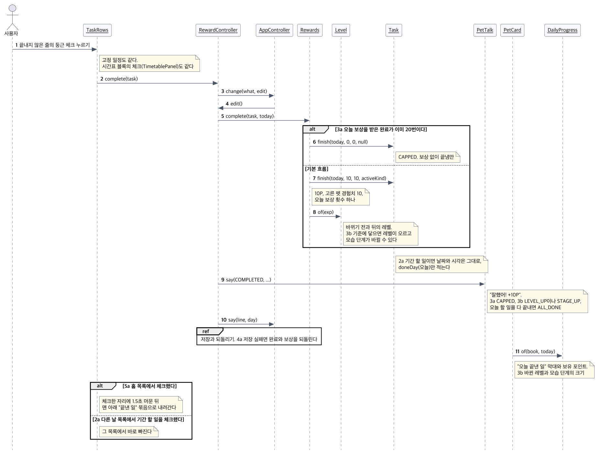

- 체크는 홈 목록, 일정관리 목록(`TaskRows`)과 시간표 블록(`TimetablePanel`) 세 곳이고 그 뒤 흐름이 같아 목록 하나로 그렸다.
- 끝냄과 보상은 `Rewards`가 `Task.finish`로 적는다(07 "06에 없는 메서드"). 2a는 `finish` 안에서 나뉘어 노트에 적었다.
- 3a와 3b의 펫 말은 `Rewards.complete`가 돌려준 `RewardResult`로 고른다(06 8번). 여럿에 해당하면 `STAGE_UP`, `LEVEL_UP`, `CAPPED`, `ALL_DONE`, `COMPLETED` 순으로 앞의 것 하나다(06 16번).

### UC-08 할 일 완료 취소하기

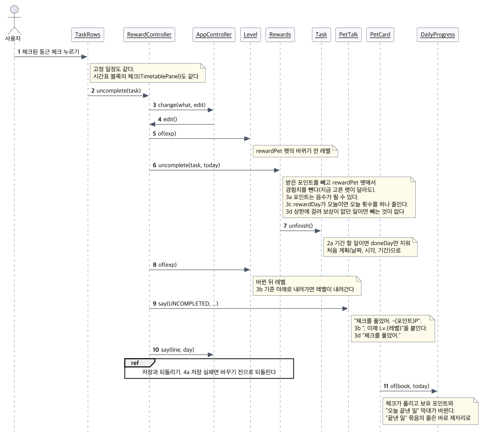

- 3a, 3c, 3d는 `Rewards.uncomplete` 안에서 나뉘어 메시지가 같으므로 그 메시지의 노트에 적었다.
- `uncomplete`는 돌려주는 값이 없다(06 9번). 펫 말의 ", 이제 Lv.{레벨}"(3b)을 고르려고 controller가 바꾸기 전과 뒤에 `Level.of`를 부른다.

### UC-13 일정 시작 알림 받기

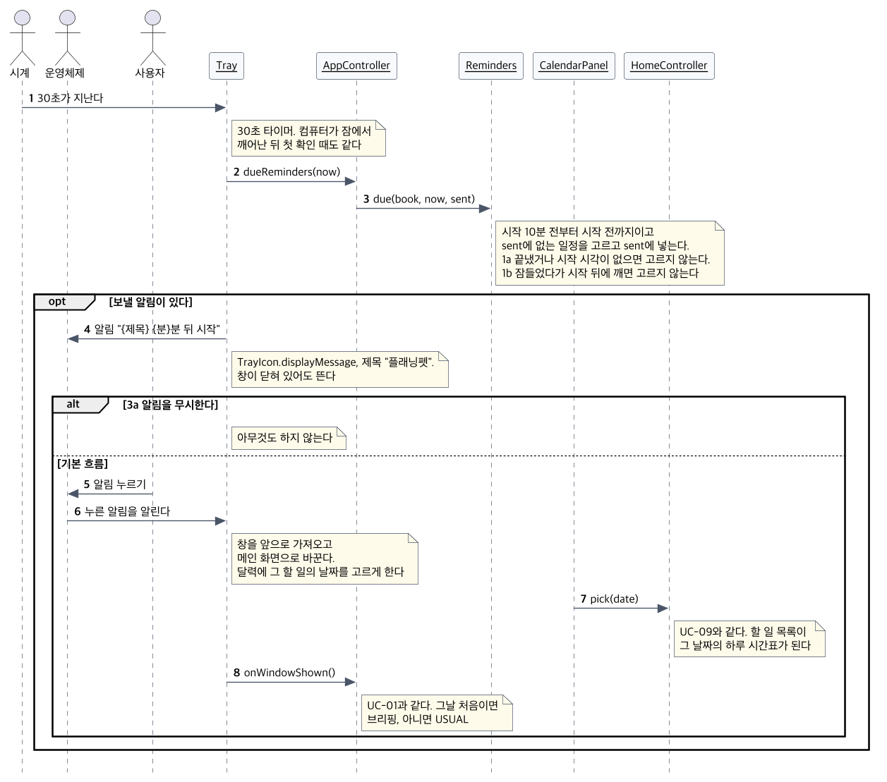

- 30초 타이머와 운영체제 알림은 `Tray`가 맡는다(07 "30초 타이머는 `app.view.Tray`에 둔다"). 이미 보낸 알림 `sent`는 `AppController`의 필드이고 저장하지 않는다(06 17번).
- 1a와 1b는 `Reminders.due` 안에서 나뉘어 그 메시지의 노트에 적었다.
- 알림을 누르면 그 날짜를 고르고(UC-09의 `pick`) 나서 창이 보일 때의 `onWindowShown`을 부른다. 그날 처음 연 것이면 브리핑이 고른 날짜의 말보다 나중이라 브리핑이 남는다(D-23).
- 운영체제 알림을 누른 것을 Java가 받는지는 운영체제마다 다를 수 있다(05 "확인하지 않은 것").

### UC-18 컴퓨터 켤 때 실행 설정하기

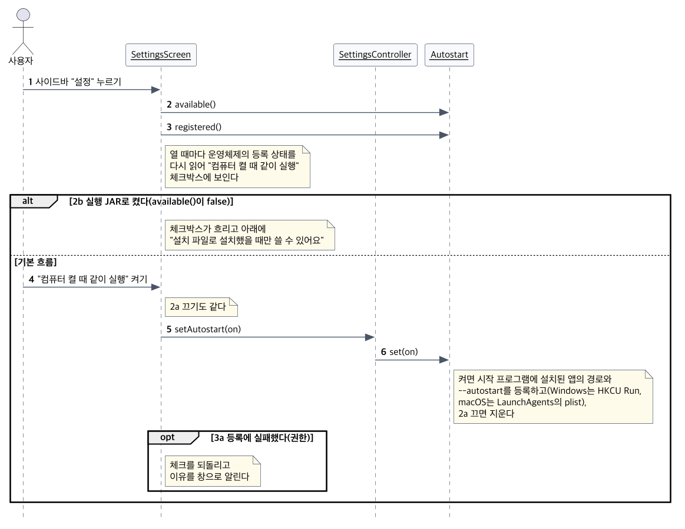

- 등록 상태는 운영체제에 있고 `AppData`에 없어 22번 `change`를 거치지 않는다. 그래서 저장 실패 갈래도 없다.
- 2a는 체크를 끄는 것만 달라 기본 흐름의 노트에 적었다. 3a의 창은 view가 띄운다(07 "controller는 창을 모른다").

### UC-19 창 닫기와 앱 끝내기

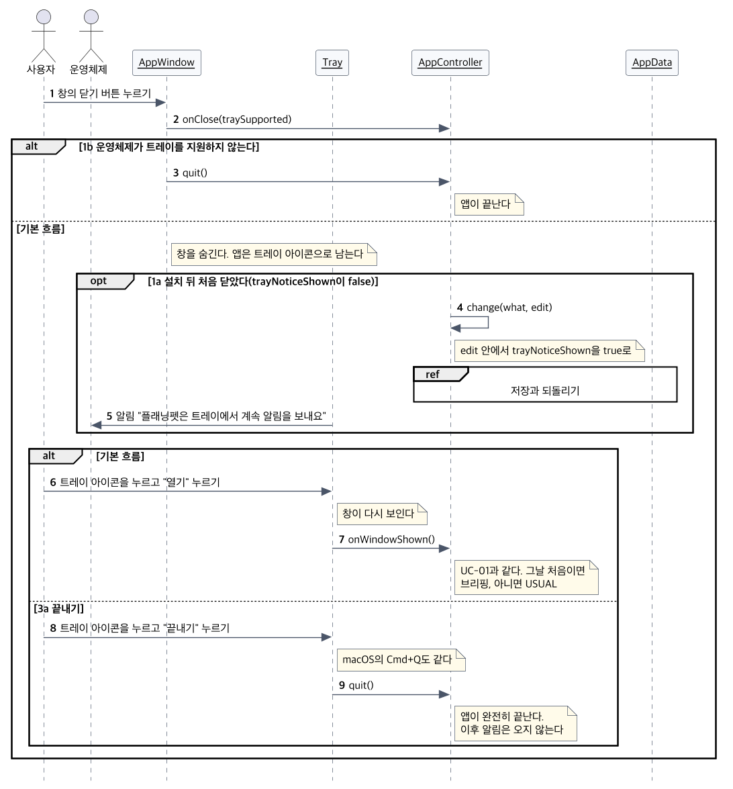

- `onClose`는 트레이 지원 여부를 받아 할 일(`CloseAction`)을 돌려준다(06 25번). 창을 숨기거나 끝내는 일은 view가 한다.
- 1a의 처음 닫기 안내는 `trayNoticeShown`을 저장해야 해서 22번 `change`로 감쌌다. 운영체제 알림은 `Tray`가 띄운다.

### UC-24 통계 보기

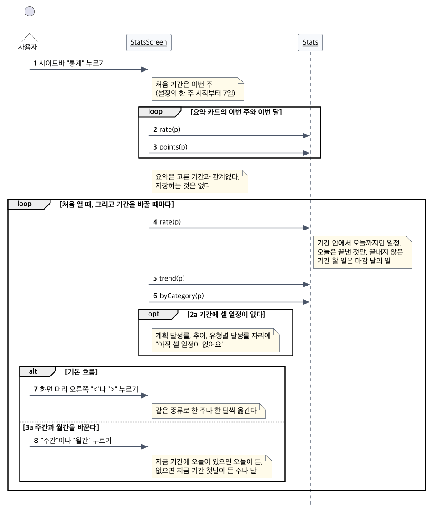

- 통계는 데이터를 바꾸지 않아 22번을 거치지 않는다. 다른 화면에서 데이터가 바뀌면 데이터 변경 알림을 받아 다시 센다(06 22번).
- 4(고른 기간으로 다시 세기)는 기간을 바꿀 때마다 도는 `loop`로 그렸다. 요약은 처음 열 때 한 번 센다.

## 펫과 나의 방 유스케이스

### UC-14 나의 방 보기

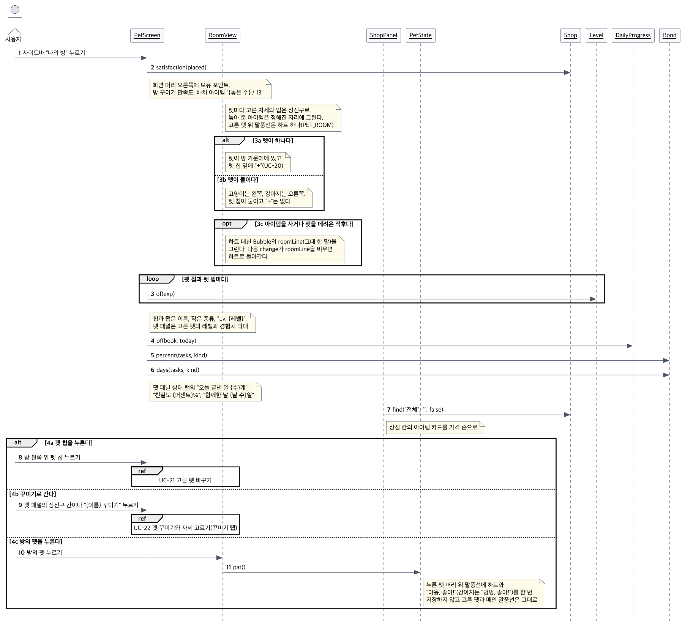

- 보기만 해서 22번을 거치지 않는다. 다른 화면에서 데이터가 바뀌면 데이터 변경 알림을 받아 다시 그린다(06 22번).
- 3a와 3b는 펫 수에 따라 그리는 자리만 달라 노트로 적었다. 3c의 한 번 하는 말은 UC-15와 UC-20 그림에 있다.
- 4c의 한마디는 `PetState.pat`이 돌려준다. 메인 말풍선에 넣지 않으므로 `AppController.say`를 부르지 않는다(06 16번 `PETTED`).

## 다시 그리기

원본은 [diagrams/](diagrams/) 아래 `seq-*.puml`이고 공통 꾸밈은 `seq-common.iuml`이다. PlantUML로 그린다.

```sh
cd docs/diagrams && plantuml -tpng seq-*.puml
```

한글 글꼴은 07과 같이 `Apple SD Gothic Neo`로 정해 두었다. macOS가 아니면 `seq-common.iuml`의 `skinparam defaultFontName`을 그 컴퓨터에 있는 한글 글꼴로 바꿔서 그린다.
