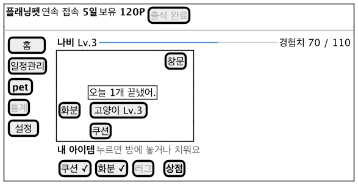
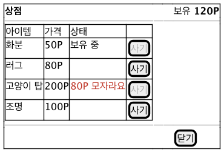
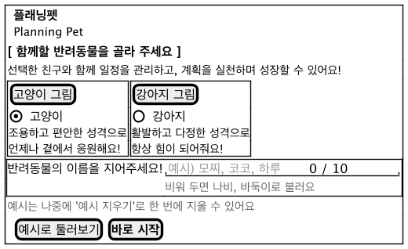
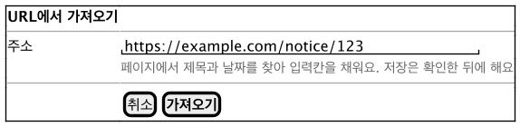

# 05. 화면 설계

유스케이스([02-usecases.md](02-usecases.md))를 사용자가 어떤 화면에서 하는지 정한다. 화면마다 와이어프레임, 이어진 유스케이스, 입력 항목을 적는다. 입력 항목 표는 수업 슬라이드 "0. Swing"의 GUI 스케치처럼 이름, 부품, 형식과 범위, 오류 처리를 쓴다.

화면 틀은 팀 기획 노트의 스케치를 따랐다. 그림 속 일정과 숫자는 대학생 사용자를 가정한 예시다.

## 설계 원칙

1. **하루는 메인 한 화면에서 끝난다.** 오늘 할 일을 보고, 체크하고, 새로 넣는 일이 모두 메인에서 된다. 다른 화면은 시간 배치(일정관리)와 펫 꾸미기(pet)처럼 가끔 하는 일을 맡는다.
2. **흐름을 끊지 않는다.** 보상, 레벨 업, 하루 상한 같은 소식은 펫 말풍선으로 알린다. 화면을 막는 창은 지울지 묻기, 저장 실패처럼 사용자가 결정해야 하거나 일이 실패했을 때만 띄운다.
3. **기본값은 보이게 둔다.** 사용자가 고치지 않아도 들어갈 값은 처음부터 칸에 채워 두고 칸 아래에 알린다(D-07, D-12).
4. **못 쓰는 것은 감추지 않고 비활성으로 둔다.** 통계(D-05), 이미 한 출석, 포인트가 모자란 아이템은 버튼을 흐리게 하고 이유를 보인다.

## 창 구조

앱은 창 하나(`JFrame`)에 화면 네 개를 바꿔 보여 준다. 최소 크기는 1000x680이다(노트북 1366x768에서 작업 표시줄을 빼고 들어가는 크기).

| 자리 | 내용 | 부품 |
|---|---|---|
| 위 | 앱 이름, 연속 접속 일수, 보유 포인트, 출석 버튼. 모든 화면에서 같다 | `JPanel` (`BorderLayout.NORTH`) |
| 왼쪽 | 내비게이션 바: 홈, 일정관리, pet, 통계(비활성), 설정 | `JToggleButton` 묶음 (`BorderLayout.WEST`) |
| 가운데 | 고른 화면 | `CardLayout` (`BorderLayout.CENTER`) |

내비게이션 바의 "홈"은 메인 화면이다. 통계 버튼은 누를 수 없고, 마우스를 올리면 "다음 버전에서 열려요"를 보인다(D-05).

## 화면 흐름

메인 창 안의 네 화면은 내비게이션 바로 서로 오가므로 화살표를 그리지 않았다. 창 밖의 상자는 모두 메인 창 위에 뜨는 창(`JDialog`)이고, 닫으면 띄운 화면으로 돌아간다.

## 메인

- **이어진 유스케이스**: UC-01, UC-02, UC-03(버튼), UC-04, UC-05와 UC-06(목록에서), UC-07, UC-08, UC-09
- **달력**: 보이는 달의 날짜 칸이다. 오늘은 노란 배경, 고른 날짜는 굵은 글씨, 끝내지 않은 할 일이 있는 날은 파란 점으로 표시한다.
- **할 일 목록**: 고른 날짜의 할 일이다. 시작 시각이 있는 할 일을 시각 순으로 먼저, 시각이 없는 할 일을 넣은 순으로 그 아래에 둔다. 오른쪽에 걸리는 시간을 보인다. 체크한 할 일은 자리를 지키고 회색 취소선으로 바뀐다. 여러 개를 이어서 체크할 때 줄이 움직이지 않게 하려는 것이다.
- **할 일 고치기와 지우기**: 할 일을 두 번 누르면 일정 입력 창이 수정으로 열린다. 오른쪽 버튼을 누르면 "수정", "삭제" 메뉴가 뜬다.
- **빠른 추가**: 목록 아래 입력칸에 제목을 쓰고 Enter를 누르면 고른 날짜에 30분짜리 할 일이 생긴다. 칸 아래에 "시간을 안 쓰면 30분으로 들어가요"를 늘 보이고, 새 할 일은 목록 오른쪽에 30분을 보인다(D-12).
- **펫 말풍선**: 성취도 막대 위에 뜬다. 앱을 켤 때 오늘 할 일 수와 마감이 가까운 할 일을 말하고(UC-01), 할 일을 끝내면 칭찬하고, 하루 보상 상한에 닿거나 레벨이 오르면 그 사실을 말한다(UC-07). 다음 말이 올 때까지 남아 있다.
- **성취도 막대**: 고양이가 진행만큼 막대 위를 걸어간다. 그림은 하루 달성도(오늘 할 일 4개 중 1개)로 그렸다. 무엇을 셀지는 Q-03에 따른다.

| 번호 | 이름 | 부품 | 형식과 범위 | 오류 처리 |
|---|---|---|---|---|
| 1 | 출석 | `JButton` | 하루 한 번 누른다 | 오늘 이미 출석했으면 "출석 완료"로 바뀌고 비활성이다 |
| 2 | 이전 달, 다음 달 | `JButton` | 누르면 한 달씩 옮긴다 | 없음. 고른 날짜는 그대로다 |
| 3 | 달력 날짜 | `JTable` 칸 | 보이는 달의 날짜 | 다른 달의 빈 칸은 눌러도 바뀌지 않는다 |
| 4 | 할 일 체크박스 | 목록 줄 안의 `JCheckBox` | 완료, 미완료 | 저장에 실패하면 체크를 되돌리고 저장 실패 창을 띄운다 |
| 5 | 빠른 추가 입력칸 | `JTextField` | 글자 1자부터 100자. 앞뒤 공백은 지운다 | 비어 있으면 Enter를 눌러도 아무 일도 없다. 100자를 넘게는 써지지 않는다. 저장에 실패하면 칸에 제목을 남긴다 |
| 6 | 일정 추가 | `JButton` | 누르면 일정 입력 창을 연다. 날짜는 고른 날짜로 채운다 | 없음 |

## 일정관리

- **이어진 유스케이스**: UC-10, UC-11(버튼), UC-03(버튼), UC-05, UC-07, UC-08
- **시간표**: 월요일부터 일요일까지 일주일을 보인다(D-11). 세로는 0시부터 24시까지이고, 처음에는 8시가 맨 위에 오도록 내려 둔다. 시작 시각이 있는 일정은 시작 칸부터 걸리는 시간만큼 칸을 차지한다. 같은 시간에 겹친 일정은 그 날의 폭을 나눠 쓴다.
- **색**: 그림은 수업처럼 옮기지 않는 일정을 파랑, 할 일을 노랑으로 그렸다. 어떤 일정을 옮기지 않는지는 Q-16에서 정하고, 색도 그 구분을 따른다. 끝낸 일정은 회색 취소선이다.
- **시각 없는 할 일**: 오른쪽 목록에 이번 주의 시작 시각 없는 할 일을 모은다(D-10). 자동 배치는 이 할 일들을 시간표의 빈 칸에 놓는다.
- **펫**: 오른쪽 아래에서 시각 없는 할 일이 몇 개인지 말하고 자동 배치를 권한다.

| 번호 | 이름 | 부품 | 형식과 범위 | 오류 처리 |
|---|---|---|---|---|
| 1 | 이전 주, 다음 주 | `JButton` | 누르면 일주일씩 옮긴다 | 없음 |
| 2 | 오늘 | `JButton` | 오늘이 들어 있는 주로 돌아간다 | 이미 이번 주면 아무 일도 없다 |
| 3 | 자동 배치 | `JButton` | 누르면 자동 배치 결과 창을 연다 | 배치할 할 일이 없으면 비활성이다 |
| 4 | 일정 추가 | `JButton` | 일정 입력 창을 연다. 날짜는 오늘로 채운다 | 없음 |
| 5 | 시간표 일정 | `paintComponent`로 그리는 `JComponent` | 두 번 누르면 일정 입력 창이 수정으로 열린다. 오른쪽 버튼은 메인 목록과 같은 메뉴다 | 없음 |
| 6 | 시각 없는 할 일 | `JList`와 `JCheckBox` | 메인 할 일 목록과 같다 | 메인 4번과 같다 |

## 일정 입력 창

- **이어진 유스케이스**: UC-03, UC-05, UC-06, UC-12
- 추가와 수정에 같은 창(`JDialog`, 모달)을 쓴다. 제목 줄이 "일정 추가"와 "일정 수정"으로 바뀌고, 수정일 때만 왼쪽 아래에 삭제 버튼이 생긴다.
- 그림은 추가할 때다. 날짜는 띄운 화면의 날짜로, 걸리는 시간은 30분으로 채워져 있고 그 아래에 기본값 안내가 있다(D-07).
- 시작 시각을 정하면 걸리는 시간 오른쪽에 끝나는 시각(예: "끝 15:30")을 보인다.
- 저장은 Enter, 취소는 Esc로도 된다.

| 번호 | 이름 | 부품 | 형식과 범위 | 오류 처리 |
|---|---|---|---|---|
| 1 | 제목 | `JTextField` | 글자 1자부터 100자, 꼭 써야 한다. 앞뒤 공백은 지운다 | 비어 있으면 저장하지 않고 칸 아래에 "제목을 써 주세요"를 빨간 글씨로 보인다. 100자를 넘게는 써지지 않는다 |
| 2 | 날짜 | `JSpinner` (`SpinnerDateModel`, `yyyy-MM-dd`) | 날짜. 기본은 띄운 화면의 날짜 | 형식에 맞지 않게 쓰면 칸을 벗어날 때 이전 값으로 돌아간다 |
| 3 | 시작 시각 정하기 | `JCheckBox` | 켬, 끔. 기본은 끔 | 끄면 4번 칸이 비활성이 되고 시각 없는 할 일이 된다 |
| 4 | 시작 시각 | `JSpinner` (`HH:mm`, 10분 단위) | 00:00부터 23:50 | 형식에 맞지 않으면 이전 값으로 돌아간다. 시작 시각과 걸리는 시간을 더해 다음 날로 넘어가면 저장하지 않고 "하루 안에 끝나야 해요"를 보인다 |
| 5 | 걸리는 시간 | `JSpinner` (분, 10분 단위) | 10분부터 720분. 기본 30분 | 범위 밖이거나 숫자가 아니면 이전 값으로 돌아간다. 그래서 0 이하는 들어갈 수 없다 |
| 6 | 메모 | `JScrollPane` 안의 `JTextArea` | 0자부터 1000자 | 1000자를 넘게는 써지지 않는다 |
| 7 | URL에서 가져오기 | `JButton` | URL에서 가져오기 창을 연다(UC-12) | 아래 URL 창 참고 |
| 8 | 저장, 취소, 삭제 | `JButton` | 삭제는 수정일 때만 보인다 | 삭제는 확인 창을 거친다. 저장에 실패하면 창을 닫지 않고 입력값을 남긴 채 저장 실패 창을 띄운다 |

## pet

- **이어진 유스케이스**: UC-14, UC-15(상점 버튼), UC-16
- **위**: 펫 이름, 레벨, 다음 레벨까지의 경험치 막대.
- **방**: 펫이 가운데에 있고 놓아 둔 아이템이 보인다. 아이템마다 놓이는 자리가 정해져 있다(D-13). 펫은 말풍선으로 오늘 끝낸 할 일을 말한다.
- **내 아이템**: 산 아이템이 한 줄로 있다. 방에 놓인 아이템은 체크 표시, 치운 아이템은 흐리게 보인다. 누르면 놓거나 치운다. 줄 끝에 상점 버튼이 있다.
- 펫과 아이템 그림은 Q-28에 따른다.

| 번호 | 이름 | 부품 | 형식과 범위 | 오류 처리 |
|---|---|---|---|---|
| 1 | 아이템 칸 | `JToggleButton` | 눌림이 방에 놓임이다 | 저장에 실패하면 눌림을 되돌리고 저장 실패 창을 띄운다 |
| 2 | 상점 | `JButton` | 상점 창을 연다 | 없음 |

## 상점 창

- **이어진 유스케이스**: UC-15
- 모달 `JDialog` 안의 표(`JTable`)다. 오른쪽 위에 보유 포인트를 보인다.
- 이미 산 아이템은 "보유 중"이고 사기 버튼이 비활성이다. 놓고 치우기는 pet 화면의 아이템 칸에서 한다.
- 포인트가 모자란 아이템은 사기 버튼이 비활성이고, 상태 칸에 모자란 포인트를 빨간 글씨로 보인다.
- 아이템 이름과 가격은 예시다(Q-10).

| 번호 | 이름 | 부품 | 형식과 범위 | 오류 처리 |
|---|---|---|---|---|
| 1 | 사기 | 표 줄 안의 `JButton` | 누르면 바로 산다 | 위의 두 경우 비활성이다. 저장에 실패하면 포인트와 보유 목록을 되돌리고 저장 실패 창을 띄운다 |
| 2 | 닫기 | `JButton` | 창을 닫는다. Esc로도 된다 | 없음 |

## 반려동물 고르기 창

- **이어진 유스케이스**: UC-17
- 첫 실행 때 메인 창보다 먼저 뜬다. 고를 수 있는 동물은 Q-09에 따른다. 그림은 고양이와 강아지 두 가지로 그렸다.
- 닫기 버튼으로 닫으면 아무것도 저장하지 않고 앱을 끝낸다. 다음에 켜면 다시 뜬다.

| 번호 | 이름 | 부품 | 형식과 범위 | 오류 처리 |
|---|---|---|---|---|
| 1 | 동물 | `ButtonGroup`으로 묶은 `JRadioButton` | 하나만 고른다. 기본은 고양이 | 없음 |
| 2 | 이름 | `JTextField` | 0자부터 10자. 앞뒤 공백은 지운다 | 비우면 기본 이름(고양이는 "나비", 강아지는 "바둑이")을 붙인다. 10자를 넘게는 써지지 않는다 |
| 3 | 시작하기 | `JButton` | 펫을 만들고 메인 창을 연다 | 저장에 실패하면 창을 닫지 않고 저장 실패 창을 띄운다 |

## 설정

- **이어진 유스케이스**: UC-18
- 넣을 설정은 Q-12에 따른다. 지금은 컴퓨터 켤 때 실행, 데이터 위치, 버전만 둔다.
- 데이터 위치는 저장 파일(D-08)이 있는 폴더다. 사용자가 파일을 옮기거나 백업할 때 찾을 수 있게 보인다.

| 번호 | 이름 | 부품 | 형식과 범위 | 오류 처리 |
|---|---|---|---|---|
| 1 | 컴퓨터 켤 때 같이 실행 | `JCheckBox` | 켬, 끔. 기본은 끔 | 운영체제 등록에 실패하면 체크를 되돌리고 이유를 창으로 알린다 |
| 2 | 폴더 열기 | `JButton` | 운영체제 파일 탐색기로 데이터 폴더를 연다(`Desktop.open`) | 열 수 없으면 경로를 복사할 수 있는 창을 띄운다 |

## 자동 배치 결과 창 (검토 중)

- **이어진 유스케이스**: UC-11
- 배치 결과를 저장하기 전에 보여 주고 사용자가 적용을 눌러야 저장한다. 위쪽 글은 어느 시각부터 어느 날까지의 빈 시간을 봤는지 말한다.
- 놓지 못한 할 일은 빨간 글씨로 이유를 보인다. 적용해도 그 할 일은 시각 없는 할 일로 남는다.
- 범위와 알고리즘은 Q-16에 따라 바뀐다. 그림의 범위(오늘부터 내일까지)는 예시다.

| 번호 | 이름 | 부품 | 형식과 범위 | 오류 처리 |
|---|---|---|---|---|
| 1 | 적용 | `JButton` | 놓은 할 일에 시작 시각을 넣고 저장한다 | 놓은 할 일이 없으면 비활성이다. 저장에 실패하면 모두 되돌리고 저장 실패 창을 띄운다 |
| 2 | 취소 | `JButton` | 아무것도 바꾸지 않고 닫는다 | 없음 |

## URL에서 가져오기 창 (검토 중)

- **이어진 유스케이스**: UC-12
- 일정 입력 창에서 연다. 가져오기를 누르면 버튼이 "읽는 중..."으로 바뀌고 비활성이 된다. 다 읽으면 창을 닫고 일정 입력 창의 칸을 채운다. 저장은 사용자가 일정 입력 창에서 한다.
- 읽는 방법은 Q-01에 따른다.

| 번호 | 이름 | 부품 | 형식과 범위 | 오류 처리 |
|---|---|---|---|---|
| 1 | 주소 | `JTextField` | `http://`나 `https://`로 시작하는 주소 | 아니면 가져오기를 누를 때 칸 아래에 "웹 주소를 넣어 주세요"를 보인다. 페이지를 못 읽었거나 일정을 못 찾았으면 이유를 칸 아래에 보이고, 일정 입력 창의 칸은 그대로 둔다 |
| 2 | 가져오기, 취소 | `JButton` | 읽는 중에 취소를 누르면 읽기를 멈추고 닫는다 | 없음 |

## 그 밖의 창과 알림

화면 그림 없이 Swing 기본 부품을 쓴다.

| 언제 | 부품 | 내용 | 유스케이스 |
|---|---|---|---|
| 일정 삭제 | `JOptionPane` 확인 창 | "'자소서 초안'을 지울까요?" 지우기, 취소 | UC-06 |
| 저장 실패 | `JOptionPane` 오류 창 | 무엇을 저장하지 못했는지와 바뀐 것을 되돌렸다는 사실 | 공통 |
| 데이터 파일을 못 읽음 | `JOptionPane` 오류 창 | 파일 위치와 원인. 파일은 그대로 두고 앱을 끝낸다고 알린다 | UC-01 2b |
| 마감 알림 | 운영체제 알림(`TrayIcon.displayMessage`) | 할 일 제목과 남은 시간. 누르면 메인 창이 앞으로 오고 그 날짜를 보인다 | UC-13 |
| 처음 창 닫기 | 운영체제 알림 | "플래닝펫은 트레이에서 계속 알림을 보내요" 한 번만 | UC-19 1a |
| 트레이 아이콘 | `TrayIcon`과 `PopupMenu` | 아이콘을 누르면 창이 다시 보인다. 메뉴는 열기, 끝내기 | UC-19 |

## 확인하지 않은 것

- 운영체제 알림을 눌렀을 때 Java가 그 사실을 받는지는 운영체제마다 다를 수 있다. Windows와 macOS에서 시험해 보고, 안 되면 알림을 누른 뒤 트레이 아이콘을 누르게 안내한다.
- 와이어프레임의 글꼴과 크기는 실제 Swing 화면과 다르다. 화면을 만든 뒤 그 캡처로 그림을 바꾼다.

## 더 그릴 상태

사용자 여정(D-14)에서 나온 상태다. 시각 디자인 시안을 만들 때 위 화면들과 함께 그린다.

| 상태 | 화면 | 그리는 이유 |
|---|---|---|
| 그날 첫 브리핑 | 메인 | 앱의 첫인상이다. 남은 할 일과 가까운 마감을 펫이 말한다(S-3) |
| 첫 실행 뒤 빈 화면 | 메인, 일정관리 | 할 일이 하나도 없을 때 무엇부터 할지 보여 준다. 개강 첫 주에 수업 시간표 넣기로 이끈다(S-1) |
| 시험 기간 | 메인, 일정관리 | 하루 할 일 열 개 이상, 마감이 몰린 날에도 읽혀야 한다(S-5) |
| 오랜만에 돌아옴 | 메인 | 혼내지 않고 반긴다(S-6, UC-01 2c) |
| 저녁 공부 중 | 메인 | 몇 시간 켜 둘 때 펫이 방해하지 않는 정도의 움직임(S-3) |

## 미정

02의 미정에 이어 번호를 붙인다.

- **Q-28 펫과 아이템 그림.** 레벨마다 펫 모습을 몇 가지 둘지, 그림을 어디서 구할지(팀이 그림, 무료 에셋). 무료 에셋을 쓰면 배포해도 되는 라이선스인지 확인해야 한다.
