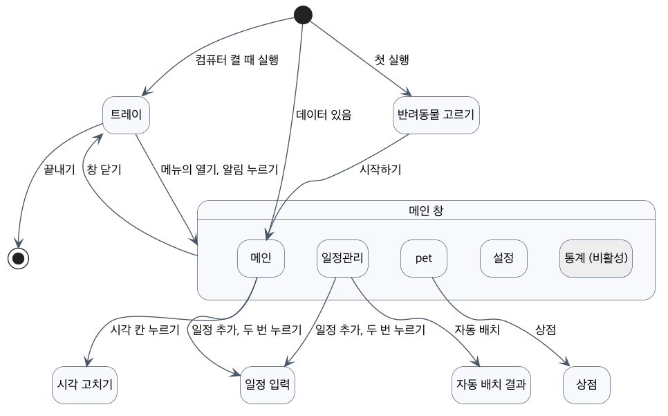
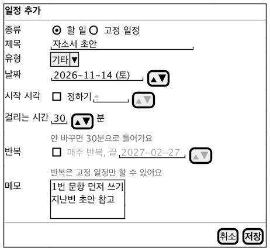
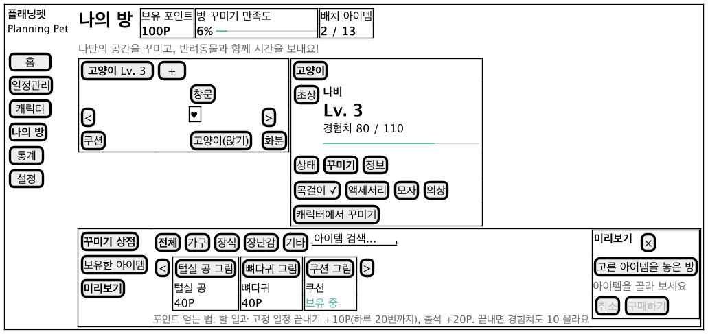
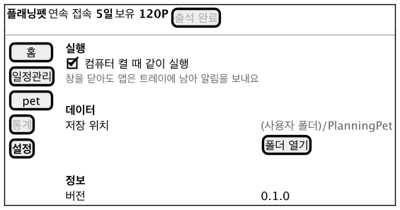
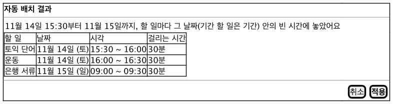

# 05. 화면 설계

유스케이스([02-usecases.md](02-usecases.md))를 사용자가 어떤 화면에서 하는지 정한다. 화면마다 와이어프레임, 이어진 유스케이스, 입력 항목을 적는다. 입력 항목 표는 수업 슬라이드 "0. Swing"의 GUI 스케치처럼 이름, 부품, 형식과 범위, 오류 처리를 쓴다.

화면 틀은 팀 기획 노트의 스케치를 따랐다. 색, 글꼴, 모양은 [디자인 시스템](design-system.md)을 따른다. 그림 속 일정과 숫자는 대학생 사용자를 가정한 예시다.

## 설계 원칙

1. **하루는 메인 한 화면에서 끝난다.** 오늘 할 일을 보고, 체크하고, 새로 넣는 일이 모두 메인에서 된다. 다른 화면은 시간 배치(일정관리), 펫 돌보기(캐릭터), 방 꾸미기(나의 방), 되돌아보기(통계)처럼 가끔 하는 일을 맡는다.
2. **흐름을 끊지 않는다.** 보상, 레벨 업, 하루 상한 같은 소식은 펫 말풍선으로 알린다. 화면을 막는 창은 지울지 묻기, 저장 실패처럼 사용자가 결정해야 하거나 일이 실패했을 때만 띄운다.
3. **기본값은 보이게 둔다.** 사용자가 고치지 않아도 들어갈 값은 처음부터 칸에 채워 두고 칸 아래에 알린다(D-07, D-12).
4. **못 쓰는 것은 감추지 않고 비활성으로 둔다.** 이미 한 출석, 포인트가 모자란 아이템, 레벨이 모자란 장신구는 버튼을 흐리게 하고 이유를 보인다.

## 창 구조

앱은 창 하나(`JFrame`)에 화면 여섯 개를 바꿔 보여 준다. 최소 크기는 1000x680이다(노트북 1366x768에서 작업 표시줄을 빼고 들어가는 크기). 창 제목 줄은 운영체제 것을 쓰고, 제목은 "플래닝펫 (Planning Pet)", 아이콘은 발자국이다(D-47).

| 자리 | 내용 | 부품 |
|---|---|---|
| 왼쪽 | 사이드바: 위에 앱 이름(로고), 그 아래 내비게이션 홈, 일정관리, 캐릭터, 나의 방, 통계, 설정(D-47) | `JToggleButton` 묶음 (`BorderLayout.WEST`) |
| 오른쪽 위 줄 | 왼쪽은 화면 머리(아이콘, 제목, 부제), 오른쪽은 화면마다 다른 카드다(D-47). 나의 방은 보유 포인트, 방 꾸미기 만족도, 배치 아이템, 통계는 주간과 월간 고르기와 기간 옮기기, 나머지(홈, 일정관리, 캐릭터, 설정)는 연속 접속 일수와 출석 버튼, 보유 포인트 | `JPanel` (본문 판의 `BorderLayout.NORTH`), 오른쪽은 화면 이름으로 바꾸는 `CardLayout` |
| 오른쪽 가운데 | 고른 화면 | `CardLayout` (본문 판의 `BorderLayout.CENTER`) |

2026-11-23 나의 방 예시를 옮기며 위 막대의 내용(앱 이름, 연속 접속, 보유 포인트, 출석)은 그대로 두고 자리만 바꿨다. 앱 이름은 사이드바 로고로, 나머지는 화면 머리 오른쪽 통계 카드로 갔다(#115, [디자인 시스템](design-system.md) 10절). 와이어프레임 가운데 홈, 일정관리, 설정은 그 전에 그린 것이라 위 막대가 남아 있다. 캐릭터, 나의 방, 통계 그림은 지금 자리로 그렸다. 화면 머리는 아이콘, 제목(26 아주 굵게), 그 아래 부제(13)다(D-33). 홈은 "오늘도 계획을 세우고, 조금씩 성장해요!", 일정관리는 "내 일정을 한눈에 확인하고, 체계적으로 관리해요!", 캐릭터는 "함께하는 펫을 돌보고, 나만의 모습으로 꾸며요!", 나의 방은 "나만의 공간을 꾸미고, 반려동물과 함께 시간을 보내요!", 통계는 "나의 계획 실천과 일정 완료 추이를 한눈에 확인해요!", 설정은 "플래닝펫을 내게 맞게 바꿔요."다.

내비게이션 바의 "홈"은 메인 화면이다. 예전의 "pet" 화면은 펫을 돌보는 캐릭터와 방을 꾸미는 나의 방으로 나눴고, 통계는 비활성 버튼(D-05)에서 화면으로 열었다(D-47).

## 화면 흐름

메인 창 안의 여섯 화면은 내비게이션 바로 서로 오가므로 화살표를 그리지 않았다. 나의 방의 "캐릭터에서 꾸미기"와 장신구 칸도 캐릭터로 가는데, 같은 창 안이라 그리지 않았다. 창 밖의 상자는 모두 메인 창 위에 뜨는 창(`JDialog`)이고, 닫으면 띄운 화면으로 돌아간다.

## 메인

- **이어진 유스케이스**: UC-01, UC-02, UC-03(버튼), UC-04, UC-05와 UC-06(목록에서), UC-07, UC-08, UC-09
- **달력**: 보이는 달의 날짜 칸이고 한 주는 일요일부터 토요일까지다. 오늘(앱 날짜, D-15)과 고른 날짜를 다르게 표시한다. 날짜 아래에는 그날 첫 할 일의 제목을 다섯 자까지 보인다(D-33, 06의 26번). 끝내지 않은 할 일이 있는 날은 `TASK_TEXT` 색, 모두 끝낸 날은 흐린 색이고, 할 일이 없는 날(고정 일정만 있는 날 포함)은 아무것도 없다. 색은 [디자인 시스템](design-system.md) 7절을 따른다.
- **할 일 목록**: 고른 날짜의 하루 시간표다(D-31, 06의 6번).
  - 위쪽은 시작 시각이 있는 할 일과 고정 일정을 시작 시각 순으로 놓는다. 줄 맨 앞에 시작과 끝 시각("10:00~11:00", 자정에 끝나면 "~24:00")을, 오른쪽에 걸리는 시간을 보인다.
  - 고정 일정도 체크박스가 있고 할 일과 같이 체크한다(D-35). 체크박스 옆에 고정 일정 색(디자인 시스템 7절)의 작은 "고정" 표시를 둔다.
  - 아래쪽은 "시각 없는 할 일" 제목 밑에 시작 시각이 없는 할 일을 넣은 순으로 둔다. 시각 칸에는 흐린 "시각 정하기"를 보인다(D-32, D-41). 하나도 없으면 제목도 보이지 않는다.
  - 체크한 할 일은 자리를 지키고 회색 취소선으로 바뀐다. 여러 개를 이어서 체크할 때 줄이 움직이지 않게 하려는 것이다.
  - 시각 칸을 누르면 시각 고치기 창이 뜬다(D-32). 시각 칸의 글자에는 밑줄을 그어 누르는 곳임을 보인다(D-40). 아래 "시각 고치기 창" 절을 본다.
  - 줄 끝(걸리는 시간 오른쪽)에 작은 "수정", "삭제" 버튼이 있다(D-33). 고정 일정 줄에도 있다.
  - 메모가 있는 일정은 제목 옆에 흐린 "메모"를 보이고, 줄에 마우스를 올리면 메모를 200자까지 보인다(D-33).
  - 그날 일정이 하나도 없으면 목록 자리에 흐린 "아직 일정이 없어요. 작은 계획을 추가해 보세요."를 보인다(D-33).
- **할 일 고치기와 지우기**: 줄 끝의 "수정", "삭제" 버튼을 누르거나, 할 일을 두 번 누르거나(수정), 오른쪽 버튼 메뉴("수정", "삭제")를 쓴다.
- **빠른 추가**: 목록 아래 입력칸에 제목을 쓰고 Enter나 칸 옆 "추가"를 누르면 고른 날짜에 30분짜리 시각 없는 할 일이 생긴다. 칸 아래에 "제목을 쓰고 Enter나 추가를 누르면 30분짜리 할 일로 들어가요"를 늘 보이고, 새 할 일은 목록 오른쪽에 30분을 보인다(D-12, D-40).
- **일정 추가**: 목록 카드의 제목 줄("11월 14일 (토) 할 일") 오른쪽에 둔다. 일정관리의 일정 추가와 같은 자리다(D-40).
- **펫 말풍선**: 성취도 막대 위의 펫(펫이 둘이면 고른 펫, D-48) 바로 위에 뜨고 꼬리가 펫을 가리킨다. 펫이 걸어가면 같이 옮겨 가고, 막대 양 끝에서는 카드 밖으로 나가지 않게 말풍선만 안쪽으로 맞춘다. 긴 문장은 너비 380에서 줄을 바꾼다(D-34). 그날 처음 창을 열면 브리핑하고(UC-01), 할 일을 끝내면 칭찬하고, 하루 보상 상한에 닿거나 레벨이 오르면 그 사실을 말한다(UC-07). 언제 어떤 문장을 말하는지는 06의 15번과 16번(대사 표)을 따른다. 다음 말이 올 때까지 남아 있다.
- **성취도 막대**: 오늘 할 일 가운데 끝낸 비율만큼 펫이 막대 위를 걸어간다(D-22, 06의 13번). 고른 날짜와 관계없이 오늘을 센다. 그림은 오늘 할 일 4개 중 1개를 끝낸 상태다. 같은 카드 위 줄 오른쪽에 펫 이름, 레벨, 경험치 막대와 "경험치 80 / 110"을 보인다(D-33, 06의 10번).

| 번호 | 이름 | 부품 | 형식과 범위 | 오류 처리 |
|---|---|---|---|---|
| 1 | 출석 | `JButton` | 글자는 "출석 +20P". 앱 날짜 하루에 한 번 누른다(06의 11번) | 오늘 이미 출석했으면 "출석 완료"로 바뀌고 비활성이다 |
| 2 | 이전 달, 다음 달 | `JButton` | 누르면 한 달씩 옮긴다 | 없음. 고른 날짜는 그대로다 |
| 3 | 달력 날짜 | `JTable` 칸 | 보이는 달의 날짜 | 다른 달의 빈 칸은 눌러도 바뀌지 않는다 |
| 4 | 할 일 체크박스 | 목록 줄 안의 `JCheckBox` | 완료, 미완료 | 저장에 실패하면 체크를 되돌리고 저장 실패 창을 띄운다 |
| 5 | 빠른 추가 입력칸과 추가 | `JTextField`와 칸 옆 `JButton` "추가" | 글자 1자부터 100자. 앞뒤 공백은 지운다. Enter와 추가는 같은 일을 한다(D-40) | 비어 있으면 Enter를 눌러도 아무 일도 없고 추가는 흐리다. 100자를 넘게는 써지지 않는다. 저장에 실패하면 칸에 제목을 남긴다 |
| 6 | 일정 추가 | 목록 카드 제목 줄 오른쪽의 `JButton` | 누르면 일정 입력 창을 연다. 날짜는 고른 날짜로 채운다. 빠른 추가 칸의 글은 쓰지 않는다 | 없음 |
| 7 | 시각 칸 | 줄 맨 앞의 밑줄 그은 `JLabel`(손 모양 커서) | 시각 있으면 "10:00~11:00", 없으면 "시각 정하기". 누르면 시각 고치기 창을 연다 | 없음 |
| 8 | 수정, 삭제 | 줄 끝의 작은 `JButton` 둘(글자 12) | 수정은 일정 입력 창을 수정으로 연다. 삭제는 일정 삭제 확인 창을 거친다 | 삭제의 저장에 실패하면 되돌리고 저장 실패 창을 띄운다 |

### 시각 고치기 창

시각 칸 바로 아래에 뜨는 작은 모달 `JDialog`다(제목 줄 없음). 맨 위에 할 일 제목을 보이고, 시작 시각과 걸리는 시간만 고친다(D-32, D-43). 버튼은 오른쪽 아래에 취소, 저장 순이고 시각 빼기는 왼쪽 아래다. 반복 사본을 저장하면 범위를 묻고, 이후 반복 모두는 시작 시각과 걸리는 시간만 뒤 사본에 넣는다(D-42).

| 번호 | 이름 | 부품 | 형식과 범위 | 오류 처리 |
|---|---|---|---|---|
| 1 | 시작 시각 | `JSpinner`(5분 단위 목록) | 00:00부터 23:55. 기본은 그 일정의 시작 시각, 시각 없는 할 일이면 06의 14번 `defaultStart` | 끝이 24:00을 넘으면 저장하지 않고 창 아래에 "하루 안에 끝나야 해요"를 보인다 |
| 2 | 걸리는 시간 | `JSpinner`(분, 5분 단위) | 10분부터 720분. 기본은 그 일정의 값 | 범위 밖이거나 5분 단위가 아니거나 숫자가 아니면 이전 값으로 돌아간다 |
| 3 | 시각 빼기 | `JButton` | 시각 있는 할 일에만 보인다. 누르면 시각 없는 할 일이 되고 창이 닫힌다 | 저장에 실패하면 되돌리고 저장 실패 창을 띄운다 |
| 4 | 저장, 취소 | `JButton` | 저장은 Enter, 취소는 Esc로도 된다. 저장하면 목록이 새 순서로 바뀐다 | 저장에 실패하면 되돌리고 저장 실패 창을 띄운다 |

## 일정관리

- **이어진 유스케이스**: UC-10, UC-11(버튼), UC-03(버튼), UC-05, UC-06, UC-07, UC-08
- **시간표**: 월요일부터 일요일까지 일주일을 보인다(D-11). 세로는 0시부터 24시까지이고, 처음에는 8시가 맨 위에 오도록 내려 둔다. 시작 시각이 있는 일정은 시작 칸부터 걸리는 시간만큼 칸을 차지한다. 같은 시간에 겹친 일정은 06의 19번 함수대로 열을 나눠 그 날의 폭을 나눠 쓴다. 모든 블록 왼쪽 위에는 체크박스가 있어 끝내거나 취소한다(D-33, D-35, UC-07, UC-08). 블록에 마우스를 올리면 메모를 보인다.
- **색**: 고정 일정(D-16), 할 일, 끝낸 할 일(취소선)을 다른 색으로 그린다. 색은 디자인 시스템 7절을 따른다(와이어프레임은 파랑과 노랑으로 그렸다). 시간표 위 머리줄 왼쪽에 세 색의 뜻("고정 일정", "할 일", "끝냄")을 작은 색 칸과 함께 보인다(D-44).
- **시각 없는 할 일**: 오른쪽 목록에 이번 주의 시작 시각 없는 할 일을 모은다(D-10). 줄 모양은 메인 목록과 같고 날짜("11/14")를 앞에 붙인다. 날짜가 오늘보다 앞선 할 일은 둘째 줄 왼쪽에 빨간 "지난 날"을 보인다(D-44). 목록이 좁아서 수정, 삭제 버튼은 줄의 둘째 줄 오른쪽에 둔다. 비면 흐린 "이번 주에 시각 없는 할 일이 없어요."를 보인다. 자동 배치는 이 할 일들을 시간표의 빈 칸에 놓는다.
- **펫**: 오른쪽 아래에서 이번 주 남은 날의 시각 없는 할 일(자동 배치가 놓을 수 있는 것)이 몇 개인지 말하고 자동 배치를 권한다(06의 16번 `SCHEDULE_HINT`, D-44).

| 번호 | 이름 | 부품 | 형식과 범위 | 오류 처리 |
|---|---|---|---|---|
| 1 | 이전 주, 다음 주 | `JButton` | 누르면 일주일씩 옮긴다 | 없음 |
| 2 | 오늘 | `JButton` | 오늘이 들어 있는 주로 돌아간다 | 이미 이번 주면 아무 일도 없다 |
| 3 | 자동 배치 | `JButton` | 누르면 자동 배치 결과 창을 연다 | 배치할 할 일이 없으면 비활성이다 |
| 4 | 일정 추가 | `JButton` | 일정 입력 창을 연다. 날짜는 보이는 주에 오늘이 있으면 오늘, 없으면 그 주 월요일로 채운다(06의 14번) | 없음 |
| 5 | 시간표 일정 | `paintComponent`로 그리는 `JComponent` | 블록의 체크박스를 누르면(왼쪽 버튼 한 번) 끝내거나 취소한다. 두 번 누르면 일정 입력 창이 수정으로 열린다. 오른쪽 버튼은 메인 목록과 같은 메뉴다 | 저장에 실패하면 체크를 되돌리고 저장 실패 창을 띄운다 |
| 6 | 시각 없는 할 일 | `JList`와 `JCheckBox` | 메인 할 일 목록과 같다 | 메인 4번과 같다 |

## 일정 입력 창

- **이어진 유스케이스**: UC-03, UC-05, UC-06
- 추가와 수정에 같은 창(`JDialog`, 모달)을 쓴다. 제목 아래에 유형 칸(10번)이 있다(D-54). 제목 줄이 "일정 추가"와 "일정 수정"으로 바뀌고, 수정일 때만 왼쪽 아래에 삭제 버튼이 생긴다.
- 그림은 메인에서 추가할 때다. 날짜는 06의 14번 함수가 고른 날짜로, 걸리는 시간은 30분으로 채워져 있고 그 아래에 기본값 안내가 있다(D-07).
- 종류를 고정 일정으로 바꾸면 시작 시각 정하기가 켜진 채 비활성이 되고 반복 칸이 활성이 된다. 수정할 때는 종류와 반복 칸이 비활성이다(06의 4번). 반복 사본을 고칠 때는 반복 칸이 켜진 채 비활성이고 끝 날짜는 그 반복의 마지막 날짜이며, 저장하면 범위를 묻는다(D-42).
- 시작 시각을 정하면 걸리는 시간 오른쪽에 끝나는 시각(예: "끝 15:30")을 보인다.
- 저장은 Enter(메모 칸에서는 줄바꿈), 취소는 Esc로도 된다. 버튼은 오른쪽 아래에 취소, 저장 순이고 삭제는 왼쪽 아래다(D-43).
- 칸 아래의 오류 문장은 06의 2번을 따른다. 저장을 누른 뒤에 보이고, 그 뒤로는 칸을 고칠 때마다 다시 검사해 맞는 칸의 오류는 지운다(D-43).

| 번호 | 이름 | 부품 | 형식과 범위 | 오류 처리 |
|---|---|---|---|---|
| 1 | 종류 | `ButtonGroup`으로 묶은 `JRadioButton` | 할 일, 고정 일정. 기본은 할 일 | 수정할 때는 비활성이다 |
| 2 | 제목 | `JTextField` | 글자 1자부터 100자, 꼭 써야 한다. 앞뒤 공백은 지운다 | 비어 있으면 저장하지 않고 칸 아래에 "제목을 써 주세요"를 빨간 글씨로 보인다. 100자를 넘게는 써지지 않고 붙여 넣은 글은 100자에서 자른다 |
| 3 | 날짜 | `JSpinner` (`SpinnerDateModel`, `yyyy-MM-dd`) | 날짜. 지난 날짜도 된다. 화살표는 커서 자리와 관계없이 하루씩 바꾼다(D-43) | 형식에 맞지 않게 쓰면 칸을 벗어날 때 이전 값으로 돌아간다 |
| 4 | 시작 시각 정하기 | `JCheckBox` | 켬, 끔. 기본은 끔 | 끄면 5번 칸이 비활성이 되고 시각 없는 할 일이 된다. 고정 일정이면 켜진 채 비활성이다 |
| 5 | 시작 시각 | `JSpinner` (`HH:mm`, 5분 단위) | 00:00부터 23:55. 처음 값은 06의 14번 `defaultStart(날짜, 지금)`이고, 수정이면 그 일정의 시작 시각 | 형식에 맞지 않으면 이전 값으로 돌아간다. 끝이 24:00을 넘으면 저장하지 않고 "하루 안에 끝나야 해요"를 보인다 |
| 6 | 걸리는 시간 | `JSpinner` (분, 5분 단위) | 10분부터 720분. 기본 30분. 추가 창에서 값이 30일 때만 칸 아래에 "안 바꾸면 30분으로 들어가요"를 보인다(D-43) | 범위 밖이거나 5분 단위가 아니거나 숫자가 아니면 이전 값으로 돌아간다 |
| 7 | 매주 반복 | `JCheckBox`와 끝 날짜 `JSpinner` | 끄면 반복 없음. 끝 날짜 기본은 날짜에 15주를 더한 날(D-17)이고, 반복을 켜기 전에는 날짜를 바꾸면 끝 날짜도 따라 바뀐다. 끝 날짜 화살표도 하루씩이다. 반복 사본을 고칠 때는 켜진 채 비활성이고 끝 날짜는 그 반복의 마지막 날짜다. 수정할 때는 이 칸을 검사하지 않는다(D-42) | 할 일이면 비활성이고 칸 아래에 "반복은 고정 일정만 할 수 있어요"를 보인다. 끝 날짜가 앞이거나 26번을 넘으면 저장하지 않고 06의 2번 문장을 보인다 |
| 8 | 메모 | `JScrollPane` 안의 `JTextArea` | 0자부터 1000자 | 1000자를 넘게는 써지지 않는다 |
| 9 | 저장, 취소, 삭제 | `JButton` | 삭제는 수정일 때만 보인다. 반복 사본을 저장하면 범위를 묻는다(D-42) | 삭제는 확인 창을 거치고, 반복 사본이면 범위를 묻는다. 저장에 실패하면 창을 닫지 않고 입력값을 남긴 채 저장 실패 창을 띄운다 |
| 10 | 유형 | `JComboBox` | 학업, 운동, 프로젝트, 개인/취미, 기타. 추가할 때 처음 값은 기타, 수정이면 그 일정의 유형(D-54). 제목 칸 바로 아래에 있다 | 목록 밖의 값은 고를 수 없다 |

## 나의 방

- **이어진 유스케이스**: UC-14, UC-15, UC-16, UC-20("+"), UC-21
- 펫이 사는 방을 꾸미는 화면이다(D-47). 배치는 2026-11-23 나의 방 예시를 따른다. 가운데 줄은 방 카드(왼쪽)와 펫 패널(오른쪽), 아래 줄은 상점 칸이다. 상점은 따로 뜨는 창이 아니라 이 칸이다(D-53).
- **머리 오른쪽**: 보유 포인트("100P"), 방 꾸미기 만족도("6%"와 막대), 배치 아이템("2 / 13") 카드 셋이다(D-47, D-52). 이 화면에는 연속 접속과 출석 카드가 없다.
- **방**: 함께 키우는 펫이 저마다 고른 자세와 입은 장신구로 있다(D-50, D-51). 펫이 하나면 가운데, 둘이면 고양이가 왼쪽, 강아지가 오른쪽이다. 놓아 둔 아이템은 아이템마다 정해진 자리에 있다(D-13). 방에는 창문과 바닥이 늘 있다(D-27).
  - 고른 펫 옆에 하트 둘과 강조선이 있고, 머리 위 말풍선은 평소 하트 하나다. 아이템을 사거나 펫을 데려온 직후에만 그 말("{아이템} 고마워!", "안녕, 나는 {이름}{이야/야}. 잘 부탁해!")을 한 번 보이고, 다음 데이터 변경 때 하트로 돌아간다(D-56, 06의 16번 `PET_ROOM`).
  - 방 왼쪽 위에 펫 칩(얼굴, 종류, "Lv. {레벨}")이 펫마다 있고 고른 펫의 칩이 눌려 있다. 펫이 하나면 칩 옆에 "+"가 있고, 둘이면 "+"는 없고 방 양옆에 화살표가 있다(D-48, D-56).
- **펫 패널**: 위에 펫 탭(펫마다 하나), 그 아래 고른 펫의 초상, 발자국과 이름, "Lv. 3", "경험치 80 / 110"(06의 10번)과 막대가 있다. 그 아래 상태, 꾸미기, 정보 탭이 있고 처음은 꾸미기다. 맨 아래 "캐릭터에서 꾸미기" 버튼이 캐릭터 화면으로 간다.
  - 상태: "오늘 끝낸 일 {수}개", "친밀도 {퍼센트}%", "함께한 날 {날 수}일"(06의 13번, 27번).
  - 꾸미기: 장신구 네 칸(목걸이, 액세서리, 모자, 의상). 입은 칸은 그 장신구 그림과 민트 테두리, 안 입은 칸은 칸 아이콘이다. 누르면 캐릭터 화면으로 간다. 마우스를 올리면 "{칸}: {장신구}"(안 입었으면 "안 입었어요")를 보인다.
  - 정보: 종류와 이름, "자세 {자세}".
- **상점 칸**: 왼쪽 메뉴, 가운데 분류 탭과 검색과 카드 줄, 오른쪽 미리보기 칸이다(D-53, 06의 20번).
  - 왼쪽 메뉴는 꾸미기 상점(모든 아이템), 보유한 아이템(가진 것만), 미리보기(미리보기 칸 열고 닫기)이고, 그 아래 쇼핑백 그림이 있다.
  - 카드는 그림, 이름, 가격(동전과 "{가격}P", 가진 것은 민트 "보유 중")이고 가격 순이다. 고른 카드는 민트 테두리와 오른쪽 위 체크 배지가 붙는다. 한 줄에 들어가지 않는 카드는 양옆 화살표로 넘긴다.
  - 미리보기 칸은 고른 아이템을 놓은 방(펫 없이), 이름, 가격, 취소와 동작 버튼이다. 고른 것이 없으면 "아이템을 골라 보세요"이고 두 버튼이 흐리다. 동작 버튼은 가진 아이템이 아니면 "구매하기", 가진 것이면 방에 없을 때 "방에 놓기", 있을 때 "방에서 치우기"다. 포인트가 모자라면 구매하기가 흐리고 그 아래에 빨간 "{포인트}P 모자라요"를 보인다.
  - 맞는 아이템이 없으면 카드 자리에 "맞는 아이템이 없어요."를, 보유한 아이템에서 가진 것이 하나도 없으면 "아직 가진 아이템이 없어요. 상점에서 사면 바로 방에 놓여요."를 보인다.
  - 맨 아래에 흐린 "포인트 얻는 법: 할 일과 고정 일정 끝내기 +10P(하루 20번까지), 출석 +20P. 끝내면 경험치도 10 올라요"를 보인다(D-45).
- 그림은 고양이 하나(Lv.3), 100P, 쿠션과 화분을 가져 놓은 상태다. 실제 화면은 [prototype/screenshots/5-room.png](../prototype/screenshots/5-room.png)다. 값은 [디자인 시스템](design-system.md) 10절에 있다.

| 번호 | 이름 | 부품 | 형식과 범위 | 오류 처리 |
|---|---|---|---|---|
| 1 | 펫 칩, 펫 탭 | `JToggleButton`(`Pill`) 묶음 | 펫마다 하나. 누르면 그 펫을 고른다(UC-21) | 저장에 실패하면 고른 펫을 되돌리고 저장 실패 창을 띄운다 |
| 2 | 펫 데려오기 | 원 `JButton` "+" | 펫이 하나일 때만 칩 옆에 보인다. 누르면 펫 데려오기 창을 연다(UC-20) | 없음 |
| 3 | 앞 펫, 다음 펫 | 방 양옆 원 `JButton` | 펫이 둘일 때만 보인다. 고른 펫을 바꾼다(D-56) | 1과 같다 |
| 4 | 상태, 꾸미기, 정보 | `JToggleButton`(`Pill`) 묶음 | 처음은 꾸미기 | 없음 |
| 5 | 장신구 칸, 캐릭터에서 꾸미기 | `JButton` | 캐릭터 화면으로 간다 | 없음 |
| 6 | 꾸미기 상점, 보유한 아이템 | `JToggleButton` 묶음 | 처음은 꾸미기 상점. 바꾸면 카드 줄이 처음부터 보인다 | 없음 |
| 7 | 미리보기 | `JToggleButton`과 미리보기 칸의 닫기 원 버튼 | 처음은 켬. 미리보기 칸을 열고 닫는다. 카드를 고르면 다시 열린다 | 없음 |
| 8 | 분류 탭 | `JToggleButton`(`Pill`) 묶음 | 전체, 가구, 장식, 장난감, 기타. 처음은 전체. 다섯 탭이 한 줄에 안 들어가면 아이콘을 빼고 글자만 둔다 | 없음 |
| 9 | 아이템 검색 | `JTextField` | 이름에 쓴 글자가 든 아이템만 보인다. 앞뒤 공백은 지운다. 비면 모두. 빈 칸에는 흐린 "아이템 검색..." | 맞는 아이템이 없으면 "맞는 아이템이 없어요." |
| 10 | 아이템 카드, 앞뒤 화살표 | `JToggleButton`(`ShopCard`), 원 `JButton` | 누르면 고르고, 고른 카드를 다시 누르면 고르기를 푼다. 화살표는 한 줄만큼 넘긴다 | 넘길 카드가 없으면 그쪽 화살표가 흐리다 |
| 11 | 취소 | `JButton` | 고르기를 푼다 | 고른 것이 없으면 흐리다 |
| 12 | 구매하기, 방에 놓기, 방에서 치우기 | `JButton`(주 행동) | 구매하기는 바로 산다(UC-15). 방에 놓기와 방에서 치우기는 놓거나 치운다(UC-16) | 고른 것이 없거나 포인트가 모자라면 흐리다. 저장에 실패하면 포인트, 보유 목록, 놓인 아이템을 되돌리고 저장 실패 창을 띄운다 |

## 캐릭터

- **이어진 유스케이스**: UC-21(펫 탭), UC-22, UC-23
- 고른 펫을 돌보고 꾸미는 화면이다(D-47). 배치는 2026-11-23 캐릭터 창 예시를 따른다. 머리 오른쪽은 홈과 같은 연속 접속과 출석, 보유 포인트 카드다.
- **왼쪽**: 위에 펫 탭(얼굴과 종류, 펫마다 하나), 가운데 방 그림 위의 큰 펫, 아래 자세 다섯 칸이다.
  - 큰 펫은 고른 자세로, 꾸미기 탭에서 입혀 보는 중인 장신구를 입고 그린다(D-51). 옆에 하트와 강조선, 발밑에 러그와 털실 공이 있다. 양옆 화살표는 자세를 바꾼다.
  - 자세 칸은 앉기, 자기, 기지개, 밥 먹기, 노래 순이고 그 자세의 3단계 펫 그림이다. 고른 자세는 민트 테두리다(D-50).
- **오른쪽**: 위에 발자국과 이름, "이름 변경" 버튼, "Lv. 3"과 분홍 알약 "친밀도 {퍼센트}%"(06의 27번), "경험치 80 / 110"과 막대가 있다. 친밀도에 마우스를 올리면 "경험치를 받은 날이 30일이면 100%예요. 쉬어도 줄지 않아요"를 보인다(D-49).
  - 성장 단계: 같은 그림의 세 크기(0.72배, 0.86배, 1배)를 화살표로 잇고 지금 단계에 `MINT_PALE` 바탕을 깐다(D-50). 마우스를 올리면 "레벨 1~3, 4~6, 7~10에서 자라요"를 보인다.
  - 상태, 꾸미기, 정보 탭이 있고 처음은 꾸미기다. 상태는 "오늘 끝낸 일 {수}개", "친밀도 {퍼센트}% (함께한 날 {날 수}일)", "누적 경험치 {경험치}"(D-56). 정보는 종류, 이름, 자세, 입은 장신구(없으면 "없음")다.
  - 꾸미기 탭은 왼쪽에 칸 목록(목걸이, 액세서리, 모자, 의상), 오른쪽에 고른 칸의 장신구 카드다. 카드는 열리는 레벨 순이다(D-51). 열린 카드는 그림과 이름, 안 열린 카드는 자물쇠와 "Lv.{레벨} 해금"이다. 입혀 보는 카드는 민트 테두리와 체크 배지다.
  - 맨 아래 "꾸미기 적용"(주 행동)은 꾸미기 탭에서만 보인다. 입혀 본 장신구가 저장된 것과 같으면 흐리다.
- 입혀 본 장신구는 적용하기 전에 다른 펫을 고르면 버리고 새로 고른 펫의 저장된 장신구로 돌아간다. 자세는 누르는 즉시 저장한다.
- 그림은 고양이 하나(나비, Lv.3, 경험치 받은 날 2일)다. 실제 화면은 [prototype/screenshots/6-character.png](../prototype/screenshots/6-character.png)다.

| 번호 | 이름 | 부품 | 형식과 범위 | 오류 처리 |
|---|---|---|---|---|

## 반려동물 고르기 창

- **이어진 유스케이스**: UC-17
- 첫 실행 때 메인 창보다 먼저 뜬다. 고양이와 강아지 중 하나를 고른다(D-27).
- 닫기 버튼으로 닫으면 아무것도 저장하지 않고 앱을 끝낸다. 다음에 켜면 다시 뜬다.

| 번호 | 이름 | 부품 | 형식과 범위 | 오류 처리 |
|---|---|---|---|---|
| 1 | 동물 | `ButtonGroup`으로 묶은 `JRadioButton` | 하나만 고른다. 기본은 고양이 | 없음 |
| 2 | 이름 | `JTextField` | 0자부터 10자, 처음에는 비어 있다. 앞뒤 공백은 지운다. 칸 아래에 흐린 "비워 두면 나비, 바둑이로 불러요"를 늘 보인다 | 비우면 기본 이름(고양이는 "나비", 강아지는 "바둑이")을 붙인다. 10자를 넘게는 써지지 않는다. Enter는 시작하기와 같다(D-43) |
| 3 | 시작하기 | `JButton` | 펫을 만들고 메인 창을 연다 | 저장에 실패하면 창을 닫지 않고 저장 실패 창을 띄운다 |

## 설정

- **이어진 유스케이스**: UC-18
- 설정은 컴퓨터 켤 때 실행, 데이터 위치, 버전의 셋이다(D-29).
- 데이터 위치는 저장 파일(D-08)이 있는 폴더다(06의 21번). 사용자가 파일을 옮기거나 백업할 때 찾을 수 있게 보인다.

| 번호 | 이름 | 부품 | 형식과 범위 | 오류 처리 |
|---|---|---|---|---|
| 1 | 컴퓨터 켤 때 같이 실행 | `JCheckBox` | 켬, 끔. 기본은 끔. 화면을 열 때마다 운영체제의 등록 상태를 다시 읽는다(06의 25번) | 운영체제 등록에 실패하면 체크를 되돌리고 이유를 창으로 알린다. 실행 JAR로 켰으면 비활성이고 "설치 파일로 설치했을 때만 쓸 수 있어요"를 보인다 |
| 2 | 폴더 열기 | `JButton` | 운영체제 파일 탐색기로 데이터 폴더를 연다(`Desktop.open`) | 열 수 없으면 경로를 복사할 수 있는 창을 띄운다 |

## 자동 배치 결과 창

- **이어진 유스케이스**: UC-11
- 배치 결과를 저장하기 전에 보여 주고 사용자가 적용을 눌러야 저장한다. 위쪽 글은 어느 시각부터 어느 날까지의 빈 시간을 봤는지 말한다.
- 놓지 못한 할 일은 날짜 칸에 "놓지 못함", 시각 칸에 "그날 빈 시간이 모자라요"를 빨간 글씨로 보인다. 적용해도 그 할 일은 시각 없는 할 일로 남는다.
- 표의 칸은 고칠 수 없고 열을 옮길 수 없다. 버튼은 오른쪽 아래에 취소, 적용 순이다(D-43).
- 대상, 순서, 놓는 시간은 D-25와 06의 18번을 따른다. 그림은 11월 14일(토) 15:23에 일정관리 그림의 주에서 누른 결과다.

| 번호 | 이름 | 부품 | 형식과 범위 | 오류 처리 |
|---|---|---|---|---|
| 1 | 적용 | `JButton` | 놓은 할 일에 시작 시각을 넣고 저장한다 | 놓은 할 일이 없으면 비활성이다. 저장에 실패하면 모두 되돌리고 저장 실패 창을 띄운다 |
| 2 | 취소 | `JButton` | 아무것도 바꾸지 않고 닫는다 | 없음 |

## URL에서 가져오기 창 (다음 단계)

이번 버전에서는 만들지 않는다(D-26). 다음 단계에서 Q-01을 정할 때 [이전 그림](diagrams/ui-url.png)에서 다시 시작한다.

## 그 밖의 창과 알림

화면 그림 없이 Swing 기본 부품을 쓴다.

| 언제 | 부품 | 내용 | 유스케이스 |
|---|---|---|---|
| 일정 삭제 | `JOptionPane` 확인 창 | "'자소서 초안'을 삭제할까요?" 삭제, 취소(D-41) | UC-06 |
| 반복 일정 저장 | `JOptionPane` 선택 창 | "'자료구조'는 매주 반복 일정이에요. 어디까지 바꿀까요?" 이 일정만, 이후 반복 모두, 취소(D-42) | UC-05 |
| 반복 일정 삭제 | `JOptionPane` 선택 창 | "'자료구조'는 매주 반복 일정이에요." 이 일정만, 이후 반복 모두, 취소 | UC-06 |
| 저장 실패 | `JOptionPane` 오류 창 | 제목 "저장하지 못했어요", 내용은 06의 22번 문장 | 공통 |
| 데이터 파일을 못 읽음 | `JOptionPane` 오류 창 | 파일 위치와 원인(새 버전에서 만든 파일이면 "새 버전의 플래닝펫에서 만든 파일이에요"). 파일은 그대로 두고 앱을 끝낸다고 알린다 | UC-01 2b |
| 일정 시작 알림 | 운영체제 알림(`TrayIcon.displayMessage`) | 시작 10분 전에 "통계 과제 10분 뒤 시작"(06의 17번). 누르면 메인 창이 앞으로 오고 그 날짜를 보인다 | UC-13 |
| 처음 창 닫기 | 운영체제 알림 | "플래닝펫은 트레이에서 계속 알림을 보내요" 설치 뒤 한 번만(06의 25번) | UC-19 1a |
| 트레이 아이콘 | `TrayIcon`과 `PopupMenu` | 아이콘을 누르면 메뉴(열기, 끝내기)가 뜬다. 열기는 창을 다시 보인다 | UC-19 |

## 확인하지 않은 것

- 운영체제 알림을 눌렀을 때 Java가 그 사실을 받는지는 운영체제마다 다를 수 있다. Windows와 macOS에서 시험해 보고, 안 되면 알림을 누른 뒤 트레이 아이콘을 누르게 안내한다.
- 와이어프레임의 글꼴과 크기는 실제 Swing 화면과 다르다. 화면을 만든 뒤 그 캡처로 그림을 바꾼다.

## 더 그릴 상태

사용자 여정(D-14)에서 나온 상태다. 시각 디자인 시안을 만들 때 위 화면들과 함께 그린다.

| 상태 | 화면 | 그리는 이유 |
|---|---|---|
| 그날 첫 브리핑 | 메인 | 앱의 첫인상이다. 남은 할 일과 가까운 마감을 펫이 말한다(S-3) |
| 첫 실행 뒤 빈 화면 | 메인, 일정관리 | 할 일이 하나도 없을 때 무엇부터 할지 보여 준다. 개강 첫 주에 수업 시간표 넣기로 이끈다(S-1) |
| 시험 기간 | 메인, 일정관리 | 하루 할 일 열 개 이상, 마감이 몰린 날에도 읽혀야 한다(S-5) |
| 오랜만에 돌아옴 | 메인 | 혼내지 않고 반긴다(S-6, UC-01 5c) |
| 저녁 공부 중 | 메인 | 몇 시간 켜 둘 때 펫이 방해하지 않는 정도의 움직임(S-3) |

## 미정

02의 미정에 이어 번호를 붙인다.

- **Q-28 펫과 아이템 그림.** 고양이 세 단계와 가구 여섯 개는 `planning-pet`의 그림을 쓴다(D-30). 강아지, 책상, 소파 그림이 남았다. 그림을 만든 이미지 생성 서비스의 약관이 배포를 허락하는지도 확인해야 한다.
- **Q-29 할 일의 날짜는 하는 날인가, 마감일인가.** 펫 브리핑은 할 일의 날짜를 "마감"이라 부르고, 자동 배치는 그 날짜 안에서만 놓는다. 블라인드 검사에서 8명이 어느 쪽인지 몰랐다. 마감일이면 자동 배치가 그 앞 날짜에 놓아야 하고, 하는 날이면 펫 문장을 바꿔야 한다.
- **Q-30 달력 칸에 그날 일정 수와 고정 일정을 보일지.** 지금은 첫 할 일 제목 하나만 보이고 고정 일정은 보이지 않는다(06의 26번). 9명이 나머지가 몇 개인지, 수업이 왜 안 보이는지 몰랐다.
- **Q-31 시간이 겹친 일정의 표시.** 겹치면 열을 나눌 뿐 알리지 않고, 좁아진 블록은 제목이 한두 글자만 보인다(걸음 단위 점검 세 흐름).
- **Q-32 시간표가 처음 보이는 범위.** 08:00이 맨 위라 저녁 일정과 밤에 놓은 자동 배치 결과가 안 보인다(6명, 세 흐름). 지금 시각 근처로 내릴지 정한다.
- **Q-33 주의 시작 요일.** 홈 달력은 일요일, 주간 표는 월요일부터다(10원칙 평가 다섯 명).
- **Q-34 메뉴 이름 "pet".** 다른 메뉴는 한글인데 이것만 영어 소문자다(3명, 평가 다섯 명). 팀 기획 노트의 표기를 따른 것이라 팀이 정한다.
- **Q-35 반려동물 종류와 이름을 나중에 바꾸기.** 설정에 바꿀 곳이 없다(평가 다섯 명).
- **Q-36 여러 요일 반복과 매일 반복.** 주 2회 수업이나 매일 하는 할 일을 넣으려면 창을 여러 번 열어야 한다(5명, 두 흐름).
- **Q-37 일정을 넣거나 지운 뒤 펫 말.** 홈 말풍선이 바뀐 상태를 따라가지 않는다. 수업을 넣은 뒤에도 "수업부터 넣어 볼까?", 할 일을 넣은 뒤에도 "오늘은 할 일이 없어."가 남는다(두 흐름).
- **Q-38 끝낸 할 일 줄의 자리.** 체크해도 줄이 움직이지 않게 제자리에 두는데(메인), 할 일이 많으면 남은 일이 스크롤 아래로 밀린다(세 흐름).
- **Q-39 자정을 넘는 일정.** 끝이 24:00을 넘으면 막는데 나누라는 안내가 없고 끝을 "24:10"으로 적는다(평가 다섯 명).
