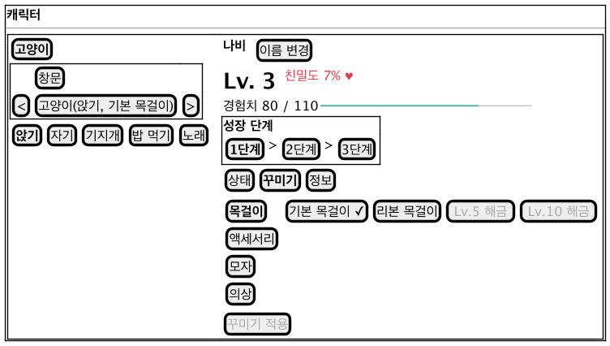
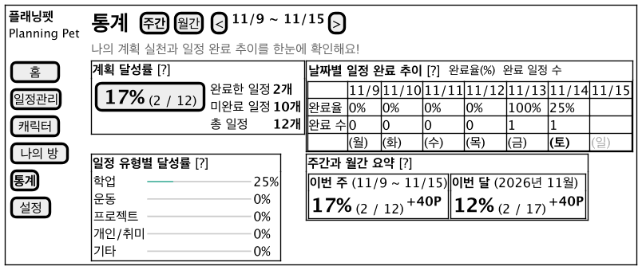
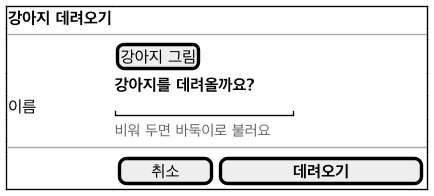

# 05. 화면 설계

유스케이스([02-usecases.md](02-usecases.md))를 사용자가 어떤 화면에서 하는지 정한다. 화면마다 와이어프레임, 이어진 유스케이스, 입력 항목을 적는다. 입력 항목 표는 수업 슬라이드 "0. Swing"의 GUI 스케치처럼 이름, 부품, 형식과 범위, 오류 처리를 쓴다.

화면 틀은 팀 기획 노트의 스케치를 따랐다. 색, 글꼴, 모양은 [디자인 시스템](design-system.md)을 따른다. 그림 속 일정과 숫자는 대학생 사용자를 가정한 예시다.

## 설계 원칙

1. **하루는 메인 한 화면에서 끝난다.** 오늘 할 일을 보고, 체크하고, 새로 넣는 일이 모두 메인에서 된다. 다른 화면은 시간 배치(일정관리), 방 꾸미기와 펫 돌보기(나의 방과 그 위에 뜨는 캐릭터 창), 되돌아보기(통계)처럼 가끔 하는 일을 맡는다.
2. **흐름을 끊지 않는다.** 보상, 레벨 업, 하루 상한 같은 소식은 펫 말풍선으로 알린다. 화면을 막는 창은 지울지 묻기, 저장 실패처럼 사용자가 결정해야 하거나 일이 실패했을 때만 띄운다.
3. **기본값은 보이게 둔다.** 사용자가 고치지 않아도 들어갈 값은 처음부터 칸에 채워 두고 칸 아래에 알린다(D-07, D-12).
4. **못 쓰는 것은 감추지 않고 비활성으로 둔다.** 이미 한 출석, 포인트가 모자란 아이템, 레벨이 모자란 장신구는 버튼을 흐리게 하고 이유를 보인다.

## 창 구조

앱은 창 하나(`JFrame`)에 화면 다섯 개를 바꿔 보여 준다. 최소 크기는 1000x680이다(노트북 1366x768에서 작업 표시줄을 빼고 들어가는 크기). 창 제목 줄은 운영체제 것을 쓰고, 제목은 "플래닝펫 (Planning Pet)", 아이콘은 발자국이다(D-47).

| 자리 | 내용 | 부품 |
|---|---|---|
| 왼쪽 | 사이드바: 위에 앱 이름(로고), 그 아래 내비게이션 홈, 일정관리, 나의 방, 통계, 설정(D-47, D-58) | `JToggleButton` 묶음 (`BorderLayout.WEST`) |
| 오른쪽 위 줄 | 왼쪽은 화면 머리(아이콘, 제목, 부제), 오른쪽은 화면마다 다른 카드다(D-47). 나의 방은 보유 포인트, 방 꾸미기 만족도, 배치 아이템, 통계는 주간과 월간 고르기와 기간 옮기기, 나머지(홈, 일정관리, 설정)는 연속 접속 일수와 출석 버튼, 보유 포인트 | `JPanel` (본문 판의 `BorderLayout.NORTH`), 오른쪽은 화면 이름으로 바꾸는 `CardLayout` |
| 오른쪽 가운데 | 고른 화면 | `CardLayout` (본문 판의 `BorderLayout.CENTER`) |

2026-11-23 나의 방 예시를 옮기며 위 막대의 내용(앱 이름, 연속 접속, 보유 포인트, 출석)은 그대로 두고 자리만 바꿨다. 앱 이름은 사이드바 로고로, 나머지는 화면 머리 오른쪽 통계 카드로 갔다(#115, [디자인 시스템](design-system.md) 10절). 와이어프레임 가운데 일정관리, 설정은 그 전에 그린 것이라 위 막대가 남아 있다. 홈, 나의 방, 통계 그림은 지금 자리로 그렸다. 화면 머리는 아이콘, 제목(26 아주 굵게), 그 아래 부제(13)다(D-33). 홈은 "오늘도 계획을 세우고, 조금씩 성장해요!", 일정관리는 "내 일정을 한눈에 확인하고, 체계적으로 관리해요!", 나의 방은 "나만의 공간을 꾸미고, 반려동물과 함께 시간을 보내요!", 통계는 "나의 계획 실천과 일정 완료 추이를 한눈에 확인해요!", 설정은 "플래닝펫을 내게 맞게 바꿔요."다.

내비게이션 바의 "홈"은 메인 화면이다. 예전의 "pet" 화면은 방을 꾸미는 나의 방과 그 위에 뜨는 캐릭터 창(펫 돌보기)으로 나눴고, 통계는 비활성 버튼(D-05)에서 화면으로 열었다(D-47, D-58).

## 화면 흐름

메인 창 안의 다섯 화면은 내비게이션 바로 서로 오가므로 화살표를 그리지 않았다. 창 밖의 상자는 모두 메인 창 위에 뜨는 창(`JDialog`)이고, 닫으면 띄운 화면으로 돌아간다.

## 메인

- **이어진 유스케이스**: UC-01, UC-02, UC-03(버튼), UC-04, UC-05와 UC-06(목록에서), UC-07, UC-08, UC-09, UC-22(펫 카드)
- **배치**: 왼쪽 위 펫 카드, 왼쪽 아래 달력, 오른쪽 위아래 전체 할 일 목록이다(D-59). 2026-11-24 팀이 준 홈 예시의 다듬은 모양을 따르되, 예시의 방 카드와 "캐릭터 꾸미기, 성장하기" 버튼은 넣지 않아 펫 요소는 펫 카드 하나다.
- **펫 카드**: 고른 펫(D-48)의 그림, 지은 이름과 그 옆 작은 종류("고양이"), "Lv. 3"(D-81), 경험치 막대와 "경험치 80 / 110"(06의 10번), "오늘 끝낸 일 1 / 4"와 막대(06의 13번), 그 아래 펫 말풍선이다. 누르면 캐릭터 창이 상태 탭으로 뜬다(D-58, D-80, D-93).
  - 펫은 1단계도 카드 칸(카드 위에서 땅 선까지) 높이의 3분의 2 넘게 그린다(앉은 그림의 높이로 잰다). 홈 카드의 단계별 크기는 0.94배, 0.97배, 1배다(D-93. D-50의 0.72배, 0.86배, 1배를 홈 카드에서 바꾼다).
  - 막대는 오늘(앱 날짜) 목록의 "오늘 할 일"(할 일과 고정 일정) 가운데 끝낸 비율이다. 고른 날짜와 관계없다(D-22, D-35). 아래 "기간 안에 할 일" 묶음은 세지 않는다(D-70).
  - 오늘 "기간 안에 할 일"이 있으면 막대 아래에 "기간 할 일 {수}개 (~{월}/{일})"를 보인다. 날짜는 그 가운데 가장 가까운 마감이다(D-70, 06의 13번).
  - 말풍선은 펫 옆에 뜨고 꼬리가 펫을 가리키며 카드 폭에서 줄을 바꾼다(D-59). 그날 처음 창을 열면 브리핑하고(UC-01), 할 일을 끝내면 칭찬하고, 하루 보상 상한에 닿거나 레벨이 오르면 그 사실을 말한다(UC-07). 언제 어떤 문장을 말하는지는 06의 15번과 16번(대사 표)을 따른다. 다음 말이 올 때까지 남아 있다.
- **달력**: 보이는 달의 날짜 칸이고 한 주는 설정의 "한 주 시작"(처음은 월요일)부터 7일이다. 요일 줄과 날짜 칸이 그 요일부터 놓인다(D-91. 일요일부터 토요일까지이던 것을 바꾼다). 제목 줄 오른쪽에 이전 달, 다음 달 꺾쇠와 "오늘" 버튼이 있다(D-60). 오늘(앱 날짜, D-15)과 고른 날짜를 다르게 표시한다. 날짜 아래에는 그날 일의 수를 "{수}개"로 보인다(D-86, 06의 26번. D-33과 D-59의 첫 할 일 제목을 바꾼다). 할 일만 세고 고정 일정은 세지 않는다. 설정의 "달력에 고정 일정 보이기"를 켜면 고정 일정도 함께 센다. 칸의 수는 그날 목록의 "오늘 할 일"과 같은 것을 센다. 시각을 정한 기간 할 일은 정한 날, 시각 없는 끝내지 않은 기간 할 일은 마감 날 칸에 센다(D-94, D-65). 끝내지 않은 기간 할 일의 마감 날 칸에는 숫자 오른쪽 위에 빨간 점을 찍고(그날 셀 일이 없어도 찍는다), 칸에 마우스를 올리면 "{제목} 마감"(여럿이면 쉼표로 잇는다)을 보인다. 끝내지 않은 일이 있는 날은 수가 `TASK_TEXT` 색, 모두 끝낸 날과 지난 반복 사본이나 지난 날의 고정 일정만 남은 날은 흐린 색이고(D-69), 셀 일이 없는 날은 아무것도 없다. 색은 [디자인 시스템](design-system.md) 7절을 따른다. 기본(고정 일정을 세지 않음)에서는 고정 일정이 있는 날 펫 카드의 "오늘 끝낸 일 1 / 4"(고정 일정을 센다, D-35)와 달력 칸 "3개"가 다를 수 있다. 설정의 "달력에 고정 일정 보이기"를 켜면 둘이 같은 것을 센다(D-86, D-94, QA M-11).
- **할 일 목록**: 고른 날짜의 하루 시간표다(D-31, 06의 6번).
  - 위쪽은 시작 시각이 있는 할 일과 고정 일정을 시작 시각 순으로 놓는다. 줄은 둥근 체크, 제목, 시각 알약("10:00~11:00", 자정에 끝나면 "~24:00", 자정을 넘으면 "23:30~01:00(다음 날)"), 걸리는 시간, 수정과 삭제 아이콘 순이다(D-59, D-77).
  - 자정 넘어 다음 날 04:00 전에 시작하는 일(06 데이터의 `nextDay`)은 그날의 일이다. 그날 밤 일 뒤, 시각 있는 줄의 맨 아래에 "01:30~02:00(다음 날)"로 보인다. 다음 날 목록으로 가지 않는다(D-77).
  - 고정 일정도 체크박스가 있고 할 일과 같이 체크한다(D-35). 체크박스 옆에 고정 일정 색(디자인 시스템 7절)의 작은 "고정" 표시를 둔다.
  - 아래쪽은 "시각 없는 할 일" 제목 밑에 시작 시각이 없는 할 일을 넣은 순으로 둔다. 시각 알약은 민트 "시각 정하기"다(D-32, D-41). 하나도 없으면 제목도 보이지 않는다.
  - 끝내지 않은 시각 없는 기간 할 일은 첫날부터 마감 전날까지 날마다 목록 맨 아래 "기간 안에 할 일" 제목 밑에 보이고, 오늘 할 일 수에 들지 않는다(D-65, D-70, 06의 6번). 마감 날에는 오늘 할 일로 세고 목록 맨 위에 빨간 "오늘 마감"을 붙여 보인다. 앞날을 고르면 그날이 마감 날인 기간 할 일이 맨 위에 빨간 "마감"으로 보인다. 마감 날에 시각을 정해 둔 기간 할 일은 시각 자리에 같은 표시를 붙인다. 마감이 있는 할 일은 흐린 "~11/22까지"를 보인다.
  - 기간 할 일을 정한 날에 못 끝내면(D-67) 그 날의 목록과 시간표에서 빠지고, 다음 날부터 마감까지 날마다 "기간 안에 할 일"에 "~11/22까지"와 흐린 "17일에 하려던 일"(정한 날)을 붙여 보인다. 다시 시각을 정하거나 자동 배치로 놓으면 그 표시가 없어지고 새 칸에만 보인다. 마감이 지나도 못 끝내면 보통 할 일처럼 "지난 날"과 "어제 못 끝낸 일"이 된다. 시각을 뺀 기간 할 일(D-72)도 "기간 안에 할 일"에 든다. D-67과 D-72는 이 일이 "시각 없는 할 일"에 보인다고 적었지만, D-70이 시각 없는 기간 할 일을 따로 묶으므로 이 묶음에 둔다. 시각을 정하면 그 날짜에만 보인다. 끝내면 끝낸 날(앱 날짜) 목록의 "시각 없는 할 일"에만 끝낸 일로 보이고, 정해 둔 시각은 붙이지 않는다. 계획한 날의 목록과 시간표에서는 빠져 그 칸이 빈다. 체크를 풀면 처음 계획(날짜, 시각, 기간)으로 돌아간다(D-66).
  - "~11/22까지", "17일에 하려던 일", "오늘 마감", "마감"은 제목 옆이 아니라 제목 아래 둘째 줄 왼쪽에 이 순서로 놓는다(일정관리 목록의 "지난 날"과 같은 자리와 모양). 제목이 줄의 남는 폭을 먼저 받아, 처음 창 크기(1000x680)에서도 제목이 "…" 앞 네 글자 넘게 보인다(D-94, 06의 6번). 둘째 줄이 있는 줄은 그만큼 높다.
  - 체크하면 그 줄은 그 자리에서 체크와 회색 취소선으로 바뀌고, 1.5초 뒤 목록 맨 아래 "끝낸 일 {수}개" 묶음으로 내려간다(D-88). 잘못 눌렀을 때 바로 풀 수 있고 끝낸 것을 눈으로 보도록 잠깐 머문다. 이어서 여러 개를 체크하면 마지막 체크에서 1.5초 뒤 함께 내려가서, 누르는 동안 줄이 움직이지 않는다. 기간 할 일도 같다. 시각 줄, 맨 위 "오늘 마감" 줄, "기간 안에 할 일" 묶음의 줄은 체크해도 1.5초 동안 체크하기 전 묶음과 순서 그대로 있다(D-94). 고정 일정과 시각 있는 일도 끝내면 이 묶음으로 가고, 묶음 안은 위 목록의 순서(시각 있는 것을 시각 순, 그다음 시각 없는 것)다. 위 묶음("시각 없는 할 일")의 줄이 모두 내려가면 그 제목도 없어진다.
  - 묶음 제목 "끝낸 일 {수}개"는 누르는 버튼이다. 누르면 묶음을 접어 줄을 숨기고, 다시 누르면 편다. 처음은 펼친 채이고, 접은 상태는 날짜를 바꿔도 앱을 끌 때까지 남는다(저장하지 않는다). 묶음 안 줄의 체크를 풀면 바로 제자리로 돌아간다.
  - 오늘이 아닌 날을 보며 기간 할 일을 체크하면 끝낸 날(오늘)에만 보이므로 그 목록에서 바로 빠진다(D-66).
  - 시각 알약을 누르면 시각 고치기 창이 뜬다(D-32). 버튼 모양으로 누르는 곳임을 보인다(D-40, D-59). 아래 "시각 고치기 창" 절을 본다.
  - 끝낸 줄의 시각 알약은 누를 수 없는 흐린 글이다. 지난 날(오늘보다 앞선 날)을 고른 목록에서 기간 할 일의 "시각 정하기"는 흐리고 누를 수 없으며, 마우스를 올리면 "지난 날에는 시각을 정할 수 없어요"를 보인다(D-94). 지난 날로 시각을 정하면 그 자리에서 사라지고 다음 날부터 "{일}일에 하려던 일"이 되기 때문이다.
  - 줄 끝(걸리는 시간 오른쪽)에 연필(수정)과 휴지통(삭제) 아이콘 버튼이 있고, 마우스를 올리면 "수정", "삭제"를 보인다(D-33, D-59). 고정 일정 줄에도 있다.
  - 메모가 있는 일정은 제목 옆에 흐린 "메모"를 보이고, 줄에 마우스를 올리면 메모를 200자까지 보인다(D-33).
  - 그날 일정이 하나도 없으면 목록 자리에 흐린 "아직 일정이 없어요. 작은 계획을 추가해 보세요."를 보인다(D-33).
- **할 일 고치기와 지우기**: 줄 끝의 연필, 휴지통 버튼을 누르거나, 할 일을 두 번 누르거나(수정. 일정관리 목록에서는 한 번 누르면 시각 고치기 창이고 두 번 누르기가 없다, D-99), 오른쪽 버튼 메뉴("수정", "삭제")를 쓴다.
- **빠른 추가**: 목록 아래 연필 아이콘이 든 둥근 입력칸에 제목을 쓰고 Enter나 칸 옆 "추가"를 누르면 고른 날짜에 30분짜리 시각 없는 할 일이 생긴다. 칸 아래에 "제목을 쓰고 Enter나 추가를 누르면 30분짜리 할 일로 들어가요"를 늘 보이고, 새 할 일은 목록 오른쪽에 30분을 보인다(D-12, D-40). 넣으면 펫이 바로 넣은 일의 이름과 오늘 남은 수를 말한다("'통계 레포트' 넣었구나! 오늘 남은 일 3개야.", 고른 날짜가 오늘이 아니면 "'통계 레포트' 11/20에 넣었어.", D-90, 06의 16번 `ADDED`). 기간 할 일을 넣으면 "'E사 지원서' 넣었구나! 22일까지야."이다(D-94). 기간 할 일만 있는 날을 고르면 펫이 "할 일이 없어."에 기간 할 일을 덧붙여 목록과 맞게 말한다(06의 16번 `OTHER_DATE`, `USUAL`).
- **예시 지우기**: 첫 실행에서 넣은 예시 일정이 하나라도 남아 있으면 목록 카드 제목 줄 아래에 흐린 "예시 일정이 들어 있어요. 다 봤으면 지워도 돼요"와 오른쪽 "예시 지우기" 버튼이 든 띠를 둔다(D-74). 누르면 확인 창("그 밖의 창과 알림")을 거쳐 예시로 넣은 일정을 모두 지운다(06의 31번). 사용자가 제목, 시각, 메모, 날짜 가운데 하나라도 고친 예시는 내 일정으로 보고 남긴다(D-94). 고치지 않은 예시가 없으면 띠가 없다.
- **일정 추가**: 목록 카드의 제목 줄("11월 14일 (토) 할 일") 오른쪽에 둔다. 일정관리의 일정 추가와 같은 자리다(D-40). 이 창으로 새 일정을 넣어도 펫이 빠른 추가와 같이 말한다(D-90). 요일 반복은 "17일(화)부터 화, 목마다 넣었어요"를 말한다(D-75).

| 번호 | 이름 | 부품 | 형식과 범위 | 오류 처리 |
|---|---|---|---|---|
| 1 | 출석 | `JButton` | 글자는 "출석 +20P". 앱 날짜 하루에 한 번 누른다(06의 11번) | 오늘 이미 출석했으면 "출석 완료"로 바뀌고 비활성이다 |
| 2 | 이전 달, 다음 달, 오늘 | `JButton` | 이전 달과 다음 달은 한 달씩 옮기고 고른 날짜는 그대로다. 오늘은 오늘이 든 달로 옮기고 오늘을 고른다(D-60) | 오늘이 든 달에서 오늘을 고르고 있으면 오늘이 흐리고, 마우스를 올리면 "오늘을 보고 있어요"를 보인다 |
| 3 | 달력 날짜 | `JTable` 칸 | 보이는 달의 날짜 | 다른 달의 빈 칸은 눌러도 바뀌지 않는다 |
| 4 | 할 일 체크박스 | 목록 줄 안의 둥근 `JCheckBox` | 완료, 미완료 | 저장에 실패하면 체크를 되돌리고 저장 실패 창을 띄운다 |
| 5 | 빠른 추가 입력칸과 추가 | `JTextField`와 칸 옆 `JButton` "추가" | 글자 1자부터 100자. 앞뒤 공백은 지운다. Enter와 추가는 같은 일을 한다(D-40) | 비어 있으면 Enter를 눌러도 아무 일도 없고 추가는 흐리다. 100자를 넘게는 써지지 않는다. 저장에 실패하면 칸에 제목을 남긴다 |
| 6 | 일정 추가 | 목록 카드 제목 줄 오른쪽의 `JButton` | 누르면 일정 입력 창을 연다. 날짜는 고른 날짜로 채운다. 빠른 추가 칸의 글은 쓰지 않는다 | 없음 |
| 7 | 시각 알약 | 제목 오른쪽의 알약 `JButton` | 시각 있으면 "10:00~11:00", 없으면 민트 "시각 정하기". 누르면 시각 고치기 창을 연다 | 끝낸 줄이면 흐리고 누를 수 없다. 지난 날 목록의 기간 할 일이면 흐리고 누를 수 없으며 툴팁 "지난 날에는 시각을 정할 수 없어요"(D-94) |
| 8 | 수정, 삭제 | 줄 끝의 아이콘 `JButton` 둘(연필, 휴지통, 툴팁 "수정", "삭제") | 수정은 일정 입력 창을 수정으로 연다. 삭제는 일정 삭제 확인 창을 거친다 | 삭제의 저장에 실패하면 되돌리고 저장 실패 창을 띄운다 |
| 10 | 예시 지우기 | 목록 카드 제목 줄 아래 띠의 `JButton` | 예시 일정이 남았을 때만 보인다. 누르면 확인 창을 띄우고, 지우기를 고르면 예시 일정을 모두 지운다(D-74) | 저장에 실패하면 되돌리고 저장 실패 창을 띄운다 |
| 9 | 펫 카드 | 누를 수 있는 `JComponent`(`PetCard`, `Card`와 같은 모양과 그림자, 손 모양 커서, Enter와 Space로도 누른다) | 누르면 캐릭터 창을 상태 탭으로 연다(D-58, D-93) | 없음 |

### 시각 고치기 창

메인 시각 칸 바로 아래나 일정관리 목록의 누른 줄 아래에 뜨는 작은 모달 `JDialog`다(제목 줄 없음, D-99). 맨 위에 할 일 제목을 보이고, 시작 시각과 걸리는 시간만 고친다(D-32, D-43). 저장할 때 같은 날 다른 일정과 겹치면 입력 창과 같이 묻는다(D-87). 버튼은 오른쪽 아래에 취소, 저장 순이고 시각 빼기는 왼쪽 아래다. 반복 사본을 저장하면 범위를 묻고, 이후 반복 모두는 시작 시각과 걸리는 시간만 뒤 사본에 넣는다(D-42). 시각 없는 기간 할 일에 시각을 정하면 날짜가 창을 연 목록의 날(메인은 고른 날짜, 일정관리 오른쪽 목록은 누른 줄의 날짜이고 그 날이 지난 날이면 오늘)로 옮겨지고 마감은 남는다(D-65, D-99).

| 번호 | 이름 | 부품 | 형식과 범위 | 오류 처리 |
|---|---|---|---|---|
| 1 | 시작 시각 | `JSpinner`(5분 단위 목록) | 00:00부터 23:55, 이어서 "00:00(다음 날)"부터 "03:55(다음 날)"까지(D-77). 다음 날 값이면 칸 옆에 "(토 01:30)"처럼 실제 날과 시각을 적는다. 기본은 그 일정의 시작 시각, 시각 없는 할 일이면 06의 14번 `defaultStart` | 쳐 넣은 값은 일정 입력 창 5번과 같이 맞추거나 받지 않고 같은 글을 보인다(D-98). "밤 4시"처럼 다음 날로 읽은 값은 그대로 두고 같은 글을 보이며, 저장하면 그 일이 다음 날로 옮겨진다. 반복 사본에서 "이후 반복 모두"를 고르면 뒤 사본도 각자 다음 날로 옮겨진다(25일은 26일). 화살표나 다른 값으로 바꾸면 글이 사라지고 원래 날에 저장한다(D-101). 마감 날인 기간 할 일은 마감을 넘기지 않고 03:55(다음 날)로 맞추고 "마감(18일) 안에 두려고 03:55로 맞췄어요"를 보인다. 글은 이 칸 묶음("시작 시각", 칸, 실제 시각 글) 바로 아래 그 너비 안에 걸리는 시간 글과 따로 붙고, 길면 낱말 사이에서 두 줄로 접히며 창이 늘어나 버튼이 아래로 밀린다. 끝이 다음 날 04:00을 넘으면 저장하지 않고 창 아래에 "다음 날 04:00까지 끝나야 해요"를 보인다. 자정을 넘는 것은 막지 않는다(D-77) |
| 2 | 걸리는 시간 | `JSpinner`(분, 5분 단위) | 10분부터 720분. 기본은 그 일정의 값 | 쳐 넣은 값은 일정 입력 창 6번과 같이 맞추거나 받지 않고 같은 글을 보인다(D-98). 글은 이 칸 묶음("걸리는 시간", 칸, "분") 바로 아래 그 너비 안에 따로 붙고, 길면 낱말 사이에서 두 줄로 접히며 창이 늘어나 버튼이 아래로 밀린다 |
| 3 | 시각 빼기 | `JButton` | 시각 있는 할 일에만 보인다. 누르면 시각 없는 할 일이 되고 창이 닫힌다. 반복 사본이면 "이 일정만 / 이후 반복 모두"를 묻고 처음 골라 둔 버튼은 "이 일정만"이다. 기간 할 일은 계획한 날에서 빠지고 오늘부터 마감까지 날마다 "기간 안에 할 일"에 "~11/22까지"와 함께 보인다(D-72, 06의 4번) | 범위 물음에서 취소하면 아무것도 바뀌지 않고 창이 남는다. 저장에 실패하면 되돌리고 저장 실패 창을 띄운다 |
| 4 | 저장, 취소 | `JButton` | 저장은 Enter, 취소는 Esc로도 된다. 저장하면 목록이 새 순서로 바뀐다 | 저장에 실패하면 되돌리고 저장 실패 창을 띄운다 |

## 일정관리

- **이어진 유스케이스**: UC-10, UC-11(버튼), UC-03(버튼), UC-05, UC-06, UC-07, UC-08
- **시간표**: 설정의 "한 주 시작"(처음은 월요일)부터 일주일을 보인다(D-11, D-91). 설정을 바꾸면 보던 주의 첫날이 든 새 주로 바뀐다. 세로는 0시부터 다음 날 4시(28:00)까지다(D-77). 24:00 자리에 "자정" 선을 긋고, 그 아래 네 시간은 "다음 날" 칸으로 옅게 칠하고 왼쪽 시각을 "00:00"부터 다시 적는다. 자정 넘어 시작하는 일과 자정을 넘는 일은 그날 칸 자정 아래로 이어 그린다. 일정관리를 열 때와 주를 옮길 때 이번 주면 지금 시각 한 시간 앞이 맨 위가 되게 내리고(밤 01:30이면 앱 오늘 칸의 자정 아래 00:30), 다른 주면 08:00이 맨 위다. 일정을 체크하거나 고쳐 다시 그릴 때는 자리를 옮기지 않는다(D-89, 06의 19번). 시작 시각이 있는 일정은 시작 칸부터 걸리는 시간만큼 칸을 차지한다. 같은 시간에 겹친 일정은 06의 19번 함수대로 열을 나눠 그 날의 폭을 나눠 쓴다. 모든 블록 왼쪽 위에는 체크박스가 있어 끝내거나 취소한다(D-33, D-35, UC-07, UC-08). 블록에 마우스를 올리면 메모를 보인다. 겹쳐 좁아진 블록과 제목이 잘린 블록은 마우스를 올리면 전체 제목과 시각("자소서 초안 14:00~15:00")을 먼저 보이고 메모를 그 아래에 보인다(D-87, 06의 19번).
- **색**: 고정 일정(D-16), 할 일, 끝낸 할 일(취소선)을 다른 색으로 그린다. 색은 디자인 시스템 7절을 따른다(와이어프레임은 파랑과 노랑으로 그렸다). 시간표 위 머리줄 왼쪽에 세 색의 뜻("고정 일정", "할 일", "끝냄")을 작은 색 칸과 함께 보인다(D-44).
- **시각 없는 할 일**: 오른쪽 목록에 이번 주의 날에 보이는 시작 시각 없는 할 일을 모은다(D-10, 06의 7번). 줄 모양은 메인 목록과 같고 날짜("11/14")를 앞에 붙인다. 날짜는 줄이지 않고, 제목이 그 뒤 남는 폭을 받는다. "~11/22까지"와 "오늘 마감", "마감"은 메인 목록처럼 둘째 줄 왼쪽에 "지난 날"과 함께 놓는다(D-94). 끝내지 않은 기간 할 일은 이번 주에 보이는 날이 여러 날이어도 이번 주에서 보이는 첫날에 한 줄이고 둘째 줄은 "~11/22까지"다(D-65). 마감 날이 이번 주에 있으면 그날 아래에 한 줄을 더하고, 그날이 오늘이면 빨간 "오늘 마감", 앞날이면 빨간 "마감"을 붙인다(첫날이 마감 날이면 그 줄에 붙인다). 마감이 지났는데 못 끝낸 기간 할 일은 보통 할 일처럼 마감 날 줄 하나에 "지난 날"만 붙는다(D-67). 끝내면 끝낸 날 아래에만 체크와 취소선으로 보인다(D-93, 06의 7번). 시각을 정해 시간표에 놓인 기간 할 일은 목록에 줄이 없다. 날짜가 오늘보다 앞선 끝내지 않은 할 일(기간 할 일은 마감이 오늘보다 앞선 것)은 둘째 줄 왼쪽에 빨간 "지난 날"을 보인다(D-44). 끝낸 일에는 "지난 날"을 붙이지 않고 체크, 회색, 취소선으로 보인다(D-78). 지난 날의 끝내지 않은 할 일 반복 사본은 놓친 습관 날이라 "지난 날" 없이 흐리게 보이고 체크는 된다(D-69). 줄(제목)을 한 번 누르면 그 줄 아래에 메인과 같은 시각 고치기 창이 뜬다. 이 목록에서는 두 번 누르기로 수정 창을 열지 않고 연필로 연다. 빨리 두 번 눌러도 창은 하나만 뜬다. 끝낸 줄은 눌러도 창이 뜨지 않는다. 줄의 날이 오늘보다 앞인 끝내지 않은 기간 할 일도 마감이 남았으면 창이 뜨고, 시각을 정하면 오늘의 일이 된다(D-99). 목록이 좁아서 수정, 삭제 버튼은 줄의 둘째 줄 오른쪽에 둔다. 비면 흐린 "이번 주에 시각 없는 할 일이 없어요."를 보인다. 자동 배치는 이 할 일들을 시간표의 빈 칸에 놓는다.
- **끌어 놓기**: 시각 없는 할 일 줄은 체크박스, 연필, 휴지통을 뺀 어디든(제목, 걸리는 시간 글, 빈 바탕) 잡고 시간표로 끈다(D-99). 끝낸 줄과 마감이 지나도 끝내지 못한 기간 할 일의 줄은 끌리지 않고 마우스도 바뀌지 않는다. 마감이 지난 줄에 마우스를 올리면 "마감이 지난 일은 옮길 수 없어요"를 보이고, 메모가 있으면 그 아래에 메모를 잇는다(홈 지난 날 목록의 흐린 "시각 정하기" 툴팁과 같은 꼴, D-99). 마감이 지난 일은 받지 않으므로 어느 날에도 놓지 않는다(D-99). 그 밖의 끝내지 않은 줄 위에서 마우스는 펼친 손, 끄는 동안 쥔 손이다. 체크박스에서는 끌기가 시작되지 않고 끄는 동안 체크되지 않는다. 줄을 누른 채 5px 넘게 움직여야 끌기가 시작되고, 5px까지 움직이고 떼면 누르기다. 끄는 동안 그 할 일의 걸리는 시간만 한 반투명 상자가 놓일 자리(30분 단위로 내림, 끝이 다음 날 04:00을 넘으면 당긴 자리, 06의 4번 끌어 놓기)에 따라오고 상자에 "14:00~14:30"을 보인다. 잡는 순간 놓을 수 없는 날(지난 날, 기간 할 일의 기간 밖)의 세로 칸이 회색으로 흐려진다. 새벽 4시 전에는 앞날이 앱의 오늘이라 밝다. 흐린 날 위에서는 상자가 회색이고 시각 글 자리에 까닭("지난 날", "11/18~11/21만 돼요")을 보이며 마우스는 빨간 원과 사선의 금지 모양이다. 끄는 동안 목록의 그 줄은 흐리게 남는다. 기간 할 일이 목록에 두 줄(첫날 줄과 마감 날 줄)이면 두 줄 다 흐리다. 마우스가 시간표의 보이는 위 끝이나 아래 끝 30px 띠에 닿으면 시간표가 저절로 그쪽으로 굴러간다. 띠 안쪽에서 1초에 1시간쯤, 끝에서 1초에 4시간쯤이고 그 사이는 끝에 가까울수록 빨라진다. 마우스가 시간표(왼쪽 시각 글 칸 포함)의 가로 범위 안이면 요일 머리줄 위나 시간표 아래 밖에서도 1초에 4시간쯤으로 굴러가고, 가로 범위 밖(목록, 사이드바, 창 밖 왼쪽)에서는 굴러가지 않는다. Esc를 누르면 끌기를 그만두고 줄은 목록에 그대로이며, 상자는 시간표 밖에 놓을 때처럼 목록의 그 줄 자리로 돌아간다. 놓으면 겹침과 반복 범위를 묻고 놓는다. 시간표에 블록이 생기고 목록에서 줄이 빠지며 펫 말풍선의 수가 준다. 놓은 블록 바로 옆 작은 글 상자에 "11/18 14:00~14:30에 놓았어요"(당겼으면 "다음 날 04:00까지 끝나야 해서 03:00(다음 날)에 놓았어요")와 민트 "되돌리기"를 5초 보이고, 마우스를 올려 둔 동안은 머물며 마우스를 뗀 때부터 다시 5초다. 글 상자는 놓인 블록의 날 칸 오른쪽에 뜨고 오른쪽에 자리가 없으면(처음 창의 목, 금 칸도 그렇다) 왼쪽에 뜬다. 요일이 아니라 자리로 정하므로 한 주 시작이 일요일이어도 같다. 시간표의 보이는 아래 끝에서는 잘리지 않게 위로 올려 뜬다. 긴 일이 당겨져 놓인 블록의 위 끝이 보이는 칸 위에 있으면 시간표가 저절로 굴러 블록 위 끝과 글 상자가 함께 보인다. 되돌리기는 묻지 않고 놓기 전 날짜, 시각 없음, 목록 자리, 펫 말풍선 수, 함께 바뀐 뒤 사본까지 돌린다. 다음 줄을 끌기 시작하거나, 시간표의 주를 옮기거나, 다른 화면으로 가면 글 상자는 바로 사라진다. 놓을 수 없는 날에 놓으면 줄은 목록에 그대로 남고, 상자가 시간표 밖에 놓을 때처럼 목록의 그 줄 자리로 돌아가며, 손을 놓은 자리 옆에 까닭 글("지난 날에는 놓을 수 없어요", "11/18부터 11/21까지 놓을 수 있어요")을 3초 보인다. 이 글들은 펫 말풍선에 띄우지 않는다. 시간표의 보이는 칸 밖(요일 머리줄, 목록, 창 밖)에 놓으면 아무것도 바뀌지 않고 글도 없으며, 상자가 목록의 그 줄 자리로 짧게 돌아간다.
- **펫**: 오른쪽 아래에서 이번 주 남은 날의 시각 없는 할 일(자동 배치가 놓을 수 있는 것)이 몇 개인지 말하고 자동 배치를 권한다(06의 16번 `SCHEDULE_HINT`, D-44). 일정관리에서 새 일정을 넣으면 이 말풍선은 D-39대로 두고, 홈 펫 카드의 말풍선에 홈에서 넣을 때와 같은 말(넣은 일의 이름과 오늘 남은 수)을 남긴다. 홈에 돌아오면 그 말이 보여, 첫 실행의 "수업부터 넣어 볼까?"가 일정을 넣은 뒤에 남지 않는다(D-94, 06의 16번 `ADDED`).

| 번호 | 이름 | 부품 | 형식과 범위 | 오류 처리 |
|---|---|---|---|---|
| 1 | 이전 주, 다음 주 | `JButton` | 누르면 일주일씩 옮긴다 | 없음 |
| 2 | 오늘 | `JButton` | 오늘이 들어 있는 주로 돌아간다 | 이미 이번 주면 흐리고, 마우스를 올리면 "이번 주를 보고 있어요"를 보인다(D-60) |
| 3 | 자동 배치 | `JButton` | 누르면 자동 배치 결과 창을 연다 | 배치할 할 일이 없으면 비활성이다 |
| 4 | 일정 추가 | `JButton` | 일정 입력 창을 연다. 날짜는 보이는 주에 오늘이 있으면 오늘, 없으면 그 주 첫날로 채운다(06의 14번) | 없음 |
| 5 | 시간표 일정 | `paintComponent`로 그리는 `JComponent` | 블록의 체크박스를 누르면(왼쪽 버튼 한 번) 끝내거나 취소한다. 두 번 누르면 일정 입력 창이 수정으로 열린다. 오른쪽 버튼은 메인 목록과 같은 메뉴다 | 저장에 실패하면 체크를 되돌리고 저장 실패 창을 띄운다 |
| 6 | 시각 없는 할 일 | `JList`와 `JCheckBox` | 메인 할 일 목록과 같다. 다만 줄을 한 번 누르면 시각 고치기 창을 열고, 두 번 누르기로 수정 창을 열지 않는다. 줄을 시간표로 끌어 놓으면 그 날과 시각으로 정한다(D-99) | 메인 4번과 같다 |

## 일정 입력 창

- **이어진 유스케이스**: UC-03, UC-05, UC-06
- 추가와 수정에 같은 창(`JDialog`, 모달)을 쓴다. 제목 아래에 유형 칸(10번)이 있다(D-54). 제목 줄이 "일정 추가"와 "일정 수정"으로 바뀌고, 수정일 때만 왼쪽 아래에 삭제 버튼이 생긴다.
- 유형과 반복의 고르는 칸은 제목, 날짜 칸처럼 흰 바탕에 얇은 테두리이고 칸 안 오른쪽 끝에 작은 아래 꺾쇠가 있다. 칸 어디를 눌러도 목록이 열린다(D-97).
- 그림은 메인에서 추가할 때다. 날짜는 06의 14번 함수가 고른 날짜로, 걸리는 시간은 30분으로 채워져 있고 그 아래에 기본값 안내가 있다(D-07). 반복은 "안 함"이고 흐린 끝 날짜는 할 일의 기본(날짜에 4주)이다.
- 칸끼리는 이렇게 움직인다. 사용자가 손으로 고르거나 끈 값은 다른 칸을 오가도 지키고, 앱이 저절로 정하거나 바꾼 값은 맥락이 돌아오면 되돌리거나 새 맥락을 따른다(D-101). 요일 단추(7번), 고정 일정을 거친 정하기와 기간(아래 줄), 기간을 켰다 끈 정하기(4번), 반복을 거친 기간과 되돌린 마감(11번)이 이것을 따른다.
- 종류를 고정 일정으로 바꾸면 시작 시각 정하기가 켜진 채 비활성이 되고, 기간 안에 하기가 꺼진 채 비활성이 된다. 다시 할 일로 돌아오면 고정 일정으로 가기 앞에 둔 대로 되돌린다. 시작 시각 정하기를 끈 채였으면 꺼지고, 켠 채였으면 켜진 채 시각은 마지막에 고친 값이다. 기간 안에 하기를 켠 채였으면 다시 켜지고 마감 날짜도 그대로이며 시작 시각 정하기는 꺼진 채 비활성이다(D-101). 할 일과 고정 일정 모두 반복을 고를 수 있다(D-64).
- 반복과 기간은 함께 고를 수 없다(D-65). 반복이 "안 함"이 아니면 기간 안에 하기가 꺼진 채 비활성이고 그 옆에 "반복 일정은 기간을 정할 수 없어요"를 늘 보인다(D-73). 기간 안에 하기를 켜면 반복이 "안 함"인 채 비활성이 되고 반복 칸 아래에 "기간 안에 하는 할 일은 반복할 수 없어요"를 보인다.
- 요일 반복을 저장하면 날짜 칸의 날이 고른 요일이 아니어도 막지 않고, 펫이 "17일(화)부터 화, 목마다 넣었어요"처럼 처음 들어간 날과 요일들을 말한다(D-75, 06의 16번 `WEEKLY_ADDED`). 처음 들어간 날이 오늘과 다른 달이면 "12월 1일(화)부터 화마다 넣었어요"처럼 달을 붙인다(D-94).
- 수정할 때는 종류와 반복 칸이 비활성이다(06의 4번). 기간 할 일의 마감만 바꿔 저장하면 시작일, 메모, 걸리는 시간, 정해 둔 날짜와 시각은 그대로이고 "~{월}/{일}까지", 달력, 브리핑이 새 마감을 따른다(D-93). 반복 사본을 고칠 때는 반복 칸이 그 반복의 방식(매일, 고른 요일)인 채 비활성이고 끝 날짜는 그 반복의 마지막 날짜이며, 저장하면 범위를 묻는다(D-42). 기간 안에 하기와 마감은 반복 사본이 아닌 할 일이면 수정할 때도 켜고 끄고 고친다. 다만 마감이 지나도 끝내지 못한 기간 할 일은 날짜, 기간 안에 하기, 마감일 칸이 비활성이고 마우스를 올리면 "마감이 지난 일은 날짜를 바꿀 수 없어요"를 보이며, 기간 안에 하기 옆에 같은 글을 늘 보인다. 제목, 유형, 걸리는 시간, 메모만 고치고 삭제할 수 있다(D-99). 마감이 지난 일은 받지 않으므로 마감을 늦추거나 기간을 꺼 다른 날로 옮길 수 없다.
- 저장하려는 일정이 같은 날 다른 일정과 시간이 겹치면 막지 않고 저장 전에 "14:00~15:00 '자소서 초안'과 30분 겹쳐요. 그래도 넣을까요?"를 묻는다(D-87, 06의 3번 겹침 묻기). 겹침은 실제 시각으로 보아, 앞날 밤의 다음 날 시각 일정이나 다음 날 새벽 일정과 겹쳐도 묻고 그 일정의 날을 "11/20(금) 23:00~01:00(다음 날)"처럼 앞에 붙인다(D-94). 넣기면 저장하고, 취소면 창이 남는다. 반복 일정이면 범위 물음보다 먼저 묻는다. 시각 고치기 창의 저장도 같다.
- 시작 시각을 정하면 걸리는 시간 오른쪽에 끝나는 시각을 "15:30에 끝나요"로 보인다(D-73). 끝이 자정을 넘으면 "01:00(다음 날)에 끝나요"다(D-77).
- 기간 안에 하기를 켜면 날짜 칸 이름은 "시작일", 마감 칸 이름은 "마감일"이다. 반복 끝 칸 이름은 "반복 끝나는 날"이다(D-73).
- 저장은 Enter(메모 칸에서는 줄바꿈), 취소는 Esc로도 된다. 버튼은 오른쪽 아래에 취소, 저장 순이고 삭제는 왼쪽 아래다(D-43).
- 칸 아래의 오류 문장은 06의 2번을 따른다. 저장을 누른 뒤에 보이고, 그 뒤로는 칸을 고칠 때마다 다시 검사해 맞는 칸의 오류는 지운다(D-43). 마감 칸만은 예외로, 고른 마감이 날짜보다 앞이거나 오늘보다 전이 되면 저장을 누르기 전에도 그 자리에서 보인다(D-101, 11번).

| 번호 | 이름 | 부품 | 형식과 범위 | 오류 처리 |
|---|---|---|---|---|
| 1 | 종류 | `ButtonGroup`으로 묶은 `JRadioButton` | 할 일, 고정 일정. 기본은 할 일 | 수정할 때는 비활성이다 |
| 2 | 제목 | `JTextField` | 글자 1자부터 100자, 꼭 써야 한다. 앞뒤 공백은 지운다 | 비어 있으면 저장하지 않고 칸 아래에 "제목을 써 주세요"를 빨간 글씨로 보인다. 100자를 넘게는 써지지 않고 붙여 넣은 글은 100자에서 자른다 |
| 3 | 날짜 | `JSpinner` (`SpinnerDateModel`, `yyyy-MM-dd`) | 날짜. 지난 날짜도 된다. 기간 안에 하기를 켜면 칸 이름이 "시작일"이다(D-73). 화살표는 커서 자리와 관계없이 하루씩 바꾼다(D-43) | 형식에 맞지 않게 쓰면 칸을 벗어날 때 이전 값으로 돌아간다. 마감이 지나도 끝내지 못한 기간 할 일을 고칠 때는 비활성이다(D-99) |
| 4 | 시작 시각 정하기 | `JCheckBox` | 켬, 끔. 기본은 끔 | 끄면 5번 칸이 비활성이 되고 시각 없는 할 일이 된다. 고정 일정이면 켜진 채 비활성이다. 기간 안에 하기를 켜면 꺼진 채 비활성이고 마우스를 올리면 "기간 할 일의 시각은 목록에서 정해요"를 보인다(D-68). 기간 안에 하기를 다시 끄면 켜기 앞의 정하기와 시각으로 돌아간다(D-101). 기간 할 일의 시각은 목록의 "시각 정하기"와 자동 배치로만 정한다 |
| 5 | 시작 시각 | `JSpinner` (`HH:mm`, 5분 단위) | 00:00부터 23:55, 이어서 "00:00(다음 날)"부터 "03:55(다음 날)"까지(D-77). 다음 날 값이면 칸 옆에 "(토 01:30)"처럼 실제 날과 시각을 적는다. 처음 값은 06의 14번 `defaultStart(날짜, 지금)`이고, 수정이면 그 일정에 저장해 둔 시작 시각이다. 수정 창에서 저장해 둔 시작 시각은 사용자 값이라 날짜를 바꿔도 그대로다(D-96의 저장해 둔 마감과 같은 꼴). 시각 없는 일정의 수정 창은 시작 칸을 앱이 채운 값으로 본다. 사용자가 시작 시각을 만지기 전에는 날짜를 바꾸면 새 날짜의 `defaultStart`로 따라간다(오늘이 아니면 09:00, 다시 오늘로 오면 지금 바로 뒤 5분 값. 지금은 창을 연 때가 아니라 날짜를 바꾼 그 순간의 앱 시계다). 시작 칸을 쓸 수 있게 되는 그 순간(정하기를 켤 때, 고정 일정으로 바꿔 정하기가 켜질 때, 기간 안에 하기를 꺼 정하기가 되살아날 때)에도 그때의 앱 시계로 다시 재고, 제목, 메모, 걸리는 시간 같은 다른 칸을 고칠 때는 다시 재지 않는다(S144). 만진 뒤에는 그대로다(D-101). 앱 날짜와 달력 날짜가 다른 밤(00:00~03:59)에 열면 날짜는 앱의 오늘, 시작은 지금(다음 날 시각)이다 | 쳐 넣는 동안 그 앞부분으로 시작하는 첫 값을 채워 보인다("14"는 "14:00"). 쳐 넣은 글은 06의 32번 `Typed.start`로 읽는다("9"는 09:00, "930"은 09:30, "오후 2시 반"은 14:30, "2시"는 14:00, "새벽 1시"는 01:00(다음 날), "오후 2:30"은 14:30). "730"과 "7:30"은 19:30으로 읽고 흐린 "19:30으로 읽었어요"를, "오전 14시"는 14:00으로 읽고 "오전을 빼고 14:00으로 읽었어요"를 보인다. 한 글자 "1"부터 "8"은 쳐 넣는 동안 오후 값으로 채워 보인다("1"은 "13:00"). 이어 친 글자는 친 글 뒤에 붙고("2", "1"은 "21:00"), Backspace와 Delete는 친 글의 마지막 글자를 지우고 남은 글로 다시 채워 보인다("2", Backspace, "5"는 17:00, "14" 뒤 Backspace는 "13:00"). 채운 값은 보여 주기이고 칸의 값은 친 글이기 때문이다. "밤 4시"와 "밤 5시"는 날짜 칸을 하루 뒤로 옮기고 흐린 "19일(목) 04:00으로 읽었어요"(달이 바뀌면 "12월 1일(화) ...")를 보인다. 같은 "밤 4시"를 다시 쳐도 처음 옮긴 날 그대로다. "밤 4시"가 옮긴 날짜는 앱이 정한 값이라(D-101), 시작 칸을 다른 값으로 바꾸거나(치기, 화살표) "정하기"를 끄면(기간 안에 하기를 켜 정하기가 꺼질 때도 그 순간) 원래 날로 돌아가고 흐린 글도 지운다. 사용자가 날짜 칸을 손으로 바꾼 뒤에는 옮긴 날로 다시 돌려 놓아도 사용자가 고른 날이라 그대로 둔다. "오전 12시"는 00:00(다음 날)로 두고 "오전 12시는 밤 자정, 00:00(다음 날)로 읽었어요"를 보인다. 5분 단위가 아니면 가까운 5분 값으로 맞추고(날은 넘지 않아 23:58은 23:55) 칸 바로 아래에 흐린 글 "5분 단위로 맞췄어요(09:05)"를, 다음 날 04:00을 넘으면 03:55(다음 날)로 맞추고 "하루는 새벽 4시에 끝나서 03:55(다음 날)로 맞췄어요"를 보인다. "25:00"처럼 알아듣지 못하는 글이면 이전 값을 두고 칸 바로 아래에 빨간 "14:00처럼 적어 주세요"를 보인다. 그 글을 친 채 저장을 누르면 저장하지 않고 창을 남겨 이 칸 아래 빨간 글을 보이고 커서를 이 칸에 둔다. 다른 칸이나 단추, 체크박스로 옮겨(Tab 포함, 저장 단추를 누르지 않고 포커스만 옮기거나 눌렀다가 단추 밖에서 뗀 것도) 빨간 글이 뜨고 이전 값으로 돌아간 뒤 고치지 않고 저장하면 그 값으로 저장한다(D-98). 친 글을 모두 지워 칸을 비운 채 벗어나면 빨간 글 없이 치기 앞의 상태(값, 칸 아래 글, "밤 4시"가 옮긴 날)로 돌아간다. 빈 칸은 받을 수 없는 글이 아니다. 칸 아래 글은 이 칸을 다시 고치면(쳐 넣기 시작, 화살표) 사라지고 다른 칸을 고치는 동안에는 남는다(D-98). 끝이 다음 날 04:00을 넘으면 저장하지 않고 "다음 날 04:00까지 끝나야 해요"를 보인다. 자정을 넘는 것은 막지 않는다(D-77). 5분 단위가 아닌 시각(저장 파일처럼 칸 밖에서 들어온 값)이 끝도 넘으면 두 문장과 둘을 함께 푸는 시각을 빨간 글 하나에 이어 보이고(06의 2번, D-100), 보이는 제목 칸 폭을 넘으면 낱말 사이에서 줄을 바꿔 잘리지 않게 한다 |
| 6 | 걸리는 시간 | `JSpinner` (분, 5분 단위) | 10분부터 720분. 기본 30분. 추가 창에서 값이 30일 때만 칸 아래에 "안 바꾸면 30분으로 들어가요"를 보인다(D-43). 칸에 값을 쳐 넣은 뒤에는 이 안내를 보이지 않는다(D-98) | 쳐 넣은 글은 06의 32번 `Typed.minutes`로 읽는다("30분"은 30, "1시간 반"은 90). 5분 단위가 아니면 가까운 5분 값으로 맞추고 칸 바로 아래에 흐린 글 "5분 단위로 맞췄어요(25분)"를, 720을 넘으면 720으로 맞추고 "최대 720분(12시간)까지 넣을 수 있어요"를, 10보다 작으면 10으로 맞추고 "최소 10분부터 넣을 수 있어요"를 보인다. "반시간"은 30분으로 읽고 흐린 "30분으로 읽었어요"를 보인다. 알아듣지 못하는 글("30abc")이면 이전 값을 두고 칸 바로 아래에 빨간 "숫자(분)로 넣어 주세요(예: 30)"를 보인다. 그 글을 친 채 저장을 누르면 저장하지 않고 창을 남겨 이 칸 아래 빨간 글을 보이고 커서를 이 칸에 둔다. 다른 칸이나 단추, 체크박스로 옮겨(Tab 포함, 저장 단추를 누르지 않고 포커스만 옮기거나 눌렀다가 단추 밖에서 뗀 것도) 빨간 글이 뜨고 이전 값으로 돌아간 뒤 고치지 않고 저장하면 그 값으로 저장한다(D-98). 친 글을 모두 지워 칸을 비운 채 벗어나면 빨간 글 없이 치기 앞의 상태(값, 칸 아래 글)로 돌아간다. 칸 아래 글은 이 칸을 다시 고치면(쳐 넣기 시작, 화살표) 사라지고 다른 칸을 고치는 동안에는 남는다(D-98) |
| 7 | 반복 | `JComboBox`(안 함, 매일, 요일), 요일 `JToggleButton` 일곱(설정의 한 주 시작 요일부터. 처음은 월부터 일, 일요일 시작이면 일부터 토, D-91, D-94), 끝 날짜 `JSpinner` | 기본은 안 함. 요일을 처음 고르면 요일 단추가 켜지고 날짜의 요일 하나가 골라져 있다(D-93). 앱이 골라 준 이 요일은 사용자가 요일 단추를 누르기 전까지 날짜를 바꾸는 그 순간 새 날짜의 요일로 따라가고, 한 번이라도 누른 뒤에는 날짜를 바꿔도 그대로다. 매일이나 안 함으로 갔다가 요일로 돌아오면 고른 요일이 그대로 남고, 모두 끈 채였으면 하나도 없다(D-101). 요일은 하나 이상 고른다. 끝 날짜 칸 이름은 "반복 끝나는 날"이다(D-73). 끝 날짜 기본은 고정 일정이면 날짜에 15주, 할 일이면 4주를 더한 날(06의 14번)이고, 끝 날짜를 손대지 않았으면 반복을 고른 뒤에도 날짜나 종류를 바꾸면 기본 간격을 지켜 따라 바뀐다. 손으로 끝 날짜를 정한 뒤에는 그대로 둔다(D-79). 끝 날짜 화살표도 하루씩이다. 할 일 반복은 시작 시각이 없어도 된다(D-64). 반복 사본을 고칠 때는 그 반복의 방식인 채 비활성이고 끝 날짜는 그 반복의 마지막 날짜다. 수정할 때는 이 칸을 검사하지 않는다(D-42) | 기간 안에 하기를 켜면 안 함인 채 비활성이고 칸 아래에 "기간 안에 하는 할 일은 반복할 수 없어요"를 보인다. 요일이 하나도 없거나, 끝 날짜가 앞이거나, 반복하는 날이 없거나, 사본이 120개를 넘으면 저장하지 않고 06의 2번 문장을 보인다. 끝 날짜가 시작 날짜를 따라가므로 "반복 끝나는 날이 날짜보다 전이에요"는 끝 날짜를 손으로 정한 뒤에만 나온다(D-79) |
| 8 | 메모 | `JScrollPane` 안의 `JTextArea` | 0자부터 1000자 | 1000자를 넘게는 써지지 않는다 |
| 9 | 저장, 취소, 삭제 | `JButton` | 삭제는 수정일 때만 보인다. 반복 사본을 저장하면 범위를 묻는다(D-42) | 삭제는 확인 창을 거치고, 반복 사본이면 범위를 묻는다. 저장에 실패하면 창을 닫지 않고 입력값을 남긴 채 저장 실패 창을 띄운다 |
| 10 | 유형 | `JComboBox` | 학업, 운동, 프로젝트, 개인/취미, 기타. 추가할 때 처음 값은 기타, 수정이면 그 일정의 유형(D-54). 제목 칸 바로 아래에 있다 | 목록 밖의 값은 고를 수 없다 |
| 11 | 기간 안에 하기와 마감 | `JCheckBox`와 마감 `JSpinner`(`yyyy-MM-dd`) | 날짜 칸 바로 아래에 있다. 기본은 끔이고, 켤 때만 오른쪽에 "마감일" 칸이 보인다(D-65, D-73). 날짜는 기간의 첫날, 마감은 끝날(첫날과 같거나 뒤)이다. 마감 기본은 날짜가 든 주의 마지막 날(한 주 시작이 월요일이면 일요일, 일요일이면 토요일)이고 날짜가 그 마지막 날이면 다음 주 마지막 날이다(06의 14번, D-73, D-91). 마감을 고르기 전에는 기간을 켰든 껐든 날짜를 바꾸면 마감도 새 날짜의 마감 기본으로 따라 바뀐다(다음 주 월요일 11-23으로 옮기면 마감 11-29). 마감을 고른 뒤에는 시작일을 바꾸거나, 종류를 고정 일정으로 바꿨다가 할 일로 돌아와도(기간도 다시 켜진다, D-101) 고른 마감이 그대로다(D-96). 수정할 때 저장해 둔 마감도 고른 마감이라 기간을 껐다 켜거나 끈 채 시작일을 바꾸고 켜도 그대로다. 시작일이 마감보다 뒤가 되어도 마감을 옮기지 않고 오류 처리 칸의 오류 글로 알린다. 화살표는 하루씩이다. 반복 사본이 아닌 할 일은 수정할 때도 켜고 끄고 고친다. 수정할 때 날짜 칸은 기간 첫날이다. 시각을 정해 둔 기간 할 일을 저장해도 정해 둔 날짜와 시각은 그대로다(D-66, D-68) | 고정 일정이거나, 반복 사본을 고치거나, 반복을 골랐으면 꺼진 채 비활성이다. 마감이 지나도 끝내지 못한 기간 할 일을 고칠 때는 켜진 채 마감일 칸과 함께 비활성이고, 마우스를 올리면 "마감이 지난 일은 날짜를 바꿀 수 없어요"를 보이며 옆에 같은 글을 늘 보인다(D-99). 반복을 골라 비활성이면 옆에 "반복 일정은 기간을 정할 수 없어요"를 늘 보인다(D-73). 켜 둔 기간이 반복 때문에 꺼졌으면(고정 일정에서 반복을 고른 뒤 할 일로 돌아온 때) 반복을 안 함으로 되돌리면 기간이 다시 켜지고 마감도 그대로다(D-101). 고정 일정일 때 마우스를 올리면 "기간은 할 일만 정할 수 있어요"를 보인다. 마감이 날짜보다 앞이면 저장하지 않고 "마감일이 시작일보다 전이에요"를 보인다. 마감이 날짜와 같거나 뒤여도 오늘보다 전이면 저장하지 않고 "마감일이 오늘보다 전이에요"를 보인다. 마감이 지난 일은 받지 않으므로 처음부터 마감이 지난 기간 할 일은 넣지 않는다. 끝내지 않은 일을 고칠 때도 같고 끝낸 일은 막지 않는다(D-99). 시각을 정해 둔 기간 할 일을 고칠 때 마감이 정해 둔 날보다 앞이면 저장하지 않고 "마감일이 시각을 정해 둔 11/19(목)보다 전이에요"를 보이며, 정해 둔 날짜와 시각은 그대로 둔다(D-99). 마감 칸만은 저장을 누르기 전에도 값이 바뀔 때마다 바로 검사한다. 마감 칸이 보이고 고른 마감이 날짜(시각을 정해 둔 기간 할 일은 정해 둔 날도)보다 앞이거나 위의 오늘보다 전이면, 어떤 길로 그렇게 됐든(고정 일정이나 반복을 거쳐 기간이 돌아와도, 기간을 껐다 켜도, 날짜만 바꿔도) 마감은 바꾸지 않고 그 자리에서 이 글을 마감 칸 아래에 보인다. 맞으면 사라지고 다시 어긋나면 다시 보인다. 06의 2번의 다른 오류 글은 지금처럼 저장을 누른 뒤부터다(D-101). 끝낸 할 일도 같다(D-66) |

## 나의 방

- **이어진 유스케이스**: UC-14, UC-15, UC-16, UC-20("+"), UC-21
- 펫이 사는 방을 꾸미는 화면이다(D-47). 배치는 2026-11-23 나의 방 예시를 따른다. 가운데 줄은 방 카드(왼쪽)와 펫 패널(오른쪽), 아래 줄은 상점 칸이다. 상점은 따로 뜨는 창이 아니라 이 칸이다(D-53).
- **머리 오른쪽**: 보유 포인트("100P"), 방 꾸미기 만족도("6%"와 막대), 배치 아이템("2 / 13") 카드 셋이다(D-47, D-52). 이 화면에는 연속 접속과 출석 카드가 없다.
- **방**: 함께 키우는 펫이 저마다 고른 자세와 입은 장신구로 있다(D-50, D-51). 펫이 하나면 가운데, 둘이면 고양이가 왼쪽, 강아지가 오른쪽이다. 놓아 둔 아이템은 아이템마다 정해진 자리에 있다(D-13). 방에는 창문과 바닥이 늘 있다(D-27).
  - 고른 펫 옆에 하트 둘과 강조선이 있고, 머리 위 말풍선은 평소 하트 하나다. 아이템을 사거나 펫을 데려온 직후에만 그 말("{아이템} 고마워!", "안녕, 나는 {이름}{이야/야}. 잘 부탁해!")을 한 번 보이고, 다음 데이터 변경 때 하트로 돌아간다(D-56, 06의 16번 `PET_ROOM`).
  - 펫은 어디서나 지은 이름으로 부른다. 펫 칩, 펫 탭, 홈 펫 카드, 펫 패널 모두 이름과 "Lv. {레벨}"을 보이고 종류("고양이")는 이름 옆에 작게 적는다(D-81).
  - 방 왼쪽 위에 펫 칩(얼굴, 이름과 그 옆 작은 종류, 둘째 줄 "Lv. {레벨}")이 펫마다 있고 고른 펫의 칩이 눌려 있다. 칩을 누르면 그 펫을 고르기만 한다(D-80). 펫이 하나면 칩 옆에 "+"가 있고, 둘이면 "+"는 없다(D-48). 방 양옆에 화살표는 없다(D-80).
  - 방의 펫을 누르면 그 펫 머리 위 말풍선에 하트와 한마디("야옹, 좋아!", 강아지는 "멍멍, 좋아!")를 한 번 보인다(D-80, 06의 16번 `PETTED`). 펫이 둘이면 누른 펫 위에 뜬다. 저장하지 않고 고른 펫도 바꾸지 않으며, 다음 데이터 변경 때 하트로 돌아간다. 펫 위에서는 손 모양 커서다.
- **펫 패널**: 위에 펫 탭(펫마다 하나, 글은 펫 칩과 같다, 누르면 그 펫을 고르기만 한다, D-80), 그 아래 고른 펫의 초상, 발자국과 이름과 그 옆 작은 종류(D-81), "Lv. 3", "경험치 80 / 110"(06의 10번)과 막대가 있다. 그 아래 상태, 꾸미기, 정보 탭이 있고 처음은 꾸미기다. 맨 아래 "{이름} 꾸미기"(예: "나비 꾸미기") 버튼이 캐릭터 창을 꾸미기 탭으로 연다(D-83).
  - 상태: "오늘 끝낸 일 {수}개", "친밀도 {퍼센트}%", "함께한 날 {날 수}일"(06의 13번, 27번).
  - 꾸미기: 장신구 네 칸(목걸이, 액세서리, 모자, 의상). 입은 칸은 그 장신구 그림과 민트 테두리, 안 입은 칸은 칸 아이콘이다. 누르면 캐릭터 창을 꾸미기 탭으로 연다. 마우스를 올리면 "{칸}: {장신구}"(안 입었으면 "안 입었어요")를 보인다.
  - 정보: 종류와 이름, "자세 {자세}".
- **상점 칸**: 왼쪽 메뉴, 가운데 분류 탭과 검색과 카드 줄, 오른쪽 미리보기 칸이다(D-53, 06의 20번).
  - 왼쪽 메뉴는 하나만 눌리는 탭 둘(꾸미기 상점은 모든 아이템, 보유한 아이템은 가진 것만)과 그 아래 모양이 다른 켜고 끄기 스위치 "미리보기"(미리보기 칸 열고 닫기)이고, 그 아래 쇼핑백 그림이 있다(D-82). 눌린 탭만 민트로 채우고, 스위치는 알약 바탕 없이 눈 아이콘, 글자, 오른쪽 트랙과 손잡이다(켜면 민트 트랙에 손잡이가 오른쪽).
  - 카드는 그림, 이름, 가격(동전과 "{가격}P", 가진 것은 민트 "보유 중")이고 가격 순이다. 고른 카드는 민트 테두리와 오른쪽 위 체크 배지가 붙는다. 한 줄에 들어가지 않는 카드는 양옆 화살표로 넘긴다.
  - 미리보기 칸은 고른 아이템을 놓은 방(펫 없이), 이름, 가격, 취소와 동작 버튼이다. 고른 것이 없으면 "아이템을 골라 보세요"이고 두 버튼이 흐리다. 동작 버튼은 가진 아이템이 아니면 "구매하기", 가진 것이면 방에 없을 때 "방에 놓기", 있을 때 "방에서 치우기"다. 포인트가 모자라면 구매하기가 흐리고 그 아래에 빨간 "{모자란 포인트}P 모자라요"(예: "60P 모자라요")를 보인다(D-85).
  - 구매하기를 누르면 아래 "구매 확인 창"을 거쳐 산다(D-85).
  - 보유한 아이템 탭에서 가진 아이템을 고르면 두 버튼 아래에 "되팔기 +{값}P"가 보인다. 누르면 산 값 그대로 포인트를 돌려받고 그 아이템은 보유 목록에서 빠진다. 방에 놓여 있었으면 방에서도 빠진다(D-85). 다시 사면 같은 값이라 확인 창 없이 바로 되판다. 꾸미기 상점 탭에서는 보이지 않는다.
  - 맞는 아이템이 없으면 카드 자리에 "맞는 아이템이 없어요."를, 보유한 아이템에서 가진 것이 하나도 없으면 "아직 가진 아이템이 없어요. 상점에서 사면 바로 방에 놓여요."를 보인다.
  - 맨 아래에 흐린 "포인트 얻는 법: 할 일과 고정 일정 끝내기 +10P(하루 20번까지), 출석 +20P. 끝내면 경험치도 10 올라요"를 보인다(D-45).
- 그림은 고양이 하나(Lv.3), 100P, 쿠션과 화분을 가져 놓은 상태다. 실제 화면은 [prototype/screenshots/5-room.png](../prototype/screenshots/5-room.png)다. 값은 [디자인 시스템](design-system.md) 10절에 있다.

| 번호 | 이름 | 부품 | 형식과 범위 | 오류 처리 |
|---|---|---|---|---|
| 1 | 펫 칩, 펫 탭 | `JToggleButton`(`Pill`) 묶음 | 펫마다 하나. 누르면 그 펫을 고르기만 한다(UC-21, D-80) | 저장에 실패하면 고른 펫을 되돌리고 저장 실패 창을 띄운다 |
| 2 | 펫 데려오기 | 원 `JButton` "+" | 펫이 하나일 때만 칩 옆에 보인다. 누르면 펫 데려오기 창을 연다(UC-20) | 없음 |
| 3 | 방의 펫 | 방 그림(`RoomView`) 위의 펫 그림 | 누르면 그 펫이 하트와 한마디로 반응한다(D-80). 저장하지 않는다 | 없음 |
| 4 | 상태, 꾸미기, 정보 | `JToggleButton`(`Pill`) 묶음 | 처음은 꾸미기 | 없음 |
| 5 | 장신구 칸, "{이름} 꾸미기" | `JButton` | 캐릭터 창을 꾸미기 탭으로 연다(D-83, D-93) | 없음 |
| 6 | 꾸미기 상점, 보유한 아이템 | `JToggleButton` 묶음(`ButtonGroup`, 하나만 눌리는 탭) | 처음은 꾸미기 상점. 바꾸면 카드 줄이 처음부터 보인다(D-82) | 없음 |
| 7 | 미리보기 | 스위치(`Switch`, `JToggleButton`)와 미리보기 칸의 닫기 원 버튼 | 처음은 켬. 미리보기 칸을 열고 닫는다. 위의 두 탭과 따로 켜고 끈다. 카드를 고르면 다시 켜진다(D-82) | 없음 |
| 8 | 분류 탭 | `JToggleButton`(`Pill`) 묶음 | 전체, 가구, 장식, 장난감, 기타. 처음은 전체. 다섯 탭이 한 줄에 안 들어가면 아이콘을 빼고 글자만 둔다 | 없음 |
| 9 | 아이템 검색 | `JTextField` | 이름에 쓴 글자가 든 아이템만 보인다. 앞뒤 공백은 지운다. 비면 모두. 빈 칸에는 흐린 "아이템 검색..." | 맞는 아이템이 없으면 "맞는 아이템이 없어요." |
| 10 | 아이템 카드, 앞뒤 화살표 | `JToggleButton`(`ShopCard`), 원 `JButton` | 누르면 고르고, 고른 카드를 다시 누르면 고르기를 푼다. 화살표는 한 줄만큼 넘긴다 | 넘길 카드가 없으면 그쪽 화살표가 흐리다 |
| 11 | 취소 | `JButton` | 고르기를 푼다 | 고른 것이 없으면 흐리다 |
| 12 | 구매하기, 방에 놓기, 방에서 치우기 | `JButton`(주 행동) | 구매하기는 구매 확인 창을 거쳐 산다(UC-15, D-85). 방에 놓기와 방에서 치우기는 놓거나 치운다(UC-16) | 고른 것이 없거나 포인트가 모자라면 흐리고, 모자라면 아래에 "{모자란 포인트}P 모자라요". 저장에 실패하면 포인트, 보유 목록, 놓인 아이템을 되돌리고 저장 실패 창을 띄운다 |
| 13 | 되팔기 | `JButton` "되팔기 +{값}P" | 보유한 아이템 탭에서 가진 아이템을 골랐을 때만 보인다. 누르면 산 값 그대로 포인트를 돌려받고 보유 목록과 방에서 뺀다. 고르기는 풀린다(UC-16, D-85, 06의 20번 `sell`) | 저장에 실패하면 포인트, 보유 목록, 놓인 아이템을 되돌리고 저장 실패 창을 띄운다 |

### 구매 확인 창

`JOptionPane` 창이다(제목 "아이템 사기"). "{아이템}{을/를} {값}P에 살까요? 남는 포인트 {남는 포인트}P"(예: "액자를 120P에 살까요? 남는 포인트 0P")와 취소, 구매하기 버튼이다(D-85). 조사는 아이템 이름 마지막 글자의 받침을 따른다.

| 번호 | 이름 | 부품 | 형식과 범위 | 오류 처리 |
|---|---|---|---|---|
| 1 | 구매하기 | `JButton` | 산다(06의 20번 `buy`). 펫이 "{아이템} 고마워!"를 한 번 말한다 | 저장에 실패하면 되돌리고 저장 실패 창을 띄운다 |
| 2 | 취소 | `JButton` | 아무것도 하지 않는다. 물음 창을 닫아도 같다 | 없음 |

## 캐릭터 창

- **이어진 유스케이스**: UC-21(펫 탭, 화살표), UC-22, UC-23
- 고른 펫을 돌보고 꾸미는 창이다(D-47, D-58). 메뉴가 아니라 홈 펫 카드, 나의 방 펫 패널의 장신구 칸, "{이름} 꾸미기"로 연다(D-80). 나의 방의 펫 칩은 창을 열지 않는다. 메인 창 위에 뜨는 `JDialog`(제목 "캐릭터", 모달)이고 운영체제 창 틀의 닫기나 Esc로 닫는다. 배치는 2026-11-23 캐릭터 창 예시를 따른다.
- 창 안 크기는 메인 창의 폭과 높이의 3분의 2쯤이라 뒤의 메인 창이 보인다. 안의 내용(오른쪽 카드, 꾸미기 탭의 장신구 칸과 꾸미기 적용)이 들어가는 최소 크기 800x580보다 작아지지 않는다(D-93). 메인 창이 최소 크기(1000x680)면 800x580이다.
- 창은 늘 상태 탭으로 열린다. 지난번에 본 탭과 관계없고 처음 열 때도 같다. 장신구 칸이나 "{이름} 꾸미기"로 열면 꾸미기 탭으로 열린다(D-83, D-93). 열 때마다 입혀 보는 장신구는 고른 펫의 저장된 장신구에서 시작한다.
- **왼쪽**: 위에 펫 탭(얼굴, 이름과 그 옆 작은 종류, 둘째 줄 "Lv. {레벨}", 펫마다 하나, D-81), 가운데 방 그림 위의 큰 펫, 아래 자세 다섯 칸이다.
  - 큰 펫은 고른 자세로, 꾸미기 탭에서 입혀 보는 중인 장신구를 입고 그린다(D-51). 옆에 하트와 강조선, 발밑에 러그와 털실 공이 있다. 양옆 화살표는 고른 펫을 앞이나 다음 펫으로 바꾼다(D-80). 자세는 아래 자세 칸에서 고른다. 펫이 하나면 두 화살표가 흐리다.
  - 자세 칸은 앉기, 자기, 기지개, 밥 먹기, 노래 순이고 그 자세의 3단계 펫 그림 아래에 자세 이름을 늘 적는다. 고른 자세는 민트 바탕과 민트 테두리다(D-50, D-84).
- **오른쪽**: 위에 발자국과 이름과 그 옆 작은 종류(D-81), "이름 변경" 버튼, "Lv. 3"과 분홍 알약 "친밀도 {퍼센트}%"(06의 27번), "경험치 80 / 110"과 막대가 있다. 친밀도에 마우스를 올리면 "경험치를 받은 날이 30일이면 100%예요. 쉬어도 줄지 않아요"를 보인다(D-49).
  - 성장 단계: 같은 그림의 세 크기(0.72배, 0.86배, 1배)를 화살표로 잇고 지금 단계에 `MINT_PALE` 바탕을 깐다(D-50). 마우스를 올리면 "레벨 1~3, 4~6, 7~10에서 자라요"를 보인다.
  - 상태, 꾸미기, 정보 탭이 있고 열 때마다 상태 탭이다(D-93). 상태는 "오늘 끝낸 일 {수}개", "친밀도 {퍼센트}% (함께한 날 {날 수}일)", "누적 경험치 {경험치}"(D-56). 정보는 종류, 이름, 자세, 입은 장신구(없으면 "없음")다.
  - 꾸미기 탭은 왼쪽에 칸 목록(목걸이, 액세서리, 모자, 의상), 오른쪽에 고른 칸의 장신구 카드다. 카드는 열리는 레벨 순이다(D-51). 열린 카드는 그림과 이름, 안 열린 카드는 자물쇠와 "Lv.{레벨} 해금"이다. 입혀 보는 카드는 민트 테두리와 체크 배지다.
  - 맨 아래 "꾸미기 적용"(주 행동)은 꾸미기 탭에서만 보인다. 입혀 본 장신구가 저장된 것과 같으면 흐리다.
- 입혀 본 장신구가 저장된 것과 다른데 창을 닫거나(닫기, Esc) 다른 펫 탭이나 화살표로 펫을 바꾸면 아래 "꾸미기 적용 확인 창"으로 묻는다(D-61). 같으면 묻지 않는다. 자세는 누르는 즉시 저장한다.
- 그림은 고양이 하나(나비, Lv.3, 경험치 받은 날 2일)다. 실제 창 안은 [prototype/screenshots/6-character.png](../prototype/screenshots/6-character.png)다.

| 번호 | 이름 | 부품 | 형식과 범위 | 오류 처리 |
|---|---|---|---|---|
| 1 | 펫 탭 | `JToggleButton`(`Pill`) 묶음 | 펫마다 하나. 누르면 그 펫을 고른다(UC-21) | 저장에 실패하면 되돌리고 저장 실패 창을 띄운다 |
| 2 | 자세 칸 | `JToggleButton` 다섯 | 앉기, 자기, 기지개, 밥 먹기, 노래. 그림 아래에 이름을 늘 적는다(D-84). 처음은 앉기. 누르면 바로 저장하고 고른 칸은 테두리로 보인다 | 저장에 실패하면 자세를 되돌리고 저장 실패 창을 띄운다 |
| 3 | 앞 펫, 다음 펫 | 큰 그림 양옆 원 `JButton` | 펫 순서(고양이, 강아지)대로 고른 펫을 바꾸고 끝에서 처음으로 돈다(UC-21, D-80, 06의 30번 `step`) | 펫이 하나면 흐리다. 입혀 본 장신구가 있으면 먼저 꾸미기 적용 확인 창으로 묻고 취소면 바꾸지 않는다. 저장에 실패하면 되돌리고 저장 실패 창을 띄운다 |
| 4 | 이름 변경 | `JButton` | 이름 변경 창을 연다(UC-23, D-57) | 없음 |
| 5 | 상태, 꾸미기, 정보 | `JToggleButton`(`Pill`) 묶음 | 열 때마다 상태. 장신구 칸이나 "{이름} 꾸미기"로 열면 꾸미기(D-93) | 없음 |
| 6 | 장신구 칸 목록 | `JToggleButton` 넷 | 목걸이, 액세서리, 모자, 의상. 처음은 목걸이 | 없음 |
| 7 | 장신구 카드 | `JButton` | 누르면 입혀 보고, 입혀 본 카드를 다시 누르면 벗겨 본다. 저장하지 않는다 | 고른 펫의 레벨보다 높은 레벨에서 열리는 카드는 누를 수 없고, 마우스를 올리면 "레벨 {레벨}{이/가} 되면 열려요"를 보인다 |
| 8 | 꾸미기 적용 | `JButton`(주 행동) | 입혀 본 장신구를 고른 펫에 저장한다(06의 28번) | 바꾼 것이 없으면 흐리다. 저장에 실패하면 되돌리고 저장 실패 창을 띄운다 |

### 꾸미기 적용 확인 창

`JOptionPane` 창이다(제목 "꾸미기"). "입혀 본 장신구를 적용할까요?"와 적용, 버리기, 취소 버튼이다(D-61).

| 번호 | 이름 | 부품 | 형식과 범위 | 오류 처리 |
|---|---|---|---|---|
| 1 | 적용 | `JButton` | 입혀 본 장신구를 저장하고(06의 28번) 하던 일(창 닫기, 펫 바꾸기)을 잇는다 | 저장에 실패하면 되돌리고 저장 실패 창을 띄우며 캐릭터 창은 그대로다 |
| 2 | 버리기 | `JButton` | 저장된 장신구로 돌아가 하던 일을 잇는다 | 없음 |
| 3 | 취소 | `JButton` | 아무것도 하지 않는다. 물음 창을 닫아도 같다 | 없음 |

### 이름 변경 창

`JOptionPane` 창이다(제목 "이름 변경"). 지금 이름이 든 칸 하나와 그 아래 흐린 "10자까지. 비워 두면 {기본 이름}로 불러요", 취소와 저장 버튼이다(D-57). 이름만 바꾸고 종류는 바꾸지 않는다. 종류를 바꾸는 곳은 없고, 다른 종류는 나의 방의 "+"로 데려와 키운다(D-92).

| 번호 | 이름 | 부품 | 형식과 범위 | 오류 처리 |
|---|---|---|---|---|
| 1 | 이름 | `JTextField` | 0자부터 10자, 처음 값은 지금 이름. 앞뒤 공백은 지운다 | 비우면 기본 이름(고양이는 "나비", 강아지는 "바둑이")을 붙인다. 10자를 넘게는 써지지 않는다 |
| 2 | 저장, 취소 | `JButton` | 저장하면 고른 펫의 이름을 바꾼다. 취소나 창 닫기는 바꾸지 않는다 | 저장에 실패하면 이름을 되돌리고 저장 실패 창을 띄운다 |

## 통계

- **이어진 유스케이스**: UC-24
- 고른 기간에 계획을 얼마나 해냈는지 보는 화면이다(D-47, D-55). 배치는 2026-11-23 통계 예시를 따른다. 위 줄은 계획 달성률과 날짜별 일정 완료 추이, 아래 줄은 일정 유형별 달성률과 주간과 월간 요약이다. 값은 모두 06의 29번이 센다.
- **머리 오른쪽**: 내다보는 고양이(도형으로 그린 얼굴), 주간과 월간 알약, "<" 기간 ">"이다(D-47). 기간 글자는 주간이면 "11/16 ~ 11/22", 월간이면 "2026년 11월"이다. 처음은 이번 주다.
- **계획 달성률**: 왼쪽에 도넛(끝낸 몫을 위에서 시계 방향으로 채우고 가운데에 "{퍼센트}%"와 "({끝낸 수} / {셀 일정 수})"), 오른쪽에 완료한 일정, 미완료 일정, 총 일정의 수("{수}개")다.
- **날짜별 일정 완료 추이**: 주간이면 날마다, 월간이면 주마다 한 칸이다. 막대는 완료 일정 수, 선은 완료율(%)이고 위에 범례 "완료율(%)", "완료 일정 수"가 있다. 칸 아래 글자는 주간이면 날짜와 요일, 월간이면 그 주의 날짜 범위다. 오늘 뒤의 칸은 흐리다. 칸에 마우스를 올리면 말풍선에 날짜, "완료 {수}개 / 전체 {수}개", "완료율 {퍼센트}%"(셀 일정이 없으면 "셀 일정이 없어요")를 보인다.
- **일정 유형별 달성률**: 셀 일정이 있는 유형만 D-54 순서(학업, 운동, 프로젝트, 개인/취미, 기타)로 아이콘, 이름, 막대, 퍼센트를 보인다. 유형마다 자기 색이 있고 기타는 연보라다. 회색은 흐림(끝냄, 못 누름)으로 읽혀 쓰지 않는다(D-97).
- **주간과 월간 요약**: 고른 기간과 관계없이 이번 주("이번 주 (11/16 ~ 11/22)")와 이번 달("이번 달 (2026년 11월)")의 달성률("{퍼센트}%", "({끝낸 수} / {셀 일정 수})")과 그 기간에 얻은 포인트("+{포인트}P")다.
- 카드 제목 옆 "?"에 마우스를 올리면 그 카드가 무엇을 세는지 보인다. 계획 달성률은 "끝낸 수 / 셀 일정 수예요. 셀 일정은 고른 기간 안에서 오늘까지인 날의 할 일과 고정 일정이고, 앞날의 일정은 세지 않아요."다.
- 셀 일정이 없으면 계획 달성률, 추이, 유형별 달성률, 요약 칸 자리에 흐린 "아직 셀 일정이 없어요"를 보인다(D-55).
- 통계 화면일 때 사이드바 아래에 자는 고양이(자기 자세의 펫 그림, D-50)를 둔다.
- 그림은 오늘이 11월 14일(토)일 때 이번 주다. 실제 화면은 [prototype/screenshots/10-stats.png](../prototype/screenshots/10-stats.png)다.

| 번호 | 이름 | 부품 | 형식과 범위 | 오류 처리 |
|---|---|---|---|---|
| 1 | 주간, 월간 | `JToggleButton` 묶음 | 처음은 주간. 바꾸면 지금 기간에 오늘이 있을 때 오늘이 든 주나 달로, 없을 때 지금 기간 첫날이 든 주나 달로 간다 | 없음 |
| 2 | 이전 기간, 다음 기간 | `JButton` | 한 주나 한 달씩 옮긴다. 앞날의 기간으로도 옮길 수 있고, 그 기간은 셀 일정이 없다 | 없음 |
| 3 | 추이 칸 | `paintComponent`로 그리는 `JComponent` | 마우스를 올리면 말풍선을 보인다. 누르는 동작은 없다 | 없음 |

## 반려동물 고르기 창

- **이어진 유스케이스**: UC-17
- 첫 실행 때 메인 창보다 먼저 뜬다. 고양이와 강아지 중 하나를 고른다(D-27). 남은 종류는 나중에 나의 방에서 데려온다(D-48).
- 펫과 이름을 고른 다음 아래 두 버튼 "예시로 둘러보기"와 "바로 시작" 가운데 하나를 눌러 시작한다(D-74). 예시로 둘러보기는 오늘과 이번 주 날짜에 맞춘 예시 일정을 채워 메인 창을 열고(06의 31번), 바로 시작은 빈 목록으로 연다. 두 버튼 위에 흐린 "예시는 나중에 '예시 지우기'로 한 번에 지울 수 있어요"를 늘 보인다.
- 메인 창이 뜨면 펫은 처음 만난 인사를 한다. 바로 시작이면 수업부터 넣자고 이끌고, 예시면 예시를 넣어 뒀다고 말한다(06의 16번 `FIRST_RUN`).
- 닫기 버튼으로 닫으면 아무것도 저장하지 않고 앱을 끝낸다. 다음에 켜면 다시 뜬다.

| 번호 | 이름 | 부품 | 형식과 범위 | 오류 처리 |
|---|---|---|---|---|
| 1 | 동물 | `ButtonGroup`으로 묶은 `JRadioButton` | 하나만 고른다. 기본은 고양이 | 없음 |
| 2 | 이름 | `JTextField` | 0자부터 10자, 처음에는 비어 있다. 앞뒤 공백은 지운다. 칸 아래에 흐린 "비워 두면 나비, 바둑이로 불러요"를 늘 보인다 | 비우면 기본 이름(고양이는 "나비", 강아지는 "바둑이")을 붙인다. 10자를 넘게는 써지지 않는다. Enter는 바로 시작과 같다(D-43, D-74) |
| 3 | 예시로 둘러보기, 바로 시작 | `JButton` 둘. 오른쪽 아래에 예시로 둘러보기, 바로 시작 순이고 바로 시작이 주 행동이다 | 둘 다 펫을 만들고 메인 창을 연다. 예시로 둘러보기는 예시 일정을 함께 넣는다(D-74, 06의 31번) | 저장에 실패하면 창을 닫지 않고 저장 실패 창을 띄운다 |

### 펫 데려오기 창

- **이어진 유스케이스**: UC-20
- 나의 방의 "+"를 누르면 뜨는 `JOptionPane` 창이다. 제목은 "{종류} 데려오기", 위 글은 "{종류}를 데려올까요?"이고 종류는 아직 없는 쪽 하나다. 이름 칸은 고르기 창과 같고(D-27, D-48), 칸 아래 안내는 그 종류의 기본 이름만 말한다("비워 두면 바둑이로 불러요"). 버튼은 취소, 데려오기다.
- 데려온 펫은 경험치 0, 앉기 자세, 기본 목걸이이고 고른 펫이 된다.

| 번호 | 이름 | 부품 | 형식과 범위 | 오류 처리 |
|---|---|---|---|---|
| 1 | 이름 | `JTextField` | 0자부터 10자, 처음에는 비어 있다. 앞뒤 공백은 지운다 | 비우면 기본 이름을 붙인다. 10자를 넘게는 써지지 않는다 |
| 2 | 데려오기, 취소 | `JButton` | 데려오기는 펫을 만들고 창을 닫는다. 취소나 창 닫기는 아무것도 만들지 않는다 | 저장에 실패하면 새 펫과 고른 펫을 되돌리고 저장 실패 창을 띄운다 |

## 설정

- **이어진 유스케이스**: UC-18
- 설정은 컴퓨터 켤 때 실행, 데이터 위치, 버전의 셋(D-29)에 "달력에 고정 일정 보이기"(D-86)와 "한 주 시작"(D-91), "예시 지우기"(D-74)를 더한 것이다.
- 데이터 위치는 저장 파일(D-08)이 있는 폴더다(06의 21번). 사용자가 파일을 옮기거나 백업할 때 찾을 수 있게 보인다.

| 번호 | 이름 | 부품 | 형식과 범위 | 오류 처리 |
|---|---|---|---|---|
| 1 | 컴퓨터 켤 때 같이 실행 | `JCheckBox` | 켬, 끔. 기본은 끔. 화면을 열 때마다 운영체제의 등록 상태를 다시 읽는다(06의 25번) | 운영체제 등록에 실패하면 체크를 되돌리고 이유를 창으로 알린다. 실행 JAR로 켰으면 비활성이고 "설치 파일로 설치했을 때만 쓸 수 있어요"를 보인다 |
| 2 | 폴더 열기 | `JButton` | 운영체제 파일 탐색기로 데이터 폴더를 연다(`Desktop.open`) | 열 수 없으면 경로를 복사할 수 있는 창을 띄운다 |
| 3 | 달력에 고정 일정 보이기 | `JCheckBox` | 켬, 끔. 기본은 끔(D-86). 켜면 홈 달력 칸의 수에 고정 일정도 센다(06의 26번). 칸 아래에 흐린 "켜면 수업 같은 고정 일정도 홈 달력 칸의 수에 들어가요"를 늘 보인다. 바꾸면 바로 저장하고 달력에 반영한다 | 저장에 실패하면 체크를 되돌리고 저장 실패 창을 띄운다 |
| 4 | 한 주 시작 | `ButtonGroup`으로 묶은 `JRadioButton` 둘("월요일", "일요일") | 하나만 고른다. 기본은 월요일(D-91). 홈 달력, 일정관리의 주, 자동 배치 범위(보이는 주), 통계의 주간과 "이번 주", 일정 입력 창의 마감 기본값이 따른다(06 데이터 절의 한 주). 칸 아래에 흐린 "달력, 일정관리, 통계의 한 주가 이 요일부터 시작해요"를 늘 보인다. 바꾸면 바로 저장하고 화면에 반영한다 | 저장에 실패하면 고른 것을 되돌리고 저장 실패 창을 띄운다 |
| 5 | 예시 지우기 | `JButton` | 메인의 예시 지우기와 같다(D-74). 옆에 흐린 "예시 일정 {수}개가 남아 있어요"를 보인다 | 예시 일정이 없으면 비활성이고 옆 글은 "예시 일정이 없어요"다 |

## 자동 배치 결과 창

- **이어진 유스케이스**: UC-11
- 배치 결과를 저장하기 전에 보여 주고 사용자가 적용을 눌러야 저장한다. 위쪽 글은 어느 시각부터 어느 날까지의 빈 시간을 봤는지 말한다("11월 14일 15:30부터 11월 15일까지, 할 일마다 그 날짜(기간 할 일은 기간) 안의 빈 시간에 놓았어요").
- 기간 할 일은 보이는 주 안에서 오늘(첫날이 앞날이면 첫날)부터 마감까지의 날 가운데 빈 시간이 있는 가장 이른 날에 놓는다. 적용하면 그 할 일의 날짜가 놓은 날로 바뀌고 마감은 남는다(D-65).
- 놓지 못한 할 일은 표에 넣지 않고 표 아래 "놓지 못한 일" 칸에 따로 둔다(D-76). 일마다 굵은 제목, 날짜(기간 할 일은 "마감 11/22(일)", 그 밖은 "날짜 11/17(화)"), 그 아래 빨간 까닭이다. 까닭은 보통 할 일이 "그날 빈 시간이 모자라요", 기간 할 일이 "마감까지 빈 시간이 모자라요"이고, 마감이 보이는 주 뒤인 기간 할 일은 "이번 주엔 자리가 없어요. 마감 11/29(일)까지 시간이 있으니 다음 주에서 자동 배치하면 놓을 수 있어요"다. 이 안내는 다음 주에 놓을 자리가 있을 때만 붙이고, 없으면 "이번 주엔 자리가 없어요. 다음 주에도 자리가 없어요. 걸리는 시간을 나누거나 다른 일을 옮겨 보세요"다(D-94, 06의 18번). 칸 맨 아래에 흐린 "다른 일을 옮기거나, 걸리는 시간을 나누거나, 시각을 정해 보세요"를 붙인다. 적용해도 그 할 일은 시각 없는 할 일로 남는다.
- 표의 칸은 고칠 수 없고 열을 옮길 수 없다. 버튼은 오른쪽 아래에 취소, 적용 순이다(D-43).
- 자동 배치는 그날 24:00 안에만 놓는다. D-77로 시간표가 다음 날 04:00까지 늘었지만 잠자는 시간에 놓지 않으려는 것이고, 자정 넘은 칸에는 사용자가 정한 일만 둔다.
- 대상, 순서, 놓는 시간은 D-25와 06의 18번을 따른다. 그림은 11월 14일(토) 15:23에 일정관리 그림의 주에서 누른 결과다.

| 번호 | 이름 | 부품 | 형식과 범위 | 오류 처리 |
|---|---|---|---|---|
| 1 | 적용 | `JButton` | 놓은 할 일에 시작 시각을 넣고 저장한다. 창이 닫히면 일정관리 시간표가 놓인 블록 가운데 가장 이른 것의 한 시간 앞으로 내려가고, 놓인 블록이 2초 동안 진하게 보인다(D-89) | 놓은 할 일이 없으면 비활성이다. 저장에 실패하면 모두 되돌리고 저장 실패 창을 띄운다 |
| 2 | 취소 | `JButton` | 아무것도 바꾸지 않고 닫는다 | 없음 |

## URL에서 가져오기 창 (다음 단계)

이번 버전에서는 만들지 않는다(D-26). 다음 단계에서 Q-01을 정할 때 [이전 그림](diagrams/ui-url.png)에서 다시 시작한다.

## 그 밖의 창과 알림

화면 그림 없이 Swing 기본 부품을 쓴다.

| 언제 | 부품 | 내용 | 유스케이스 |
|---|---|---|---|
| 일정 삭제 | `JOptionPane` 확인 창 | "'자소서 초안'을 삭제할까요?" 삭제, 취소(D-41) | UC-06 |
| 시간이 겹치는 일정 저장 | `JOptionPane` 선택 창 | 제목 "시간이 겹쳐요", "14:00~15:00 '자소서 초안'과 30분 겹쳐요. 그래도 넣을까요?" 넣기, 취소. 처음 골라 둔 버튼은 넣기(D-87) | UC-03, UC-05 |
| 반복 일정 저장 | `JOptionPane` 선택 창 | "'자료구조'는 반복 일정이에요. 어디까지 바꿀까요?" 이 일정만, 이후 반복 모두, 취소(D-42) | UC-05 |
| 반복 일정 삭제 | `JOptionPane` 선택 창 | "'자료구조'는 반복 일정이에요." 이 일정만, 이후 반복 모두, 취소 | UC-06 |
| 반복 일정 시각 빼기 | `JOptionPane` 선택 창 | 제목 "시각 빼기", "'운동'은 반복 일정이에요. 어디까지 시각을 뺄까요?" 이 일정만, 이후 반복 모두, 취소. 처음 골라 둔 버튼은 이 일정만(D-72) | UC-05 |
| 예시 지우기 | `JOptionPane` 확인 창 | 제목 "예시 지우기", "예시 일정 {수}개를 지울까요? 새로 넣은 일정은 그대로 남아요." 고친 예시가 있으면 뒤에 " 고친 예시 {수}개는 남아요."를 붙인다(D-94). 지우기, 취소(D-74) | UC-06 |
| 저장 실패 | `JOptionPane` 오류 창 | 제목 "저장하지 못했어요", 내용은 06의 22번 문장 | 공통 |
| 데이터 파일을 못 읽음 | `JOptionPane` 오류 창 | 파일 위치와 원인(새 버전에서 만든 파일이면 "새 버전의 플래닝펫에서 만든 파일이에요"). 파일은 그대로 두고 앱을 끝낸다고 알린다 | UC-01 2b |
| 일정 시작 알림 | 운영체제 알림(`TrayIcon.displayMessage`) | 시작 10분 전에 "통계 과제 10분 뒤 시작"(06의 17번). 누르면 메인 창이 앞으로 오고 그 날짜를 보인다 | UC-13 |
| 처음 창 닫기 | 운영체제 알림 | "플래닝펫은 트레이에서 계속 알림을 보내요" 설치 뒤 한 번만(06의 25번) | UC-19 1a |
| 트레이 아이콘 | `TrayIcon`과 `PopupMenu` | 아이콘을 누르면 메뉴(열기, 끝내기)가 뜬다. 열기는 창을 다시 보인다 | UC-19 |

## 확인하지 않은 것

- 운영체제 알림을 눌렀을 때 Java가 그 사실을 받는지는 운영체제마다 다를 수 있다. Windows와 macOS에서 시험해 보고, 안 되면 알림을 누른 뒤 트레이 아이콘을 누르게 안내한다.
- 와이어프레임의 글꼴과 크기는 실제 Swing 화면과 다르다. 화면을 만든 뒤 그 캡처로 그림을 바꾼다.

## 더 그릴 상태

사용자 여정(D-14)에서 나온 상태다. 시각 디자인 시안을 만들 때 위 화면들과 함께 그린다.

| 상태 | 화면 | 그리는 이유 |
|---|---|---|
| 그날 첫 브리핑 | 메인 | 앱의 첫인상이다. 남은 할 일과 가까운 마감을 펫이 말한다(S-3) |
| 첫 실행 뒤 빈 화면 | 메인, 일정관리 | 할 일이 하나도 없을 때 무엇부터 할지 보여 준다. 개강 첫 주에 수업 시간표 넣기로 이끈다(S-1) |
| 시험 기간 | 메인, 일정관리 | 하루 할 일 열 개 이상, 마감이 몰린 날에도 읽혀야 한다(S-5) |
| 오랜만에 돌아옴 | 메인 | 혼내지 않고 반긴다(S-6, UC-01 5c) |
| 저녁 공부 중 | 메인 | 몇 시간 켜 둘 때 펫이 방해하지 않는 정도의 움직임(S-3) |

## 미정

02의 미정에 이어 번호를 붙인다. Q-34(메뉴 이름 "pet")는 D-47로, Q-29(할 일의 날짜는 하는 날인가, 마감일인가)는 D-65로, Q-36(여러 요일 반복과 매일 반복)은 D-64로 풀었다. 2026-11-25에 Q-30은 D-86, Q-31은 D-87, Q-32는 D-89, Q-33은 D-91, Q-35는 D-92, Q-37은 D-90, Q-38은 D-88, Q-39는 D-77, Q-40은 D-80, Q-41은 D-81, Q-42는 D-82, Q-43은 D-83, Q-44는 D-84, Q-45는 D-85로, Q-46과 Q-47은 D-97로 풀었다(페르소나 열 명의 기대를 다수결로 따름).

- **Q-28 펫과 아이템 그림.** 그림 파일과 만든 방법은 [디자인 시스템](design-system.md) 6절과 8절에 있다. 2026-11-24 `prototype/assets`에는 자세 그림(`pets/{cat,dog}-{자세}.png`)이 없어 펫은 `PetArt`가 도형으로 그리고, 장신구 그림(`wear/`)도 같은 코드로 그려 저장한 것이다. 캣타워와 우드 침대는 예시 카드에서 잘라 낸 작은 임시 그림이고 책상과 소파는 손으로 그렸다. 생성으로 바꿀 목록은 `prototype/assets/PROMPTS.md`에 있다. 그림을 만든 이미지 생성 서비스의 약관이 배포를 허락하는지도 확인해야 한다.
