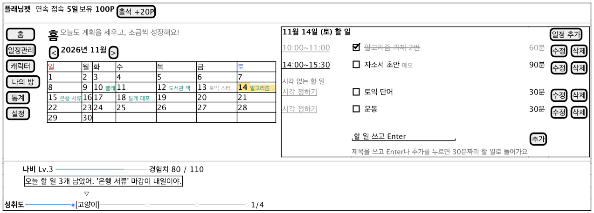
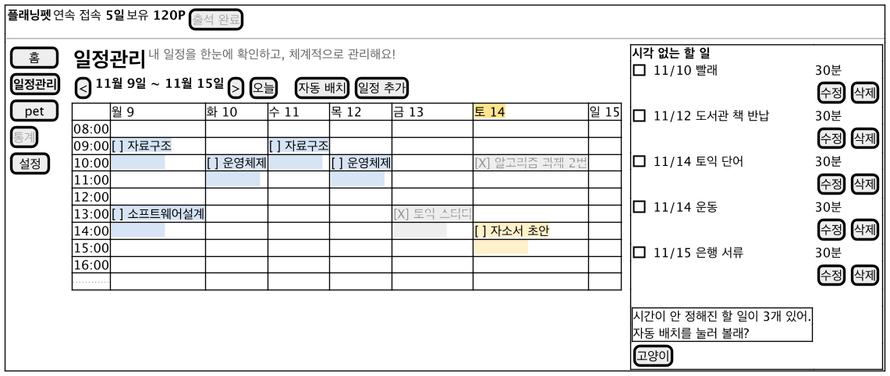

# 05. 화면 설계

유스케이스([02-usecases.md](02-usecases.md))를 사용자가 어떤 화면에서 하는지 정한다. 화면마다 와이어프레임, 이어진 유스케이스, 입력 항목을 적는다. 입력 항목 표는 수업 슬라이드 "0. Swing"의 GUI 스케치처럼 이름, 부품, 형식과 범위, 오류 처리를 쓴다.

화면 틀은 팀 기획 노트의 스케치를 따랐다. 색, 글꼴, 모양은 [디자인 시스템](design-system.md)을 따른다. 그림 속 일정과 숫자는 대학생 사용자를 가정한 예시다.

## 설계 원칙

1. **하루는 메인 한 화면에서 끝난다.** 오늘 할 일을 보고, 체크하고, 새로 넣는 일이 모두 메인에서 된다. 다른 화면은 시간 배치(일정관리)와 펫 꾸미기(pet)처럼 가끔 하는 일을 맡는다.
2. **흐름을 끊지 않는다.** 보상, 레벨 업, 하루 상한 같은 소식은 펫 말풍선으로 알린다. 화면을 막는 창은 지울지 묻기, 저장 실패처럼 사용자가 결정해야 하거나 일이 실패했을 때만 띄운다.
3. **기본값은 보이게 둔다.** 사용자가 고치지 않아도 들어갈 값은 처음부터 칸에 채워 두고 칸 아래에 알린다(D-07, D-12).
4. **못 쓰는 것은 감추지 않고 비활성으로 둔다.** 통계(D-05), 이미 한 출석, 포인트가 모자란 아이템은 버튼을 흐리게 하고 이유를 보인다.

## 창 구조

앱은 창 하나(`JFrame`)에 화면 네 개를 바꿔 보여 준다. 최소 크기는 1000x680이다(노트북 1366x768에서 작업 표시줄을 빼고 들어가는 크기).

| 자리 | 내용 | 부품 |
|---|---|---|
| 위 | 앱 이름, 연속 접속 일수, 보유 포인트, 출석 버튼. 모든 화면에서 같다 | `JPanel` (`BorderLayout.NORTH`) |
| 왼쪽 | 내비게이션 바: 홈, 일정관리, pet, 통계(비활성), 설정 | `JToggleButton` 묶음 (`BorderLayout.WEST`) |
| 가운데 | 고른 화면 | `CardLayout` (`BorderLayout.CENTER`) |

가운데 화면 맨 위에는 화면 제목(36 굵게)과 부제(19, 흐리게)를 한 줄로 둔다(D-33). 홈은 "오늘도 계획을 세우고, 조금씩 성장해요!", 일정관리는 "내 일정을 한눈에 확인하고, 체계적으로 관리해요!", pet은 "{고양이, 강아지}와 함께 성장하고, 작은 성취를 모아 보세요!", 설정은 "플래닝펫을 내게 맞게 바꿔요."다.

내비게이션 바의 "홈"은 메인 화면이다. 통계 버튼은 누를 수 없고, 마우스를 올리면 "다음 버전에서 열려요"를 보인다(D-05).

## 화면 흐름

메인 창 안의 네 화면은 내비게이션 바로 서로 오가므로 화살표를 그리지 않았다. 창 밖의 상자는 모두 메인 창 위에 뜨는 창(`JDialog`)이고, 닫으면 띄운 화면으로 돌아간다.

## 메인

- **이어진 유스케이스**: UC-01, UC-02, UC-03(버튼), UC-04, UC-05와 UC-06(목록에서), UC-07, UC-08, UC-09
- **달력**: 보이는 달의 날짜 칸이고 한 주는 일요일부터 토요일까지다. 오늘(앱 날짜, D-15)과 고른 날짜를 다르게 표시한다. 날짜 아래에는 그날 첫 할 일의 제목을 다섯 자까지 보인다(D-33, 06의 26번). 끝내지 않은 할 일이 있는 날은 `TASK_TEXT` 색, 모두 끝낸 날은 흐린 색이고, 할 일이 없는 날(고정 일정만 있는 날 포함)은 아무것도 없다. 색은 [디자인 시스템](design-system.md) 7절을 따른다.
- **할 일 목록**: 고른 날짜의 하루 시간표다(D-31, 06의 6번).
  - 위쪽은 시작 시각이 있는 할 일과 고정 일정을 시작 시각 순으로 놓는다. 줄 맨 앞에 시작과 끝 시각("10:00~11:00", 자정에 끝나면 "~24:00")을, 오른쪽에 걸리는 시간을 보인다.
  - 고정 일정도 체크박스가 있고 할 일과 같이 체크한다(D-35). 체크박스 옆에 고정 일정 색(디자인 시스템 7절)의 작은 "고정" 표시를 둔다.
  - 아래쪽은 "시간 안 정한 할 일" 제목 밑에 시작 시각이 없는 할 일을 넣은 순으로 둔다. 시각 칸에는 흐린 "시간 정하기"를 보인다(D-32). 하나도 없으면 제목도 보이지 않는다.
  - 체크한 할 일은 자리를 지키고 회색 취소선으로 바뀐다. 여러 개를 이어서 체크할 때 줄이 움직이지 않게 하려는 것이다.
  - 시각 칸을 누르면 시각 고치기 창이 뜬다(D-32). 시각 없는 할 일의 시각 칸에는 흐린 "시간 정하기"가 있다. 아래 "시각 고치기 창" 절을 본다.
  - 줄 끝(걸리는 시간 오른쪽)에 작은 "수정", "삭제" 버튼이 있다(D-33). 고정 일정 줄에도 있다.
  - 메모가 있는 일정은 제목 옆에 흐린 "메모"를 보이고, 줄에 마우스를 올리면 메모를 200자까지 보인다(D-33).
  - 그날 일정이 하나도 없으면 목록 자리에 흐린 "아직 일정이 없어요. 작은 계획을 추가해 보세요."를 보인다(D-33).
- **할 일 고치기와 지우기**: 줄 끝의 "수정", "삭제" 버튼을 누르거나, 할 일을 두 번 누르거나(수정), 오른쪽 버튼 메뉴("수정", "삭제")를 쓴다.
- **빠른 추가**: 목록 아래 입력칸에 제목을 쓰고 Enter를 누르면 고른 날짜에 30분짜리 할 일이 생긴다. 칸 아래에 "시간을 안 쓰면 30분으로 들어가요"를 늘 보이고, 새 할 일은 목록 오른쪽에 30분을 보인다(D-12).
- **펫 말풍선**: 성취도 막대 위의 펫 바로 위에 뜨고 꼬리가 펫을 가리킨다. 펫이 걸어가면 같이 옮겨 가고, 막대 양 끝에서는 카드 밖으로 나가지 않게 말풍선만 안쪽으로 맞춘다. 긴 문장은 너비 380에서 줄을 바꾼다(D-34). 그날 처음 창을 열면 브리핑하고(UC-01), 할 일을 끝내면 칭찬하고, 하루 보상 상한에 닿거나 레벨이 오르면 그 사실을 말한다(UC-07). 언제 어떤 문장을 말하는지는 06의 15번과 16번(대사 표)을 따른다. 다음 말이 올 때까지 남아 있다.
- **성취도 막대**: 오늘 할 일 가운데 끝낸 비율만큼 펫이 막대 위를 걸어간다(D-22, 06의 13번). 고른 날짜와 관계없이 오늘을 센다. 그림은 오늘 할 일 4개 중 1개를 끝낸 상태다. 같은 카드 위 줄 오른쪽에 펫 이름, 레벨, 경험치 막대와 "경험치 80 / 110"을 보인다(D-33, 06의 10번).

| 번호 | 이름 | 부품 | 형식과 범위 | 오류 처리 |
|---|---|---|---|---|
| 1 | 출석 | `JButton` | 글자는 "출석 +20P". 앱 날짜 하루에 한 번 누른다(06의 11번) | 오늘 이미 출석했으면 "출석 완료"로 바뀌고 비활성이다 |
| 2 | 이전 달, 다음 달 | `JButton` | 누르면 한 달씩 옮긴다 | 없음. 고른 날짜는 그대로다 |
| 3 | 달력 날짜 | `JTable` 칸 | 보이는 달의 날짜 | 다른 달의 빈 칸은 눌러도 바뀌지 않는다 |
| 4 | 할 일 체크박스 | 목록 줄 안의 `JCheckBox` | 완료, 미완료 | 저장에 실패하면 체크를 되돌리고 저장 실패 창을 띄운다 |
| 5 | 빠른 추가 입력칸 | `JTextField` | 글자 1자부터 100자. 앞뒤 공백은 지운다 | 비어 있으면 Enter를 눌러도 아무 일도 없다. 100자를 넘게는 써지지 않는다. 저장에 실패하면 칸에 제목을 남긴다 |
| 6 | 일정 추가 | `JButton` | 누르면 일정 입력 창을 연다. 날짜는 고른 날짜로 채운다 | 없음 |
| 7 | 시각 칸 | 줄 맨 앞의 `JLabel`(손 모양 커서) | 시각 있으면 "10:00~11:00", 없으면 "시간 정하기". 누르면 시각 고치기 창을 연다 | 없음 |
| 8 | 수정, 삭제 | 줄 끝의 작은 `JButton` 둘(글자 12) | 수정은 일정 입력 창을 수정으로 연다. 삭제는 일정 삭제 확인 창을 거친다 | 삭제의 저장에 실패하면 되돌리고 저장 실패 창을 띄운다 |

### 시각 고치기 창

시각 칸 바로 아래에 뜨는 작은 모달 `JDialog`다(제목 줄 없음). 시작 시각과 걸리는 시간만 고친다(D-32).

| 번호 | 이름 | 부품 | 형식과 범위 | 오류 처리 |
|---|---|---|---|---|
| 1 | 시작 시각 | `JSpinner`(10분 단위 목록) | 00:00부터 23:50. 기본은 그 일정의 시작 시각, 시각 없는 할 일이면 06의 14번 `defaultStart` | 끝이 24:00을 넘으면 저장하지 않고 창 아래에 "하루 안에 끝나야 해요"를 보인다 |
| 2 | 걸리는 시간 | `JSpinner`(분, 10분 단위) | 10분부터 720분. 기본은 그 일정의 값 | 범위 밖이면 이전 값으로 돌아간다 |
| 3 | 시간 빼기 | `JButton` | 시각 있는 할 일에만 보인다. 누르면 시각 없는 할 일이 되고 창이 닫힌다 | 저장에 실패하면 되돌리고 저장 실패 창을 띄운다 |
| 4 | 저장, 취소 | `JButton` | 저장은 Enter, 취소는 Esc로도 된다. 저장하면 목록이 새 순서로 바뀐다 | 저장에 실패하면 되돌리고 저장 실패 창을 띄운다 |

## 일정관리

- **이어진 유스케이스**: UC-10, UC-11(버튼), UC-03(버튼), UC-05, UC-06, UC-07, UC-08
- **시간표**: 월요일부터 일요일까지 일주일을 보인다(D-11). 세로는 0시부터 24시까지이고, 처음에는 8시가 맨 위에 오도록 내려 둔다. 시작 시각이 있는 일정은 시작 칸부터 걸리는 시간만큼 칸을 차지한다. 같은 시간에 겹친 일정은 06의 19번 함수대로 열을 나눠 그 날의 폭을 나눠 쓴다. 모든 블록 왼쪽 위에는 체크박스가 있어 끝내거나 취소한다(D-33, D-35, UC-07, UC-08). 블록에 마우스를 올리면 메모를 보인다.
- **색**: 고정 일정(D-16), 할 일, 끝낸 할 일(취소선)을 다른 색으로 그린다. 색은 디자인 시스템 7절을 따른다(와이어프레임은 파랑과 노랑으로 그렸다).
- **시각 없는 할 일**: 오른쪽 목록에 이번 주의 시작 시각 없는 할 일을 모은다(D-10). 줄 모양은 메인 목록과 같고 날짜("11/14")를 앞에 붙인다. 목록이 좁아서 수정, 삭제 버튼은 줄의 둘째 줄 오른쪽에 둔다. 비면 흐린 "이번 주에 시간 안 정한 할 일이 없어요."를 보인다. 자동 배치는 이 할 일들을 시간표의 빈 칸에 놓는다.
- **펫**: 오른쪽 아래에서 자동 배치할 수 있는 할 일이 몇 개인지 말하고 자동 배치를 권한다(06의 16번 `SCHEDULE_HINT`).

| 번호 | 이름 | 부품 | 형식과 범위 | 오류 처리 |
|---|---|---|---|---|
| 1 | 이전 주, 다음 주 | `JButton` | 누르면 일주일씩 옮긴다 | 없음 |
| 2 | 오늘 | `JButton` | 오늘이 들어 있는 주로 돌아간다 | 이미 이번 주면 아무 일도 없다 |
| 3 | 자동 배치 | `JButton` | 누르면 자동 배치 결과 창을 연다 | 배치할 할 일이 없으면 비활성이다 |
| 4 | 일정 추가 | `JButton` | 일정 입력 창을 연다. 날짜는 보이는 주에 오늘이 있으면 오늘, 없으면 그 주 월요일로 채운다(06의 14번) | 없음 |
| 5 | 시간표 일정 | `paintComponent`로 그리는 `JComponent` | 블록의 체크박스를 누르면(왼쪽 버튼 한 번) 끝내거나 취소한다. 두 번 누르면 일정 입력 창이 수정으로 열린다. 오른쪽 버튼은 메인 목록과 같은 메뉴다 | 저장에 실패하면 체크를 되돌리고 저장 실패 창을 띄운다 |
| 6 | 시각 없는 할 일 | `JList`와 `JCheckBox` | 메인 할 일 목록과 같다 | 메인 4번과 같다 |

## 일정 입력 창

- **이어진 유스케이스**: UC-03, UC-05, UC-06
- 추가와 수정에 같은 창(`JDialog`, 모달)을 쓴다. 제목 줄이 "일정 추가"와 "일정 수정"으로 바뀌고, 수정일 때만 왼쪽 아래에 삭제 버튼이 생긴다.
- 그림은 메인에서 추가할 때다. 날짜는 06의 14번 함수가 고른 날짜로, 걸리는 시간은 30분으로 채워져 있고 그 아래에 기본값 안내가 있다(D-07).
- 종류를 고정 일정으로 바꾸면 시작 시각 정하기가 켜진 채 비활성이 되고 반복 칸이 활성이 된다. 수정할 때는 종류와 반복 칸이 비활성이다(06의 4번).
- 시작 시각을 정하면 걸리는 시간 오른쪽에 끝나는 시각(예: "끝 15:30")을 보인다.
- 저장은 Enter(메모 칸에서는 줄바꿈), 취소는 Esc로도 된다. 칸 아래의 오류 문장은 06의 2번을 따른다.

| 번호 | 이름 | 부품 | 형식과 범위 | 오류 처리 |
|---|---|---|---|---|
| 1 | 종류 | `ButtonGroup`으로 묶은 `JRadioButton` | 할 일, 고정 일정. 기본은 할 일 | 수정할 때는 비활성이다 |
| 2 | 제목 | `JTextField` | 글자 1자부터 100자, 꼭 써야 한다. 앞뒤 공백은 지운다 | 비어 있으면 저장하지 않고 칸 아래에 "제목을 써 주세요"를 빨간 글씨로 보인다. 100자를 넘게는 써지지 않고 붙여 넣은 글은 100자에서 자른다 |
| 3 | 날짜 | `JSpinner` (`SpinnerDateModel`, `yyyy-MM-dd`) | 날짜. 지난 날짜도 된다 | 형식에 맞지 않게 쓰면 칸을 벗어날 때 이전 값으로 돌아간다 |
| 4 | 시작 시각 정하기 | `JCheckBox` | 켬, 끔. 기본은 끔 | 끄면 5번 칸이 비활성이 되고 시각 없는 할 일이 된다. 고정 일정이면 켜진 채 비활성이다 |
| 5 | 시작 시각 | `JSpinner` (`HH:mm`, 10분 단위) | 00:00부터 23:50. 처음 값은 06의 14번 `defaultStart(날짜, 지금)`이고, 수정이면 그 일정의 시작 시각 | 형식에 맞지 않으면 이전 값으로 돌아간다. 끝이 24:00을 넘으면 저장하지 않고 "하루 안에 끝나야 해요"를 보인다 |
| 6 | 걸리는 시간 | `JSpinner` (분, 10분 단위) | 10분부터 720분. 기본 30분 | 범위 밖이거나 10분 단위가 아니거나 숫자가 아니면 이전 값으로 돌아간다 |
| 7 | 매주 반복 | `JCheckBox`와 끝 날짜 `JSpinner` | 끄면 반복 없음. 끝 날짜 기본은 날짜에 15주를 더한 날(D-17)이고, 반복을 켜기 전에는 날짜를 바꾸면 끝 날짜도 따라 바뀐다 | 할 일이면 비활성이고 칸 아래에 "반복은 고정 일정만 할 수 있어요"를 보인다. 끝 날짜가 앞이거나 26번을 넘으면 저장하지 않고 06의 2번 문장을 보인다 |
| 8 | 메모 | `JScrollPane` 안의 `JTextArea` | 0자부터 1000자 | 1000자를 넘게는 써지지 않는다 |
| 9 | 저장, 취소, 삭제 | `JButton` | 삭제는 수정일 때만 보인다 | 삭제는 확인 창을 거치고, 반복 사본이면 범위를 묻는다. 저장에 실패하면 창을 닫지 않고 입력값을 남긴 채 저장 실패 창을 띄운다 |

## pet

- **이어진 유스케이스**: UC-14, UC-15(상점 버튼), UC-16
- **위**: 펫 이름, 레벨, 다음 레벨까지의 경험치 막대와 "경험치 {레벨 안에서 모은 값} / {폭}"(06의 10번). 그림은 누적 경험치 210인 레벨 3이다.
- **방**: 펫이 가운데에 있고 놓아 둔 아이템이 보인다. 아이템마다 놓이는 자리가 정해져 있다(D-13). 펫은 말풍선으로 오늘 끝낸 할 일 수를 말한다(06의 16번 `PET_ROOM`). 방에는 창문과 바닥이 늘 있다(D-27).
- **내 아이템**: 제목 옆에 꾸미기 진행도("꾸미기 3 / 8"과 막대, D-33)가 있다. 산 아이템이 가격 순으로 한 줄로 있다. 산 아이템은 바로 방에 놓인다(D-28). 방에 놓인 아이템은 체크 표시, 치운 아이템은 흐리게 보인다. 누르면 놓거나 치운다. 줄 끝에 상점 버튼이 있다. 줄 아래에 흐린 "포인트 얻는 법: 할 일 끝내기 +10P(하루 20번까지), 출석 +20P"를 보인다(D-33).
- 펫 모습은 동물마다 레벨 1~3, 4~6, 7~10의 세 단계다(D-20). 그림을 어디서 구할지는 Q-28에 따른다.

| 번호 | 이름 | 부품 | 형식과 범위 | 오류 처리 |
|---|---|---|---|---|
| 1 | 아이템 칸 | `JToggleButton` | 눌림이 방에 놓임이다 | 저장에 실패하면 눌림을 되돌리고 저장 실패 창을 띄운다 |
| 2 | 상점 | `JButton` | 상점 창을 연다 | 없음 |

## 상점 창

- **이어진 유스케이스**: UC-15
- 모달 `JDialog` 안의 표(`JTable`)다. 오른쪽 위에 보유 포인트를 보이고, 표 아래에 pet 화면과 같은 포인트 얻는 법을 보인다(D-33).
- 이미 산 아이템은 "보유 중"이고 사기 버튼이 비활성이다. 놓고 치우기는 pet 화면의 아이템 칸에서 한다.
- 포인트가 모자란 아이템은 사기 버튼이 비활성이고, 상태 칸에 모자란 포인트를 빨간 글씨로 보인다.
- 아이템과 가격은 D-28의 여덟 개이고 가격 순이다. 모자란 포인트는 "{포인트}P 모자라요"로 보인다(06의 20번). 그림은 보유 120P에서 쿠션, 화분, 러그를 산 상태다.

| 번호 | 이름 | 부품 | 형식과 범위 | 오류 처리 |
|---|---|---|---|---|
| 1 | 사기 | 표 줄 안의 `JButton` | 누르면 바로 산다 | 위의 두 경우 비활성이다. 저장에 실패하면 포인트와 보유 목록을 되돌리고 저장 실패 창을 띄운다 |
| 2 | 닫기 | `JButton` | 창을 닫는다. Esc로도 된다 | 없음 |

## 반려동물 고르기 창

- **이어진 유스케이스**: UC-17
- 첫 실행 때 메인 창보다 먼저 뜬다. 고양이와 강아지 중 하나를 고른다(D-27).
- 닫기 버튼으로 닫으면 아무것도 저장하지 않고 앱을 끝낸다. 다음에 켜면 다시 뜬다.

| 번호 | 이름 | 부품 | 형식과 범위 | 오류 처리 |
|---|---|---|---|---|
| 1 | 동물 | `ButtonGroup`으로 묶은 `JRadioButton` | 하나만 고른다. 기본은 고양이 | 없음 |
| 2 | 이름 | `JTextField` | 0자부터 10자, 처음에는 비어 있다. 앞뒤 공백은 지운다. 칸 아래에 흐린 "비워 두면 나비, 바둑이로 불러요"를 늘 보인다 | 비우면 기본 이름(고양이는 "나비", 강아지는 "바둑이")을 붙인다. 10자를 넘게는 써지지 않는다 |
| 3 | 시작하기 | `JButton` | 펫을 만들고 메인 창을 연다 | 저장에 실패하면 창을 닫지 않고 저장 실패 창을 띄운다 |

## 설정

- **이어진 유스케이스**: UC-18
- 설정은 컴퓨터 켤 때 실행, 데이터 위치, 버전의 셋이다(D-29).
- 데이터 위치는 저장 파일(D-08)이 있는 폴더다(06의 21번). 사용자가 파일을 옮기거나 백업할 때 찾을 수 있게 보인다.

| 번호 | 이름 | 부품 | 형식과 범위 | 오류 처리 |
|---|---|---|---|---|
| 1 | 컴퓨터 켤 때 같이 실행 | `JCheckBox` | 켬, 끔. 기본은 끔. 화면을 열 때마다 운영체제의 등록 상태를 다시 읽는다(06의 25번) | 운영체제 등록에 실패하면 체크를 되돌리고 이유를 창으로 알린다. 실행 JAR로 켰으면 비활성이고 "설치 파일로 설치했을 때만 쓸 수 있어요"를 보인다 |
| 2 | 폴더 열기 | `JButton` | 운영체제 파일 탐색기로 데이터 폴더를 연다(`Desktop.open`) | 열 수 없으면 경로를 복사할 수 있는 창을 띄운다 |

## 자동 배치 결과 창

- **이어진 유스케이스**: UC-11
- 배치 결과를 저장하기 전에 보여 주고 사용자가 적용을 눌러야 저장한다. 위쪽 글은 어느 시각부터 어느 날까지의 빈 시간을 봤는지 말한다.
- 놓지 못한 할 일은 날짜 칸에 "놓지 못함", 시각 칸에 "그날 빈 시간이 모자라요"를 빨간 글씨로 보인다. 적용해도 그 할 일은 시각 없는 할 일로 남는다.
- 대상, 순서, 놓는 시간은 D-25와 06의 18번을 따른다. 그림은 11월 14일(토) 15:23에 일정관리 그림의 주에서 누른 결과다.

| 번호 | 이름 | 부품 | 형식과 범위 | 오류 처리 |
|---|---|---|---|---|
| 1 | 적용 | `JButton` | 놓은 할 일에 시작 시각을 넣고 저장한다 | 놓은 할 일이 없으면 비활성이다. 저장에 실패하면 모두 되돌리고 저장 실패 창을 띄운다 |
| 2 | 취소 | `JButton` | 아무것도 바꾸지 않고 닫는다 | 없음 |

## URL에서 가져오기 창 (다음 단계)

이번 버전에서는 만들지 않는다(D-26). 다음 단계에서 Q-01을 정할 때 [이전 그림](diagrams/ui-url.png)에서 다시 시작한다.

## 그 밖의 창과 알림

화면 그림 없이 Swing 기본 부품을 쓴다.

| 언제 | 부품 | 내용 | 유스케이스 |
|---|---|---|---|
| 일정 삭제 | `JOptionPane` 확인 창 | "'자소서 초안'을 지울까요?" 지우기, 취소 | UC-06 |
| 반복 일정 삭제 | `JOptionPane` 선택 창 | "'자료구조'는 매주 반복 일정이에요." 이 일정만, 이후 반복 모두, 취소 | UC-06 |
| 저장 실패 | `JOptionPane` 오류 창 | 제목 "저장하지 못했어요", 내용은 06의 22번 문장 | 공통 |
| 데이터 파일을 못 읽음 | `JOptionPane` 오류 창 | 파일 위치와 원인(새 버전에서 만든 파일이면 "새 버전의 플래닝펫에서 만든 파일이에요"). 파일은 그대로 두고 앱을 끝낸다고 알린다 | UC-01 2b |
| 일정 시작 알림 | 운영체제 알림(`TrayIcon.displayMessage`) | 시작 10분 전에 "통계 과제 10분 뒤 시작"(06의 17번). 누르면 메인 창이 앞으로 오고 그 날짜를 보인다 | UC-13 |
| 처음 창 닫기 | 운영체제 알림 | "플래닝펫은 트레이에서 계속 알림을 보내요" 설치 뒤 한 번만(06의 25번) | UC-19 1a |
| 트레이 아이콘 | `TrayIcon`과 `PopupMenu` | 아이콘을 누르면 메뉴(열기, 끝내기)가 뜬다. 열기는 창을 다시 보인다 | UC-19 |

## 확인하지 않은 것

- 운영체제 알림을 눌렀을 때 Java가 그 사실을 받는지는 운영체제마다 다를 수 있다. Windows와 macOS에서 시험해 보고, 안 되면 알림을 누른 뒤 트레이 아이콘을 누르게 안내한다.
- 와이어프레임의 글꼴과 크기는 실제 Swing 화면과 다르다. 화면을 만든 뒤 그 캡처로 그림을 바꾼다.

## 더 그릴 상태

사용자 여정(D-14)에서 나온 상태다. 시각 디자인 시안을 만들 때 위 화면들과 함께 그린다.

| 상태 | 화면 | 그리는 이유 |
|---|---|---|
| 그날 첫 브리핑 | 메인 | 앱의 첫인상이다. 남은 할 일과 가까운 마감을 펫이 말한다(S-3) |
| 첫 실행 뒤 빈 화면 | 메인, 일정관리 | 할 일이 하나도 없을 때 무엇부터 할지 보여 준다. 개강 첫 주에 수업 시간표 넣기로 이끈다(S-1) |
| 시험 기간 | 메인, 일정관리 | 하루 할 일 열 개 이상, 마감이 몰린 날에도 읽혀야 한다(S-5) |
| 오랜만에 돌아옴 | 메인 | 혼내지 않고 반긴다(S-6, UC-01 5c) |
| 저녁 공부 중 | 메인 | 몇 시간 켜 둘 때 펫이 방해하지 않는 정도의 움직임(S-3) |

## 미정

02의 미정에 이어 번호를 붙인다.

- **Q-28 펫과 아이템 그림.** 고양이 세 단계와 가구 여섯 개는 `planning-pet`의 그림을 쓴다(D-30). 강아지, 책상, 소파 그림이 남았다. 그림을 만든 이미지 생성 서비스의 약관이 배포를 허락하는지도 확인해야 한다.
