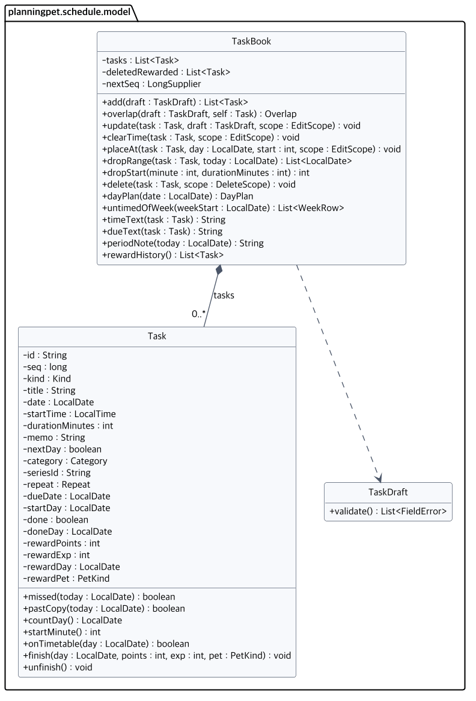
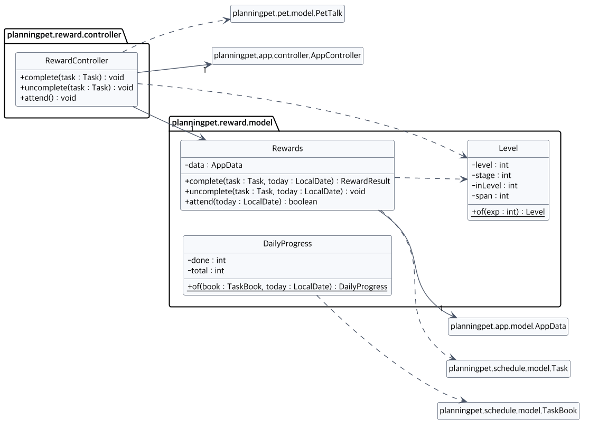
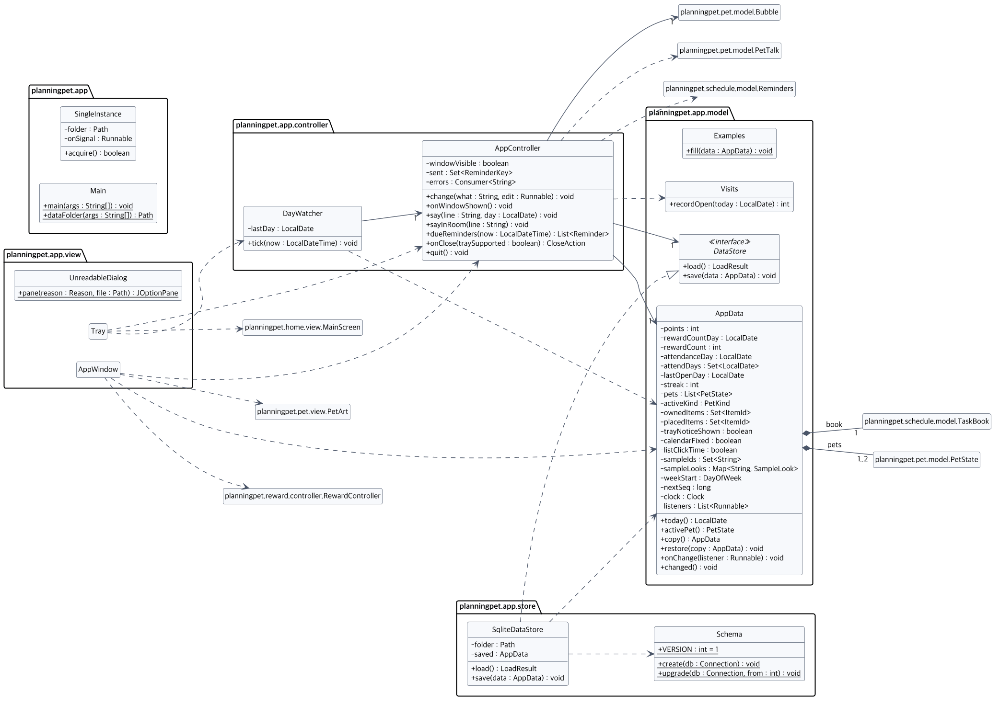

# 07. 클래스 다이어그램

본 구현(`src/`)의 클래스 설계다. [06 함수 명세](06-functions.md)의 1~32번 함수는 그 함수가 붙은 클래스의 메서드로, 06 "데이터" 절의 값은 그 값을 가진 클래스의 필드로 그렸다. 패키지는 도메인별로 나누고 도메인 안을 `model`, `view`, `controller`, `store` 층으로 나눈다(D-46, D-109). 표기는 수업 슬라이드 "0. Diagrams"를 따른다.

## 읽는 법

| 표기 | 뜻 |
|---|---|
| 칸 셋 | 위에서부터 클래스 이름, 필드(`이름 : 타입`), 메서드(`이름(인자 : 타입) : 돌려주는 타입`) |
| `-`, `+`, 밑줄 | private, public, static. 필드는 모두 private이고 메서드로만 바꾼다(D-109) |
| `<<record>>`, `<<enum>>`, `<<interface>>` | 값 묶음, 값 목록, 인터페이스 |
| 실선 화살표와 수 | 단방향 연관과 다중성(`1`, `0..*`, `1..2`) |
| 점선 화살표 | 의존(인자나 지역 변수로 쓴다) |
| 채운 마름모 | 합성(전체가 없어지면 부분도 없어진다) |
| 점선과 빈 삼각형 | 실현(인터페이스를 구현한다) |

- 값을 읽기만 하거나 값 하나만 바꾸는 메서드(`getTitle` 같은 것)는 그리지 않았다. view 클래스는 이름만 그렸다. 화면의 글과 동작은 05와 06에 있다. 모든 view가 쓰는 `common.view`(디자인 시스템의 색과 부품)와 펫 그림은 그리지 않았다.
- 함수가 돌려주는 값 묶음(`DayPlan`, `Rate` 같은 것)과 연관이 없는 값 목록은 상자 없이 타입으로만 적었다. 내용은 06의 그 함수 출력 절에 있다.
- 다른 도메인의 클래스는 `planningpet.app.model.AppData`처럼 패키지 이름을 붙인 상자로 그렸다.

## 층과 의존 방향

D-109의 방향(view에서 controller와 model, controller에서 model, store에서 model)은 층을 건너는 의존에 쓴다. 같은 층 안의 의존은 도메인이 달라도 된다. 06 읽는 법이 이미 그렇게 쓴다. 홈 view는 다른 도메인의 view를 담고, 도메인 controller는 바꾸는 일을 22번 `AppController.change`로 감싸고, 보상 model은 일정 model의 `Task`를 바꾼다. 그래서 controller가 부르는 저장과 운영체제 일은 model 층의 인터페이스로 둔다. 저장은 `app.model.DataStore`를 `app.store.FileDataStore`가 구현하고(D-08의 "인터페이스 뒤"), 컴퓨터 켤 때 실행은 `settings.model.Autostart`를 `settings.store.OsAutostart`가 구현한다. 진입점 `Main`은 층 밖(`planningpet.app`)에서 이것들을 만들어 잇기만 하므로 화살표를 그리지 않았다.

## 그림

| 도메인 | 그림 |
|---|---|
| 일정 model |  |
| 일정 규칙, controller, view |  |
| 보상 |  |
| 앱 |  |

## 나눈 까닭과 버린 안

- **데이터는 `AppData` 하나에 모은다.** 06 "데이터" 표의 `AppData` 값을 필드로 갖고, 일정은 `TaskBook`, 펫은 `PetState`로 담는다. 파일 하나(D-08)를 그대로 옮긴 꼴이라 저장은 `AppData` 하나를 쓰고 읽는다. 22번의 되돌리기는 `copy`와 `restore`가 한다. 버린 안: 도메인마다 데이터 클래스를 두기. 06 표의 대상과 달라지고, 저장할 때 다시 모아야 한다.
- **controller는 창을 모른다.** 확인을 묻는 일은 인자로 받는다. `TaskController.add`의 `ask`(3번 겹침 묻기), `clearSamples`의 `confirm`(31번 확인 창), `AppController`의 `errors`(22번 저장 실패 창)는 view가 넘긴 함수다. 버린 안: controller가 `JOptionPane`을 부르기. controller에서 view로 가는 의존이 생기고 창 없이 검사할 수 없다.
- **30초 타이머는 `app.view.Tray`에 둔다.** 타이머가 `DayWatcher.tick`(23번)과 `AppController.dueReminders`(17번)를 부르고, 받은 알림을 운영체제 알림으로 띄운다. 알림을 띄우는 일이 화면 쪽이라 controller가 view를 부르지 않게 하려는 것이다.

## 다시 그리기

원본은 [diagrams/](diagrams/) 아래 `class-*.puml`이고 공통 꾸밈은 `class-common.iuml`이다. PlantUML로 그린다.

```sh
cd docs/diagrams && plantuml -tpng class-*.puml
```

한글 글꼴은 `Apple SD Gothic Neo`로 정해 두었다. macOS가 아니면 `class-common.iuml`의 `skinparam defaultFontName`을 그 컴퓨터에 있는 한글 글꼴로 바꿔서 그린다.
