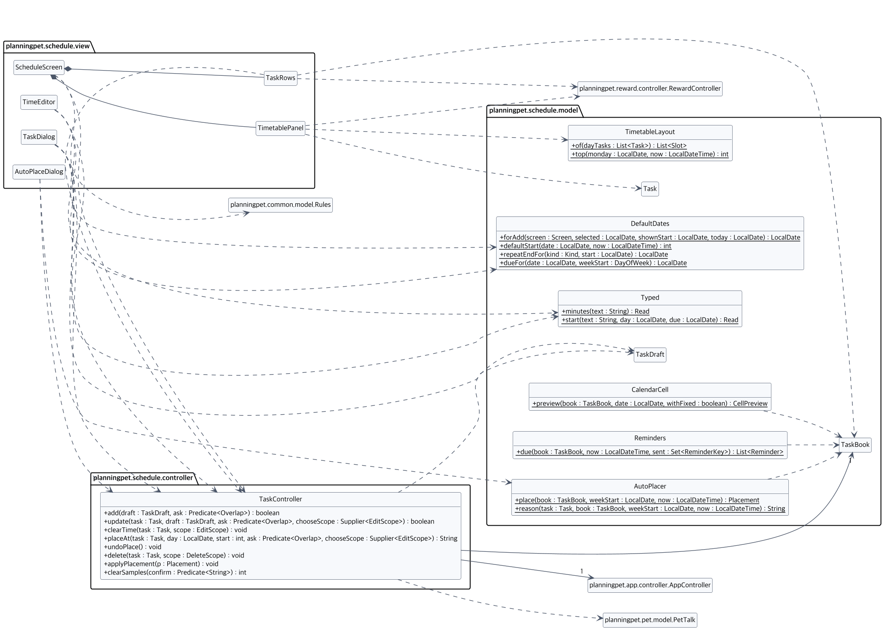
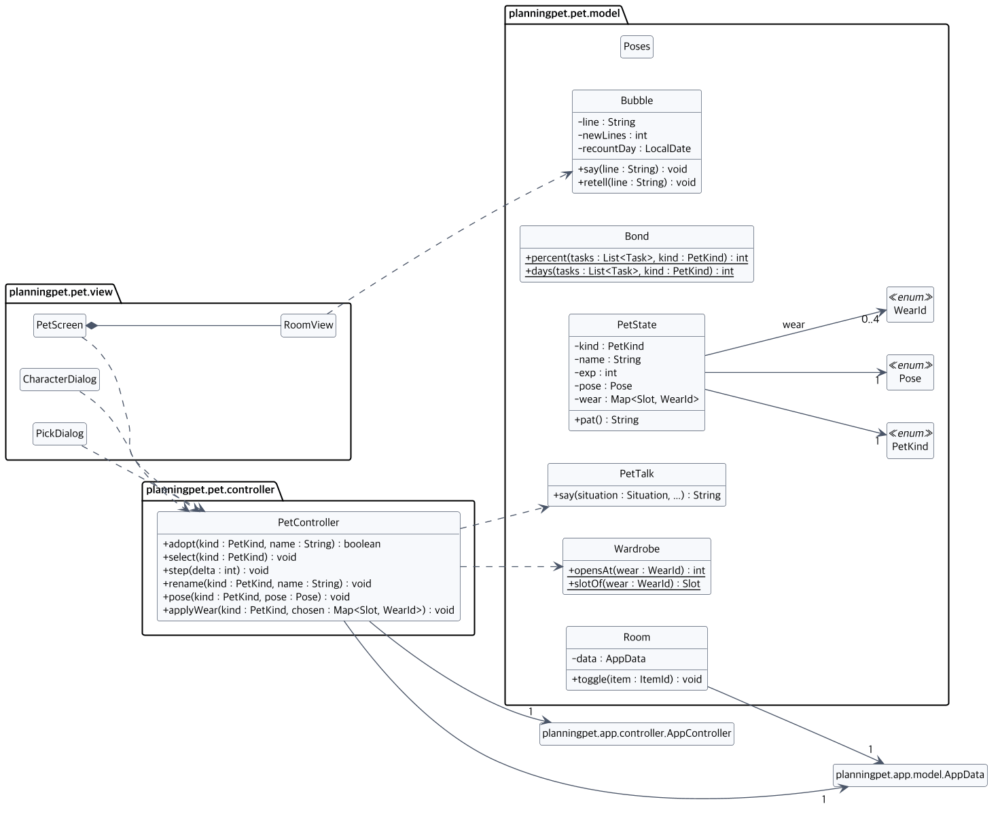
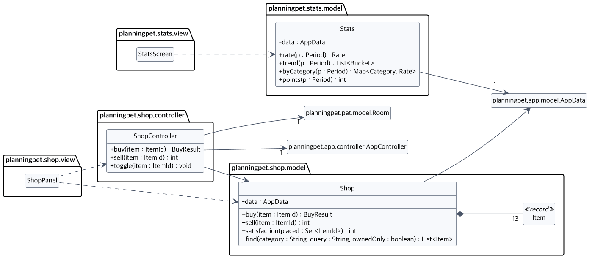
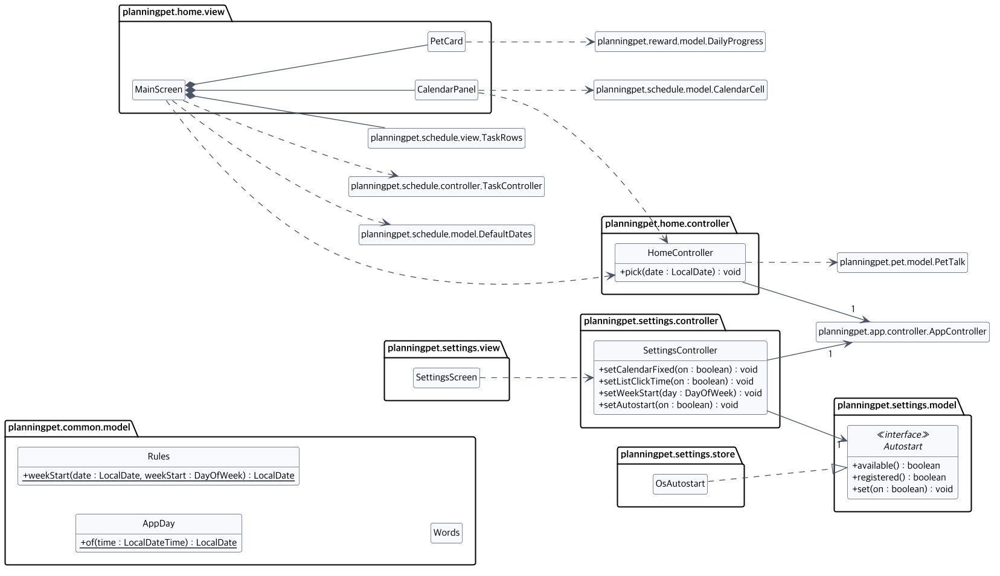

# 07. 클래스 다이어그램

본 구현(`src/`)의 클래스 설계다. [06 함수 명세](06-functions.md)의 1~32번 함수는 그 함수가 붙은 클래스의 메서드로, 06 "데이터" 절의 값은 그 값을 가진 클래스의 필드로 그렸다. 패키지는 도메인별로 나누고 도메인 안을 `model`, `view`, `controller`, `store` 층으로 나눈다(D-46, D-109). 표기는 수업 슬라이드 "0. Diagrams"를 따른다.

## 읽는 법

| 표기 | 뜻 |
|---|---|
| 칸 셋 | 위에서부터 클래스 이름, 필드(`이름 : 타입`), 메서드(`이름(인자 : 타입) : 돌려주는 타입`) |
| `-`, `+`, 밑줄 | private, public, static. 필드는 모두 private이고 메서드로만 바꾼다(D-109) |
| `<<record>>`, `<<enum>>`, `<<interface>>` | 값 묶음, 값 목록, 인터페이스 |
| 실선 화살표와 수 | 단방향 연관과 다중성(`1`, `0..*`, `1..2`) |
| 점선 화살표 | 의존(인자나 지역 변수로 쓴다) |
| 채운 마름모 | 합성(전체가 없어지면 부분도 없어진다) |
| 점선과 빈 삼각형 | 실현(인터페이스를 구현한다) |

- 값을 읽기만 하거나 값 하나만 바꾸는 메서드(`getTitle` 같은 것)는 그리지 않았다. view 클래스는 이름만 그렸다. 화면의 글과 동작은 05와 06에 있다. 모든 view가 쓰는 `common.view`(디자인 시스템의 색과 부품)와 펫 그림은 그리지 않았다.
- 함수가 돌려주는 값 묶음(`DayPlan`, `Rate` 같은 것)과 연관이 없는 값 목록은 상자 없이 타입으로만 적었다. 내용은 06의 그 함수 출력 절에 있다.
- 다른 도메인의 클래스는 `planningpet.app.model.AppData`처럼 패키지 이름을 붙인 상자로 그렸다.

## 층과 의존 방향

D-109의 방향(view에서 controller와 model, controller에서 model, store에서 model)은 층을 건너는 의존에 쓴다. 같은 층 안의 의존은 도메인이 달라도 된다. 06 읽는 법이 이미 그렇게 쓴다. 홈 view는 다른 도메인의 view를 담고, 도메인 controller는 바꾸는 일을 22번 `AppController.change`로 감싸고, 보상 model은 일정 model의 `Task`를 바꾼다. 그래서 controller가 부르는 저장과 운영체제 일은 model 층의 인터페이스로 둔다. 저장은 `app.model.DataStore`를 `app.store.SqliteDataStore`가 구현하고(D-08, D-111의 "인터페이스 뒤"), 컴퓨터 켤 때 실행은 `settings.model.Autostart`를 `settings.store.OsAutostart`가 구현한다. 진입점 `Main`은 층 밖(`planningpet.app`)에서 이것들을 만들어 잇기만 하므로 화살표를 그리지 않았다.

## 그림

| 도메인 | 그림 |
|---|---|
| 일정 model |  |
| 일정 규칙, controller, view |  |
| 보상 |  |
| 펫 |  |
| 상점, 통계 |  |
| 앱 |  |
| 홈, 설정, 공통 |  |

## 나눈 까닭과 버린 안

- **데이터는 `AppData` 하나에 모은다.** 06 "데이터" 표의 `AppData` 값을 필드로 갖고, 일정은 `TaskBook`, 펫은 `PetState`로 담는다. sqlite 파일 하나(D-111)를 그대로 옮긴 꼴이라 저장은 `AppData` 하나를 쓰고 읽는다. 22번의 되돌리기는 `copy`와 `restore`가 한다. 버린 안: 도메인마다 데이터 클래스를 두기. 06 표의 대상과 달라지고, 저장할 때 다시 모아야 한다.
- **규칙 클래스는 `AppData`를 받는다.** `Rewards`, `Visits`, `Shop`, `Room`, `Stats`는 포인트, 출석, 아이템처럼 펫 둘이 함께 쓰는 값을 바꾸거나 센다(D-48). 그래서 이 도메인 model과 `app.model`은 서로를 안다. 버린 안: 값마다 좁은 인터페이스를 두어 끊기. 클래스가 값의 수만큼 늘고 얻는 것이 그림의 화살표 몇 개뿐이다.
- **펫 말풍선 `Bubble`은 `AppData` 밖에 둔다.** 펫 말은 저장할 데이터가 아니다(06 읽는 법). `AppController`가 22번에서 다시 세기(D-106)를 판단하고, 홈과 나의 방 view가 읽는다.
- **controller는 창을 모른다.** 확인을 묻는 일은 인자로 받는다. `TaskController.add`의 `ask`(3번 겹침 묻기), `clearSamples`의 `confirm`(31번 확인 창), `AppController`의 `errors`(22번 저장 실패 창)는 view가 넘긴 함수다. 버린 안: controller가 `JOptionPane`을 부르기. controller에서 view로 가는 의존이 생기고 창 없이 검사할 수 없다.
- **30초 타이머는 `app.view.Tray`에 둔다.** 타이머가 `DayWatcher.tick`(23번)과 `AppController.dueReminders`(17번)를 부르고, 받은 알림을 운영체제 알림으로 띄운다. 알림을 띄우는 일이 화면 쪽이라 controller가 view를 부르지 않게 하려는 것이다.
- **06에 없는 메서드.** `Task.finish`와 `unfinish`는 `Rewards`가 끝냄과 보상을 적는 길이다(D-109, 필드를 열지 않는다). `AppController.onClose`와 `quit`는 25번, `SettingsController.setAutostart`와 `Autostart`는 25번의 컴퓨터 켤 때 실행이다. `TaskBook`의 `deletedRewarded`는 5번이 남기는 보상 기록이고 06 "데이터" 표에도 있다.
- **이름이 같은 `Slot` 둘.** `schedule.model.Slot`은 19번 시간표 칸, `pet.model.Slot`은 28번 장신구 칸이다. 06의 이름을 그대로 두었고 패키지가 달라 겹치지 않는다.
- **프로토타입에서 옮긴 것.** 프로토타입은 본 구현의 참고일 뿐이다(D-107). `Store`의 public 필드는 `AppData`의 private 필드로, `TaskController`가 하던 제목 길이와 지난 날 판단은 `TaskDraft.validate`로 옮긴다(D-109). `Typed`(32번)와 `PetKind`는 Swing을 쓰지 않는 규칙과 값이라 view에서 model로 옮긴다. 18번의 까닭 고르기는 `AutoPlacer.reason`이다.

## 저장 형식

데이터는 데이터 폴더(06 21번)의 sqlite 파일 `planningpet.db` 하나다(D-111). `app.store.SqliteDataStore`가 `DataStore`를 구현하고, 표를 만들고 옮기는 일은 `Schema`가 한다.

| 표 | 한 행 | 열 |
|---|---|---|
| `app` | 앱 하나(행 하나) | `AppData`의 하나뿐인 값: `points`, `rewardCountDay`, `rewardCount`, `attendanceDay`, `lastOpenDay`, `streak`, `activeKind`, `trayNoticeShown`, `calendarFixed`, `listClickTime`, `weekStart`, `nextSeq` |
| `task` | 일정 하나 | `Task`의 값 스무 개(`id`가 기본 키)와 `deleted`(`TaskBook.deletedRewarded`에 든 일정이면 1) |
| `pet` | 펫 하나 | `kind`(기본 키), `name`, `exp`, `pose`, `ord`(`pets` 안의 순서) |
| `wear` | 펫의 장신구 칸 하나 | `petKind`, `slot`, `wearId` |
| `attend_day` | 출석한 날 하나 | `day`(`attendDays`) |
| `item` | 산 아이템 하나 | `itemId`(`ownedItems`), `placed`(`placedItems`에 들면 1) |
| `sample` | 예시 일정 하나 | `taskId`(`sampleIds`)와 `sampleLooks`의 제목, 시작 시각, `nextDay`, 메모, 날짜 |

- 열 이름은 06의 값 이름을 밑줄로 잇는다(`durationMinutes`는 `duration_minutes`). 날짜는 `2026-11-16`, 시각은 `14:30`, 반복은 `DAILY`나 `MON,WED` 같은 글이고, 값이 없으면 NULL이다.
- `save`는 지난 저장(`saved`)과 달라진 행만 트랜잭션 하나로 쓴다. 체크 하나에 일정 10만 개를 다시 쓰지 않으려는 것이다. 저널은 sqlite 기본(rollback 저널, synchronous FULL)이고, 강제 종료 20번을 잰 설정이다([research/storage.md](research/storage.md)).
- `load`는 파일이 없으면 파일을 만들지 않고 `FIRST_RUN`이다. 첫 `save`가 표를 만든다. 파일은 먼저 읽기 전용으로 열어 형식 번호를 보고, sqlite 파일이 아니면 건드리지 않고 `UNREADABLE`이다(T-STORE-3).

**형식 번호와 변환.** 형식 번호는 1부터 세는 정수이고 파일의 `PRAGMA user_version`에 적는다. 표나 열이 바뀔 때만 올리고 앱 버전과는 따로 센다(D-111).

- 파일 번호가 `Schema.VERSION`보다 크면 `UNREADABLE`, "새 버전의 플래닝펫에서 만든 파일이에요"다(T-STORE-4).
- 작으면 옮기기 전에 파일을 같은 폴더의 `planningpet.v{파일 번호}.db`로 복사한다. 그 이름이 이미 있으면 덮어쓰지 않는다. 그다음 `Schema.upgrade`가 1에서 2, 2에서 3처럼 한 단계씩 트랜잭션 하나 안에서 옮기고 `user_version`을 올린다. 새로 생긴 값은 06 데이터 절의 처음 값으로 채운다(T-STORE-7).
- 옮기다 실패하면 트랜잭션이 되돌려 파일은 옮기기 전 그대로이고 `UNREADABLE`이다. 옛 앱으로 돌아가면 사본을 열 수 있다.
- 버린 안: 앱 버전 문자열(형식이 그대로인 릴리스에도 번호가 바뀐다), 사본 없이 옮기기(옛 앱으로 돌아가면 열 수 없다), 파일 형식을 손으로 짜기와 h2(D-111).

## 실행 모드

`Main`이 실행 인자로 데이터 폴더를 정하고 클래스들을 만들어 잇는다. 시계는 늘 컴퓨터 시계(`Clock.systemDefaultZone()`)이고 `AppData`에 넘긴다.

| 인자 | 하는 일 |
|---|---|
| 없음 | 운영체제 데이터 폴더(06 21번)로 뜬다 |
| `--autostart` | 컴퓨터 켤 때 실행으로 뜬다. 창을 띄우지 않는다(15번, 25번) |
| `--data-dir 경로` | 그 폴더를 데이터 폴더로 쓴다. `planningpet.db`와 24번의 잠금 파일 `planningpet.lock`이 그 폴더에 생기고, 빈 폴더면 첫 실행이다 |

- `--data-dir`은 시연과 손 확인을 실제 데이터와 떼어 놓고, 다른 프로세스로 띄워야 하는 검사(T-ONE-2, T-ONE-3)가 실행 JAR를 그대로 쓰게 한다.
- 정한 시각에서 도는 시계와 프로토타입의 목 데이터, `--sample-clock`, `--first-run`은 두지 않는다. 프로토타입은 멈춘 시계 때문에 실제 오늘로 바뀌지 않는 문제를 검사가 놓쳤다([prototype/README.md](../prototype/README.md) "빠진 것"). 첫 실행은 빈 폴더, 예시는 31번 "예시로 둘러보기"다.
- 검사(JUnit)는 생성자로 바꿔 끼운다. `AppData`에는 고정 시계나 검사가 옮기는 `Clock`을, `SqliteDataStore`와 `SingleInstance`에는 `@TempDir` 폴더를, `AppController`에는 늘 실패하는 `DataStore`(T-SAVE-1~3)를 넘긴다. T-STORE-6은 검사가 새 JVM에서 `SqliteDataStore`로 저장을 되풀이하다 강제 종료한다.

## 바깥 서비스 자리

UC-12 URL에서 일정 가져오기(다음 단계, D-26)가 들어오면 일정 도메인 model 층에 interface(주소를 받아 `TaskDraft` 목록을 돌려준다)를 두고, 웹에서 읽는 구현은 `schedule.store`에 둔다. 지금은 클래스를 만들지 않는다.

## 다시 그리기

원본은 [diagrams/](diagrams/) 아래 `class-*.puml`이고 공통 꾸밈은 `class-common.iuml`이다. PlantUML로 그린다.

```sh
cd docs/diagrams && plantuml -tpng class-*.puml
```

한글 글꼴은 `Apple SD Gothic Neo`로 정해 두었다. macOS가 아니면 `class-common.iuml`의 `skinparam defaultFontName`을 그 컴퓨터에 있는 한글 글꼴로 바꿔서 그린다.
