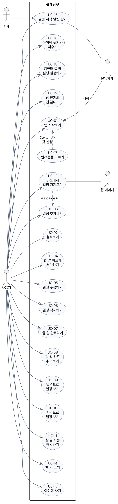

# 03. 유스케이스 다이어그램

[02-usecases.md](02-usecases.md)의 액터와 유스케이스 사이의 관계를 그린 그림이다. 표기는 수업 슬라이드 "0. Diagrams"를 따른다.



## 읽는 법

| 표기 | 뜻 | 이 그림에서 |
|---|---|---|
| 화살표(액터에서 유스케이스로) | 유스케이스를 시작하는 액터 | 사용자는 UC-13, UC-17을 뺀 모든 유스케이스, 시계는 UC-13, 운영체제는 UC-01(컴퓨터를 켤 때) |
| 화살표 없는 선 | 시작하지 않고 참여만 하는 액터 | 운영체제는 UC-13에서 알림을 띄우고 UC-18에서 실행 등록을 받는다. 사용자는 UC-13에서 알림을 받는다. 웹 페이지는 UC-12에서 읽을 내용을 준다 |
| `<<include>>` | 기본 유스케이스가 항상 포함하는 유스케이스 | UC-12는 가져온 내용으로 UC-03(일정 추가)을 거친다 |
| `<<extend>>` | 조건이 맞을 때만 기본 유스케이스에 끼어드는 유스케이스 | UC-17은 첫 실행일 때만 UC-01에 끼어든다 |

## 그리지 않은 것

- FR-STAT-1(통계)은 이번 버전에서 만들지 않으므로(D-05) 유스케이스가 없다.
- UC-12(URL)는 다음 단계로 미뤘다(D-26). 그림에는 남겨 두었고 이번 버전에서는 만들지 않는다.
- UC-11(자동 배치)은 사용자가 버튼을 눌러야 돌므로(D-25) UC-03과의 관계는 없다.

## 다시 그리기

원본은 [diagrams/usecase.puml](diagrams/usecase.puml)이다. PlantUML로 그린다.

```sh
plantuml -tpng docs/spec/diagrams/usecase.puml
```

한글 글꼴은 `Apple SD Gothic Neo`로 정해 두었다. macOS가 아니면 `skinparam defaultFontName`을 그 컴퓨터에 있는 한글 글꼴로 바꿔서 그린다.
