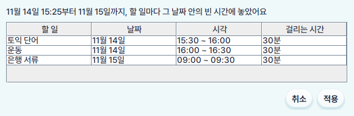
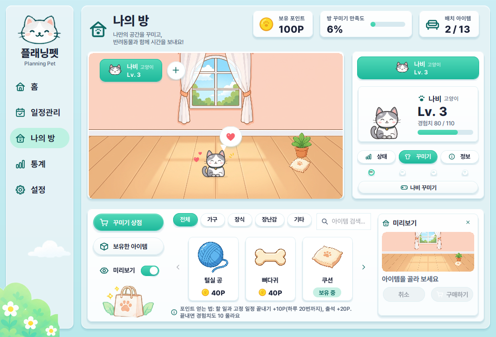
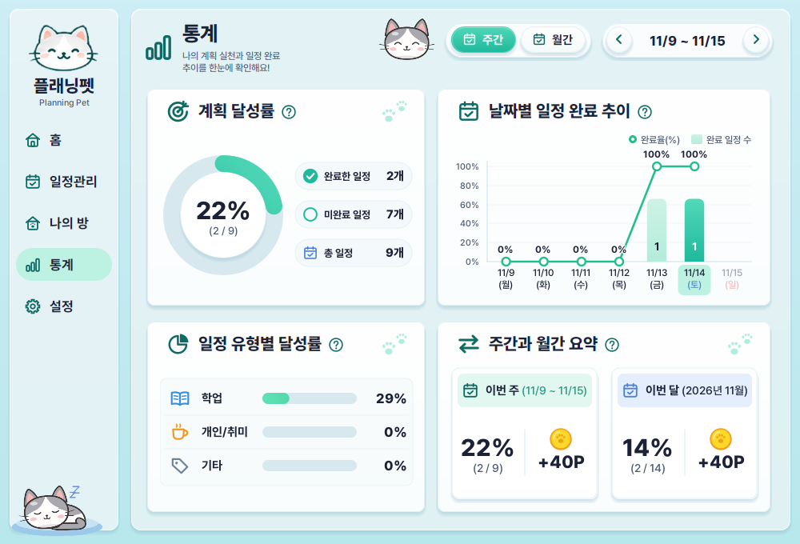
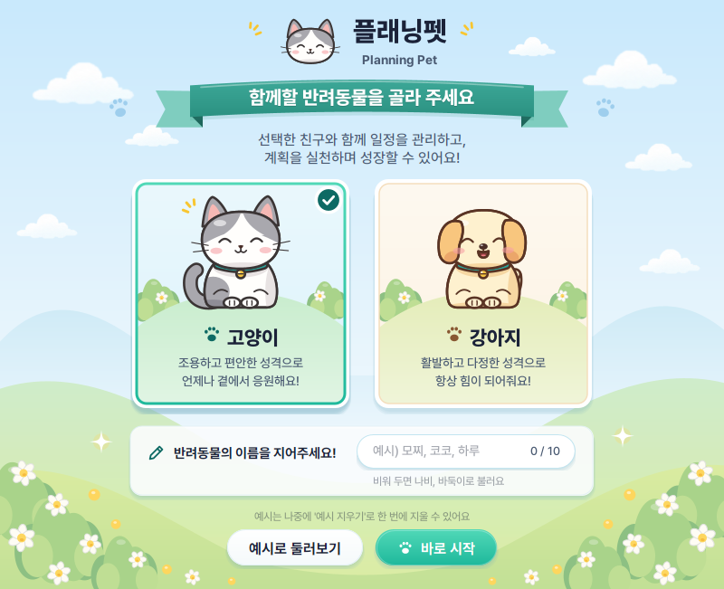
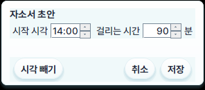

# 플래닝펫 프로토타입

[05 화면 설계](../docs/05-ui-design.md)대로 움직이는 Swing 프로토타입이다. 본 구현 전에 화면 흐름과 배치, 펫의 말과 보상이 어떻게 느껴지는지 보려고 만들었다. 본 구현의 코드가 아니다.


## 실행

JDK 21이 필요하다.

```sh
prototype/run.sh                 # 목 데이터와 컴퓨터 시계로 연다
prototype/run.sh --sample-clock  # 시계를 2026-11-14 15:23에 멈춰 05 와이어프레임과 같은 화면으로 연다
prototype/run.sh --first-run     # 데이터 없이 반려동물 고르기부터 연다
prototype/snap.sh                # 창 없이 모든 화면을 screenshots/에 그린다
prototype/check.sh               # 06 검사 표 가운데 프로토타입이 따르는 줄과 패키지 규칙(D-46)을 확인한다
prototype/qa.sh                  # 유저플로우를 창 없이 돌려 docs/qa/에 보고서와 자동 규칙 결과를 쓴다
prototype/blind.sh 1 2 3         # 블라인드 예측 검사(명세를 모르는 AI 세션, 결과는 out-blind/)
prototype/usability.sh           # 사용성 점검 2차(다른 상태 예측, 걸음 단위 점검, 10원칙 평가)
```

Windows는 `prototype\run.bat`이다.

## 코드 구조

06의 패키지 규칙(D-46)대로 `src/planningpet/` 아래를 도메인별로 나누고, 도메인 안을 `model`, `view`, `controller`로 나눈다.

- `schedule`(일정), `reward`(보상), `pet`(펫, 나의 방 화면과 그 위에 뜨는 캐릭터 창), `shop`(나의 방의 상점 칸), `stats`(통계), `home`(메인 화면), `settings`(설정), `app`(진입점, 창 틀, 앱 데이터 `Store`), `common`(앱 날짜와 글자 규칙, 디자인 시스템의 색과 부품)
- `model`은 Swing과 AWT를 쓰지 않는다. `view`는 model을 읽어 그리고, 바꿀 때는 controller를 부른다(다른 도메인의 것도 된다). controller는 바꾸는 일을 앱 controller의 `change`로 감싸고, `change`가 `Store.changed()`로 한 번 알린다
- 화면 전환과 주 옮기기처럼 model을 바꾸지 않는 다시 그리기는 `App.redraw()`로 한다
- `check.sh`가 D-46을 grep으로 검사한다. model의 Swing과 AWT, view의 알림과 펫 말, Model 메서드 호출, Model 필드 대입과 목록 바꾸기, 앱 controller 밖의 알림을 찾으면 실패한다. 잡는 형태는 `check.sh` 주석에 있고, 이름을 바꿔 부르거나 다른 클래스를 거치면 놓친다
- 펫 말만 바꾸는 동작(날짜 고르기, 그날 두 번째부터의 창 보임)은 `AppController.say`로 알림만 보낸다
- 글꼴은 `assets/fonts/`의 Pretendard(SIL OFL 1.1)를 JAR에 넣어 쓴다. 그림(`assets/`)은 나의 방 예시의 화풍이다. 생성한 그림과 예시에서 잘라 내거나 손으로 그린 그림이 섞여 있고, 어떻게 만들었는지는 `assets/PROMPTS.md`, 잘라 내고 그린 것을 다시 만드는 스크립트는 `tools/art/make-art.sh`(Python, Pillow)에 있다
- 진입점은 `app/Main`, 목 데이터는 `app/model/MockData`다. QA 코드와 창 없이 그리는 `Snap`은 `qa/planningpet/qa/`, 단위 검사는 `check/planningpet/check/`에 있다

## 목 데이터와 목 로직

- `run.sh`로 띄운 앱은 컴퓨터 시계를 쓰고 30초마다 맞춘다(06의 1번). 샘플 일정은 2026-11-14(토)가 든 주에 있어서, 다른 날 띄우면 그 일정은 지난 일로 보이고 요일 반복(D-64)으로 넣은 수업만 2026-12-18까지 이어진다. `run.sh --sample-clock`이면 시계가 2026-11-14 15:23에 멈춰 05 와이어프레임과 같은 화면이 된다.
- QA(`qa.sh`), 단위 검사(`check.sh`), 화면 그림(`snap.sh`)은 늘 샘플 시계로 돈다. 기대값을 같은 날로 맞추려는 것이다.
- 데이터는 메모리에만 있고 끄면 사라진다.
- 화면에 보이는 결과는 [06 함수 명세](../docs/06-functions.md)를 따른다. 보상과 하루 상한, 완료 취소, 레벨, 출석, 연속 접속, 브리핑과 펫 대사, 반복(매일, 요일, D-64)과 기간 안에 하는 할 일(D-65, D-66~D-72), 다음 날 04:00까지의 하루(D-77), 첫 실행 예시(D-74), 설정의 달력 고정 일정과 한 주 시작(D-86, D-91), 자동 배치, 시간표 열 나누기, 상점과 방 꾸미기 만족도, 펫 데려오기와 고르기, 친밀도, 장신구, 통계가 그렇다.

## 빠진 것

- 저장(06의 21번, 22번), 알림(17번), 앱 하나만 실행(24번), 트레이와 컴퓨터 켤 때 실행(25번)
- 검사는 모두 샘플 시계로 돈다. 그래서 실제 날짜에서만 생기는 문제는 잡지 못한다. 2026-11-24까지 띄운 앱도 시계가 멈춰 있어 일정관리와 홈 달력의 "오늘"이 실제 오늘로 가지 않았는데, 검사가 아니라 사용자가 찾았다. 띄운 앱으로 한 번 보는 확인이 필요하다
- 2차 전체 QA에서 나온 기획 공백(#181~#199, #89~#98)은 페르소나 열 명의 기대로 정해 D-66~D-93으로 반영했다. 그 결정을 반영한 뒤의 QA(`docs/qa/2026-11-25-decisions-qa.md`)에서 나온 결함과 명세 문제는 D-94로 정해 반영했다(#201 포함). 남은 결함과 문서 고칠 것(#202~#206)은 아직 반영하지 않았다
- 캐릭터 창은 메인 창이 처음 크기(1000x680)이면 800x580이라 메인 창의 3분의 2(D-93)보다 크다(가로 80%, 세로 85%). 안의 내용(오른쪽 카드, 꾸미기 탭의 장신구 칸과 꾸미기 적용)이 들어가는 최소 크기가 3분의 2보다 앞서서 그대로 둔다(D-94, QA M-6). 메인 창이 1440x900이면 960x600(3분의 2)이다
- 자세 그림 파일. 펫은 `pet/view/PetArt`가 도형으로 그린다(D-50, D-51). 캣타워와 우드 침대는 예시 카드에서 잘라 낸 작은 임시 그림이고 책상과 소파는 손으로 그렸다. 생성으로 바꿀 목록은 `assets/PROMPTS.md`에 있다(Q-28). 색, 글꼴, 모양, 나머지 그림은 [디자인 시스템](../docs/design-system.md)을 따른다(D-30).
- 10분짜리 일정은 시간표에서 글자가 보이게 최소 높이로 그려서, 바로 뒤 일정과 겹쳐 보일 수 있다. 겹친 곳을 누르면 나중에 그린 블록이 잡힌다.
- 05와 다르게 만든 곳: 달력은 `JTable` 대신 `JLabel` 칸으로 그렸다. 창 없이 그린 이미지로 확인하기 쉽게 하려는 것이다.

## 화면

| 화면 | 그림 |
|---|---|
| 일정관리 |  |
| 일정 입력 창 |  |
| 자동 배치 결과 창 |  |
| 나의 방(상점 칸 포함) |  |
| 캐릭터 창(홈 펫 카드, 나의 방의 장신구 칸과 "{이름} 꾸미기"로 연다) |  |
| 통계 |  |
| 반려동물 고르기 창 |  |
| 설정 |  |
| 시각 고치기 창(메인 시각 칸을 누름) |  |
