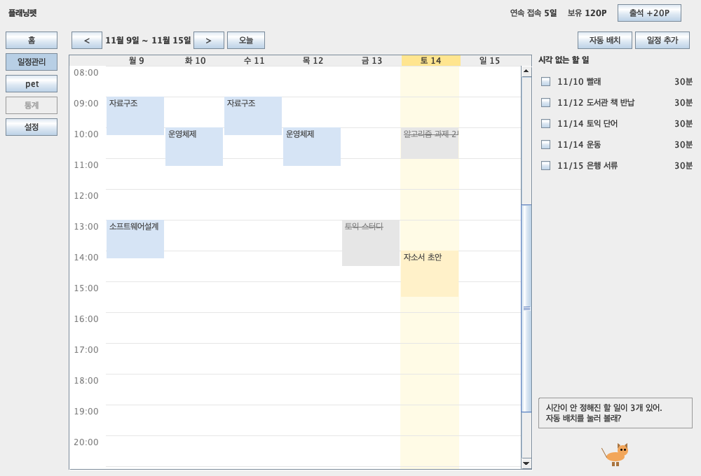
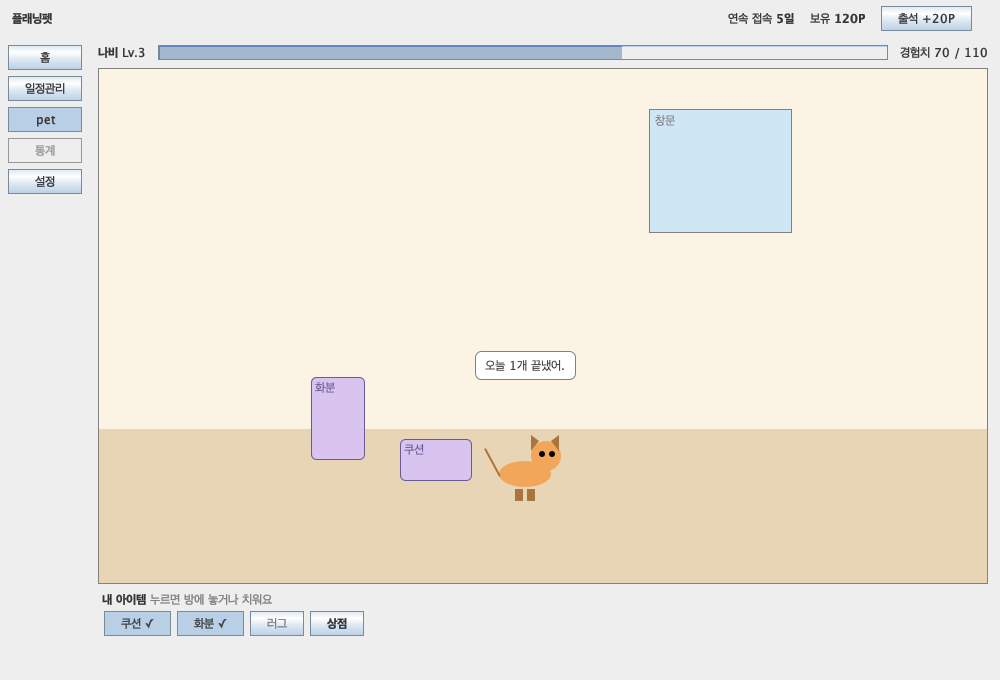
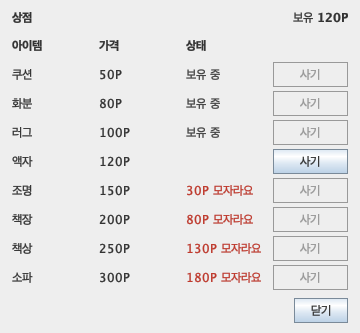

# 플래닝펫 프로토타입

[05 화면 설계](../docs/05-ui-design.md)대로 움직이는 Swing 프로토타입이다. 본 구현 전에 화면 흐름과 배치, 펫의 말과 보상이 어떻게 느껴지는지 보려고 만들었다. 본 구현의 코드가 아니다.


## 실행

JDK 21이 필요하다.

```sh
prototype/run.sh                 # 목 데이터로 연다
prototype/run.sh --first-run     # 데이터 없이 반려동물 고르기부터 연다
prototype/snap.sh                # 창 없이 모든 화면을 screenshots/에 그린다
prototype/check.sh               # 06 검사 표 가운데 프로토타입이 따르는 줄을 확인한다
```

Windows는 `prototype\run.bat`이다.

## 목 데이터와 목 로직

- 시계는 2026-11-14(토) 15:23에 멈춰 있다. 일정과 숫자는 05 와이어프레임과 같다.
- 데이터는 메모리에만 있고 끄면 사라진다.
- 화면에 보이는 결과는 [06 함수 명세](../docs/06-functions.md)를 따른다. 보상과 하루 상한, 완료 취소, 레벨, 출석, 연속 접속, 브리핑과 펫 대사, 자동 배치, 시간표 열 나누기, 상점이 그렇다.

## 빠진 것

- 저장(06의 21번, 22번), 알림(17번), 날 바뀜(23번), 앱 하나만 실행(24번), 트레이와 컴퓨터 켤 때 실행(25번)
- 시각 디자인. 색, 글꼴, 펫과 아이템 그림은 임시다(Q-28).
- 05와 다르게 만든 곳: 달력과 상점 표는 `JTable` 대신 `JLabel` 칸으로 그렸다. 창 없이 그린 이미지로 확인하기 쉽게 하려는 것이다.

## 화면

| 화면 | 그림 |
|---|---|
| 일정관리 |  |
| 일정 입력 창 |  |
| 자동 배치 결과 창 |  |
| pet |  |
| 상점 창 |  |
| 반려동물 고르기 창 |  |
| 설정 |  |
